# Qwen3-4B DSpark 训练消融

## 实验设置

训练消融采用 **offline training**：预先缓存 target hidden states，再训练 draft。GSM8K 部分另列 online training baseline 与 Backbone MLA + Markov MLA 的生成评测结果。

以 Qwen3-4B 为冻结的 target 模型，训练五层 DSpark draft。目标模型的 token embedding 与 LM head 保持冻结。除延长训练实验外，各实验训练 2,616 个 optimizer steps，约一个 epoch，占完整学习率计划的 10%。

| **项目** | 设置 |
|---|---|
| **训练数据** | Open PerfectBlend；经目标模型重新生成回复并缓存特征，共 1,339,875 个样本 |
| **Regen 采样** | Non-thinking；temperature 0.7，top-p 0.8，top-k 20，min-p 0；每次回复最多生成 4096 tokens（不含 prompt） |
| **最大序列长度** | 4096 tokens（完整对话，含 prompt 与 response） |
| **Draft 架构** | 5 层；隐藏维度 2560；FFN 中间维度 9728；GQA：32 个 Q heads、8 个 KV heads，head dim 128 |
| **Aux 层** | `[1, 9, 17, 25, 33]` |
| **Block size** | 7；Backbone 输入为 `[anchor, MASK × 6]` |
| **Anchor 采样** | 每个样本最多 512 个 |
| **监督** | 仅监督 response |
| **Markov head** | Vanilla，rank 256 |
| **Batch size** | 4 GPUs × micro-batch 1 × 梯度累积 128；global batch 512 |
| **学习率** | 峰值 \(6\times10^{-4}\)；warmup 比例 0.04；完整计划为 26,160 步 |
| **Loss** | \(0.1L_{\mathrm{CE}}+0.9L_{\mathrm{L1}}+L_{\mathrm{conf}}\)；位置权重为 \(\exp(-i/4)\)，\(i=0,\ldots,6\) |
| **训练步数** | 2,616 optimizer step，约一个 epoch |
| **总参数量** | GQA baseline：1,393,133,569（约 1.393B；含冻结的 embedding 与 LM head，不含 target backbone） |
| **可训练参数量** | GQA baseline：615,221,249（约 615.2M） |

### 指标

第 \(i\) 个 draft 位置上，从 \(q_i\) 采样、按 \(p_i\) 做拒绝采样的接受率为

$$
a_i
=\sum_v\min\bigl(p_i(v),q_i(v)\bigr)
=1-\tfrac12\lVert p_i-q_i\rVert_1.
$$

训练接受长度

$$
\tau
=1+\sum_{i=0}^{6}\prod_{j=0}^{i}a_j.
$$

### 消融条件

除 SWA 叠加在 MLA 上外，各消融相对默认配置只改一项。

<span class="ablation-sq">\(\blacksquare\)</span>**Tau loss.** 附加

$$
L_{\tau}=\frac{8-\tau}{7},
$$

系数 0.1。CE 与 L1 仍按位置衰减，该项不衰减。

<span class="ablation-sq">\(\blacksquare\)</span>**MLA.** Attention 换为 MLA：32 个 query heads，每头 QK 为 64 content + 64 RoPE，V 为 128，KV latent 512。相对 GQA（32Q / 8KV，head dim 128），可训练参数 \(612.1\mathrm{M}\) vs \(615.2\mathrm{M}\)（\(-0.51\%\)）。压缩 KV 每层每 token 为 \(512+64=576\) 个数，GQA 为 \(8\times128\times2=2048\)，约 \(3.6\times\)。

<span class="ablation-sq">\(\blacksquare\)</span>**SWA.** 叠在 MLA 上。History 相对 anchor 截成 \([\max(0,a-W+1),a)\)，至多 \(W-1\) 个 token，不随块内 query 滑动；块内 7 位仍双向可见。\(W\in\{1024,512,128\}\)，相对最大长度 4096，history KV 约为 \(1/4\)、\(1/8\)、\(1/32\)。

<span class="ablation-sq">\(\blacksquare\)</span>**Context-only.** 去掉当前 draft block 的 bi-directional K/V，只保留严格早于 anchor 的 target context。

<span class="ablation-sq">\(\blacksquare\)</span>**All-mask.** Backbone 输入改为七个 MASK，保留 block 内双向 attention。Markov head 第一个生成 draft仍接收 anchor token logits bias。

<span class="ablation-sq">\(\blacksquare\)</span>**三层 aux.** Auxiliary layers 改为 \([1,17,33]\)。

## 结果总览

<div class="js-sortable-table js-multisort js-row-reorder dspark-three-line dspark-compact" markdown="1">

| **实验** | CE ↓ | L1 ↓ | Acc. ↑ | τ ↑ | Δτ |
| --- | :---: | :---: | :---: | :---: | :---: |
| **GQA baseline** | 1.1191 | 0.4550 | 74.35% | 4.9591 | 0.00% |
| **GQA baseline（2.3 epoch）** | 0.8744 | 0.3721 | — | 5.3611 | +8.11% |
| **GQA + tau loss** | 1.1260 | 0.4546 | 74.34% | 4.9860 | +0.54% |
| **MLA** | 1.1402 | 0.4623 | 74.00% | 4.9368 | -0.45% |
| **MLA + SWA1024** | 1.1571 | 0.4690 | 73.65% | 4.9008 | -1.17% |
| **MLA + SWA512** | 1.1853 | 0.4787 | 73.16% | 4.8523 | -2.15% |
| **MLA + SWA128** | 1.2830 | 0.5140 | 71.35% | 4.6668 | -5.89% |
| **GQA context-only** | 1.1795 | 0.4767 | 73.30% | 4.8718 | -1.76% |
| **GQA all-mask** | 1.1860 | 0.4780 | 73.51% | 4.8791 | -1.61% |
| **GQA 三层 aux** | 1.1676 | 0.4735 | 73.36% | 4.8837 | -1.52% |

</div>

## GSM8K 生成评测

生成评测使用 GSM8K test 全集 1,319 题，报告平均输出长度（MOL，tokens/题）、平均接受长度（MAL）及各位置的接受率。MAL 包含 target 生成的 bonus token，计算为 `1 + accepted / rounds`。`pos-i` 表示前 i 个 draft tokens 全部被接受的比例。

### 评测协议与 shot 数对比

使用官方权重 `deepseek-ai/dspark_qwen3_4b_block7`，在 vLLM 服务上比较 DeepSpec 与 vLLM 两种评测协议，并考察示例数量对接受率的影响。两种 0-shot 协议采用相同的 non-thinking 模式与采样设置：

| 项目 | 设置 |
| --- | --- |
| Target | Qwen3-4B；non-thinking |
| Target 采样 | temperature 1、top-p 1、top-k -1、min-p 0 |
| Draft 采样 | Probabilistic；每轮 7 个 draft tokens |

DeepSpec 用户 prompt 为：

```text
{question}
Please reason step by step, and put your final answer within \boxed{}.
```

自有评测脚本（vLLM 协议）的 0-shot 用户 prompt 为：

```text
Question: {question}
Answer:
```

5-shot 在测试题之前加入五个示例问答，沿用 `Question: ...\nAnswer: ...` 格式。

DeepSpec 评测的输出上限为 2048 tokens，并发数为 32，seed 从 980406 开始逐题递增。

<div class="js-sortable-table js-multisort js-row-reorder dspark-three-line dspark-compact" markdown="1">

| 评测协议 | MAL | pos-1 | pos-2 | pos-3 | pos-4 | pos-5 | pos-6 | pos-7 | MOL |
| --- | :---: | ---: | ---: | ---: | ---: | ---: | ---: | ---: | :---: |
| DeepSpec 0-shot | **6.1305** | 93.25% | 86.04% | 79.01% | 72.63% | 66.44% | 60.60% | 55.08% | 305.63 |
| vLLM 0-shot | **6.1511** | 93.63% | 86.72% | 79.56% | 73.08% | 66.52% | 60.68% | 54.92% | 248.38 |
| vLLM 5-shot | **5.1025** | 88.73% | 78.02% | 67.69% | 57.29% | 47.69% | 39.33% | 31.51% | 143.73 |

</div>

两种 0-shot 协议的 MAL 分别为 6.1305 和 6.1511，仅相差 0.0206。vLLM 协议的平均输出长度为 248.38 tokens，比 DeepSpec 短 18.73%。

在 vLLM 协议中加入五个示例问答后，MOL 从 248.38 降至 143.73，MAL 从 6.1511 降至 5.1025，降幅为 17.05%。这组结果显示，few-shot prompt 伴随着更短的输出和更低的 draft 接受率。后续实验统一采用 vLLM 协议与 0-shot 设置。

### 接受率 vs. 采样参数

在 vLLM 0-shot、non-thinking 设置下比较 target 采样参数与 draft 采样方式，每轮提出 7 个 draft tokens。表中的 T 表示 target temperature；T、Top-p 和 Top-k 均为 target 请求参数，min-p 固定为 0。Draft 采用 probabilistic 时按 target 的温度进行概率采样，top-p/top-k 截断仅作用于 target；采用 greedy 时直接选择概率最高的 token。T=0 时，target 与 draft 均采用 greedy。

#### 官方权重

使用 `deepseek-ai/dspark_qwen3_4b_block7`。

<div class="js-sortable-table js-multisort js-row-reorder dspark-three-line dspark-compact dspark-sampling" markdown="1">

| T | Top-p | Top-k | Draft 采样 | **MAL** | pos-1 | pos-2 | pos-3 | pos-4 | pos-5 | pos-6 | pos-7 | MOL |
| :---: | ---: | ---: | --- | :---: | ---: | ---: | ---: | ---: | ---: | ---: | ---: | :---: |
| 1.0 | 1.0 | -1 | probabilistic | **6.1511** | 93.63% | 86.72% | 79.56% | 73.08% | 66.52% | 60.68% | 54.92% | 248.38 |
| 1.0 | 1.0 | -1 | greedy | **5.8528** | 90.82% | 82.53% | 74.72% | 68.03% | 61.80% | 56.39% | 51.00% | 247.51 |
| 0.7 | 0.8 | 20 | probabilistic | **6.2480** | 93.65% | 87.11% | 80.51% | 74.49% | 68.52% | 63.03% | 57.49% | 247.77 |
| 0.7 | 0.8 | 20 | greedy | **6.2437** | 93.43% | 86.86% | 80.05% | 74.34% | 68.54% | 63.24% | 57.91% | 251.56 |
| 0.0 | 1.0 | -1 | greedy | **6.3085** | 94.02% | 87.69% | 81.16% | 75.44% | 69.54% | 64.18% | 58.82% | 248.44 |

</div>

固定 draft 为 probabilistic，以 T=1、top-p=1、top-k=-1 为基准，T=0.7、top-p=0.8、top-k=20 这一参数组合的 MAL 提高 1.58%，达到 6.2480。

保持 top-p=1、top-k=-1，将 T 从 1 降至 0 后，MAL 提高 2.56%，达到 6.3085。位置 1 的连续接受率从 93.63% 升至 94.02%，位置 7 从 54.92% 升至 58.82%，后段的累计改善更明显。

固定 target 为 T=0.7、top-p=0.8、top-k=20 时，probabilistic 与 greedy draft 的 MAL 分别为 6.2480 和 6.2437，仅相差 0.0043。这组实验中，两种 draft 采样方式的接受率接近。

固定 target 为 T=1、top-p=1、top-k=-1 时，probabilistic draft 的 MAL 为 6.1511，较 greedy 的 5.8528 提高 5.10%。两组的 MOL 分别为 248.38 和 247.51 tokens/题。与 T=0.7、top-p=0.8、top-k=20 下接近的接受率相比，probabilistic draft 在 T=1、无 top-p/top-k 截断的设置下表现出更明显的接受长度收益。

#### Backbone MLA + Markov MLA

Baseline 与 Markov MLA 均训练 1 epoch。表中的 Markov MLA 指 backbone 与 Markov head 均使用 MLA 的模型，投影权重与 KV cache 不共享。Markov 通路为 `W1 → MLA → W2`，不加 residual，K/V 来自融合后的 target features，head 关注早于 anchor 的 context。客户端并发数与服务端最大请求数均为 32，每轮提出 7 个 draft tokens。

<b> GSM8K 测试 </b>

<div class="js-sortable-table js-multisort js-row-reorder dspark-three-line dspark-compact dspark-sampling dspark-paired" markdown="1">

| T | Top-p | Top-k | Draft 采样 | 模型 | **MAL** | pos-1 | pos-2 | pos-3 | pos-4 | pos-5 | pos-6 | pos-7 | MOL |
| :---: | ---: | ---: | --- | --- | :---: | ---: | ---: | ---: | ---: | ---: | ---: | ---: | :---: |
| 0.7 | 0.8 | 20 | probabilistic | Baseline | **5.5296** | 90.66% | 80.98% | 71.91% | 63.88% | 55.85% | 48.38% | 41.32% | 245.48 |
| 0.7 | 0.8 | 20 | probabilistic | Markov MLA | **5.5191** | 90.11% | 80.34% | 71.45% | 63.58% | 55.78% | 48.67% | 41.99% | 246.44 |
| 0.7 | 0.8 | 20 | greedy | Baseline | **5.5286** | 90.15% | 80.46% | 71.62% | 63.67% | 55.85% | 48.84% | 42.27% | 247.83 |
| 0.7 | 0.8 | 20 | greedy | Markov MLA | **5.5041** | 89.79% | 79.81% | 70.92% | 63.17% | 55.67% | 48.76% | 42.30% | 246.93 |
| 1.0 | 1.0 | -1 | probabilistic | Baseline | **5.3181** | 89.75% | 79.12% | 69.09% | 60.25% | 51.88% | 44.34% | 37.36% | 249.02 |
| 1.0 | 1.0 | -1 | probabilistic | Markov MLA | **5.3552** | 89.37% | 78.82% | 69.21% | 60.69% | 52.76% | 45.70% | 38.98% | 247.19 |
| 1.0 | 1.0 | -1 | greedy | Baseline | **5.2065** | 87.52% | 76.22% | 66.42% | 58.17% | 50.62% | 44.03% | 37.68% | 249.29 |
| 1.0 | 1.0 | -1 | greedy | Markov MLA | **5.2404** | 87.78% | 76.47% | 66.93% | 58.78% | 51.21% | 44.56% | 38.32% | 246.08 |
| 0.0 | 1.0 | -1 | greedy | Baseline | **5.6057** | 90.94% | 81.60% | 72.69% | 64.87% | 57.19% | 50.05% | 43.24% | 252.05 |
| 0.0 | 1.0 | -1 | greedy | Markov MLA | **5.6015** | 90.49% | 81.18% | 72.38% | 64.56% | 57.24% | 50.39% | 43.91% | 251.15 |

</div>


### 接受率：Baseline vs. DrawSpec

两组模型均训练约 1 epoch，在 GSM8K test 全集 1,319 题上评测，target temperature 为 0.7，每轮提出 7 个 draft tokens。DrawSpec 采用四层预计算、一层条件化的架构，使用 late-conditioning 分支训练的 12-state 权重，最后一层输入为 anchor + 6 states。

<div class="js-sortable-table js-multisort js-row-reorder dspark-three-line dspark-compact" markdown="1">

| 模型 | **MAL** | pos-1 | pos-2 | pos-3 | pos-4 | pos-5 | pos-6 | pos-7 | MOL |
| --- | :---: | ---: | ---: | ---: | ---: | ---: | ---: | ---: | :---: |
| Baseline | **5.5271** | 90.67% | 81.04% | 71.74% | 63.77% | 55.84% | 48.34% | 41.32% | 247.98 |
| DrawSpec | **4.7163** | 85.80% | 70.82% | 59.19% | 49.87% | 41.73% | 35.07% | 29.14% | 248.58 |

</div>

两组平均输出长度接近。DrawSpec 的 MAL 较 baseline 降低 0.8108（14.67%）。

### 历史评测

#### Online training 与官方权重

在 vLLM 服务上评测 GSM8K test 全集 1,319 题。自训练 baseline 训练至 step 2616（约 1 epoch）。Prompt 使用 `Question: {question}\nAnswer:` 格式。Target 使用 **non-thinking**，采样参数为 **temperature=0.7、top-p=0.8、top-k=20、min-p=0**；Draft 均采用 **greedy**，每轮提出 7 个 draft tokens。

<div class="js-sortable-table js-multisort js-row-reorder dspark-three-line dspark-compact" markdown="1">

| 权重 | 峰值学习率 | MAL | pos-1 | pos-2 | pos-3 | pos-4 | pos-5 | pos-6 | pos-7 |
| --- | --- | :---: | ---: | ---: | ---: | ---: | ---: | ---: | ---: |
| 自训练 Online | \(3\times10^{-4}\) | 4.3013 | 85.29% | 70.73% | 56.23% | 42.57% | 32.30% | 24.66% | 18.34% |
| 官方权重 | — | 5.1804 | 89.00% | 78.72% | 68.65% | 58.42% | 49.22% | 40.80% | 33.21% |

</div>

#### Offline training（5-shot）

<div class="js-sortable-table js-multisort js-row-reorder dspark-three-line dspark-compact" markdown="1">

| 权重 | 峰值学习率 | MAL | pos-1 | pos-2 | pos-3 | pos-4 | pos-5 | pos-6 | pos-7 |
| --- | --- | :---: | ---: | ---: | ---: | ---: | ---: | ---: | ---: |
| 自训练 Offline | \(6\times10^{-4}\) | 4.5908 | 86.33% | 73.03% | 60.17% | 48.10% | 38.23% | 29.82% | 23.40% |

</div>

## 结果分析

### Tau loss

附加 tau loss 后，末段训练接受长度 \(\tau\) 提高 0.54%，token accuracy 与 CE 基本不变，distribution L1 略有改善。

<span class="ablation-sq">\(\blacksquare\)</span>**收益随 draft depth 增大。** 第 1 个位置接受率增加约 0.045 pp，第 7 个位置增加约 0.403 pp，改善主要出现在后续位置。

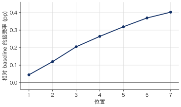{ width="50%" }

<span class="ablation-sq">\(\blacksquare\)</span>**收益主要出现在训练中后期。** 早期 tau loss 的 \(\tau\) 低于 baseline，中后期转为略高。一个可能的解释是 \(\tau\) 的前缀乘积结构：后位置的梯度包含前面位置接受率的乘积，训练早期这些乘积较小，后位置获得的有效梯度也较弱。

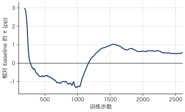{ width="50%" }

### MLA

MLA 将可训练参数减少约 0.51%，每层每 token 的 KV 元素数从 2048 压到 576，约缩小 \(3.6\times\)。末段 \(\tau\) 下降 0.45%。

<span class="ablation-sq">\(\blacksquare\)</span>**接受率下降未随 draft depth 明显扩大。** 第 1 个位置下降约 0.26 pp，第 7 个位置下降约 0.15 pp。

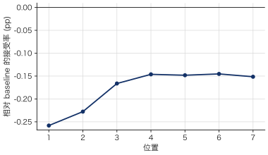{ width="50%" }

<span class="ablation-sq">\(\blacksquare\)</span>**训练曲线与 GQA 接近。** 中前期差异较小，末段才出现约 0.45% 的 \(\tau\) 差距。

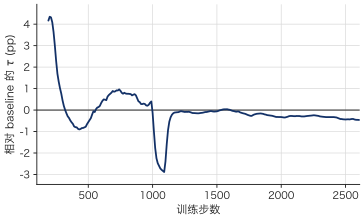{ width="50%" }

### MLA + SWA

SWA 叠加在 MLA 上。窗口从 1024 缩到 512、128 时，末段 \(\tau\) 相对 MLA 分别下降 0.73%、1.71%、5.47%。

<span class="ablation-sq">\(\blacksquare\)</span>**窗口越小，各位置接受率下降越大。** SWA128 在第 1 个位置下降约 1.49 pp，第 4–5 个位置下降约 3.28 pp，第 7 个位置下降约 2.94 pp。保留块内双向 attention 时，缩短 history 仍会降低训练接受率。

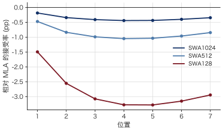{ width="50%" }

<span class="ablation-sq">\(\blacksquare\)</span>**SWA128 的差距在训练前期已出现。** 810–1000 步时，\(\tau\) 相对 MLA 已下降约 4.17%。SWA1024 同期与 MLA 接近，末段差距也最小。

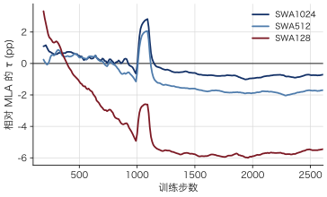{ width="50%" }

### Context-only

移除当前 draft block 的双向 K/V，仅保留严格早于 anchor 的 target context 后，末段 \(\tau\) 下降 1.76%。Anchor embedding residual 和 Markov head 的前驱 token 输入仍保留。

<span class="ablation-sq">\(\blacksquare\)</span>**第 1 个位置影响较小，下降主要出现在后续位置。** 第 1 个位置接受率下降约 0.12 pp，第 2 个位置下降约 1.56 pp，第 7 个位置下降约 0.79 pp。

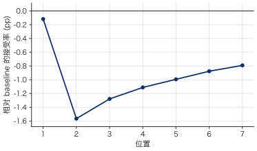{ width="50%" }

<span class="ablation-sq">\(\blacksquare\)</span>**相对 baseline 的差距较早形成。** 810–1000 步时，\(\tau\) 已下降约 1.81%，与末段差距接近。

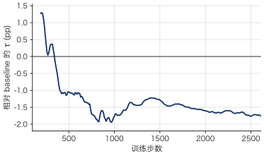{ width="50%" }

### All-mask

将 backbone 输入改为 `[MASK × 7]`，保留块内双向 attention 和 Markov head 的前驱 token 输入后，末段 \(\tau\) 下降 1.61%。

<span class="ablation-sq">\(\blacksquare\)</span>**影响集中在首位置。** 第 1 个位置接受率下降约 1.65 pp，第 2 个位置下降约 1.19 pp，第 7 个位置仅下降约 0.04 pp。与 context-only 相比，移除 anchor 输入和移除块内 K/V 影响的位置不同。

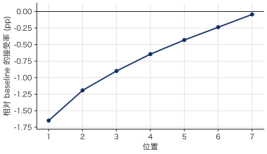{ width="50%" }

<span class="ablation-sq">\(\blacksquare\)</span>**早期差距大于末段。** 810–1000 步时，\(\tau\) 相对 baseline 下降约 3.27%，随后缩小。

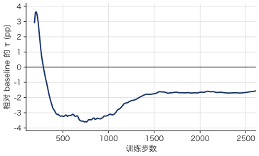{ width="50%" }

### 三层 aux

Auxiliary layers 改为 `[1, 17, 33]` 后，输入投影参数从 32.77M 降到 19.66M，可训练参数减少约 2.13%，末段 \(\tau\) 下降 1.52%。

<span class="ablation-sq">\(\blacksquare\)</span>**接受率下降随位置加深。** 第 1 个位置下降约 0.42 pp，第 4 个位置下降约 0.96 pp，第 7 个位置下降约 1.15 pp。

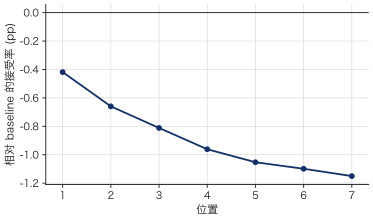{ width="50%" }

<span class="ablation-sq">\(\blacksquare\)</span>**训练前期的差距大于末段。** 810–1000 步时，\(\tau\) 相对 baseline 下降约 2.92%，随后缩小。

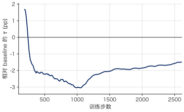{ width="50%" }

### 延长训练至 2.3 epoch

同一 GQA 配置继续训练，取 5820–6010 步（约 2.3 epoch）统计，\(\tau\) 相对 1 epoch 提高约 8.11%。

<span class="ablation-sq">\(\blacksquare\)</span>**接受率提升随位置加深。** 第 1 个位置提高约 2.59 pp，第 4 个位置提高约 5.20 pp，第 7 个位置提高约 6.42 pp。

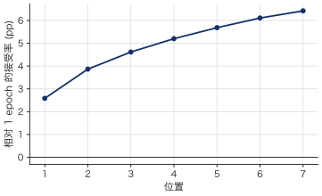{ width="50%" }

## 总结

训练消融表明：

- MLA 明显压缩 KV 表示，训练 \(\tau\) 的损失较小。进一步限制 history 时，窗口缩小带来的损失更大。
- Anchor 输入与块内 K/V 对各位置的作用不同：移除 anchor 主要影响首位置，移除块内 K/V 主要影响后续位置。
- Tau loss 的收益较小且偏向后续位置，延长训练带来的收益更大。三层 aux 则以一定质量损失换取参数减少。
