# Qwen3-4B DSpark

## 1 Design {#design}

### 1.1 Baseline Design {#_1}

DSpark baseline 读取 Qwen3-4B 的中间层隐藏状态，用五层 GQA backbone 并行预测接下来 7 个位置的基础 logits，再由 Markov head 根据前一个 token 逐步修正。Target、token embedding 和 LM head 均冻结。并行预测与顺序采样的推导见 [Speculative Decoding §5.2 DSpark](speculative-decoding.md#52-dspark)。

下表列出 baseline 的模型配置。

<figure class="dspark-table-figure" markdown="1">

| **项目** | 设置 |
|---|---|
| **最大序列长度** | 4096 tokens（完整对话，含 prompt 与 response） |
| **Draft 架构** | 5 层；隐藏维度 2560；FFN 中间维度 9728；GQA：32 个 Q heads、8 个 KV heads，head dim 128 |
| **Aux 层** | `[1, 9, 17, 25, 33]` |
| **Block size** | 7；Backbone 输入为 `[anchor, MASK × 6]` |
| **监督** | 仅监督 response |
| **Markov head** | Vanilla，rank 256 |
| **总参数量** | GQA baseline：约 1.393B（含冻结的 embedding 与 LM head） |
| **可训练参数量** | GQA baseline：约 615.2M |

<figcaption>DSpark baseline 的模型配置</figcaption>
</figure>

参数量拆分如下。Backbone 各项按五层合计，7 个预测位置共享参数；不计 target 模型本体。

<figure class="dspark-table-figure" markdown="1">

| 环节 | 维度或计算 | 参数量 | 训练 |
| --- | --- | ---: | :---: |
| Target feature 融合 FC | \(5\times2560\rightarrow2560\) | 32,768,000 | 是 |
| GQA：Q 投影 | \(5\times(2560\rightarrow4096)\) | 52,428,800 | 是 |
| GQA：K、V 投影 | \(5\times2\times(2560\rightarrow1024)\) | 26,214,400 | 是 |
| GQA：输出投影 | \(5\times(4096\rightarrow2560)\) | 52,428,800 | 是 |
| FFN：gate、up、down | \(5\times3\times2560\times9728\) | 373,555,200 | 是 |
| RMSNorm | 每层两个 2560 维、Q/K 各 128 维；另有融合与最终输出两个 2560 维 | 32,000 | 是 |
| Markov \(W_1\) | \(151936\times256\) 查表 | 38,895,616 | 是 |
| Markov \(W_2\) | \(256\rightarrow151936\) | 38,895,616 | 是 |
| Confidence head | \((2560+256)\rightarrow1\)，含 bias | 2,817 | 是 |
| **可训练小计** | **BF16 权重约 1,173.44 MiB** | **615,221,249** | |
| Token embedding | \(151936\times2560\) 查表 | 388,956,160 | 冻结 |
| LM head | \(2560\rightarrow151936\) | 388,956,160 | 冻结 |
| **总计** | | **1,393,133,569** | |

<figcaption>DSpark baseline 各部分参数量。除 confidence head 外，表中线性投影均不含 bias。</figcaption>
</figure>

### 1.2 Ablation Study {#_2}

以下训练消融均以 GQA baseline 为对照，各改一项；SWA 以 MLA 为对照。

\(\blacksquare\)**Tau loss.** 附加

$$
L_{\tau}=\frac{8-\tau}{7},
$$

系数 0.1。CE 与 L1 仍按位置衰减，该项不衰减。

\(\blacksquare\)**MLA.** 将 backbone attention 替换为 MLA。32 个 query heads，每头 QK 为 64 content + 64 RoPE，V 为 128，KV latent 为 512。

\(\blacksquare\)**SWA.** 在 MLA 上将历史窗口限制为 \(W\in\{1024,512,128\}\)。对位置为 \(a\) 的 anchor，历史范围固定为 \([\max(0,a-W+1),a)\)，块内仍双向可见。

\(\blacksquare\)**Context-only.** 移除当前 draft block 的 K/V，只读取早于 anchor 的 target context，保留 anchor 输入。

\(\blacksquare\)**All-mask.** 将 backbone 输入改为 `[MASK × 7]`，保留块内双向 attention。Markov head 仍从 anchor token 开始生成。

\(\blacksquare\)**三层 aux.** 将 target 特征层改为 `[1, 17, 33]`。

### 1.3 Markov MLA {#markov-mla}

该变体将 backbone attention 替换为 MLA，并在原有 Markov head 的 `W₁ → W₂` 之间加入 MLA。Backbone 并行计算各位置的基础 logits，Markov head 则根据上一个生成 token 和 target context，逐步修正 logits 并采样。

<figure id="fig-markov-mla" markdown="span">
  { width="100%" style="display: block; margin: 0 auto;" }
  <figcaption style="color: var(--md-default-fg-color--light); font-style: normal; margin-top: 0;">Fig. 1: Backbone MLA 与 Markov MLA 架构</figcaption>
</figure>

五层 target features 按 token 拼接，经 FC 和 RMSNorm 融合为 \(C\)。Markov MLA 的 Q 来自上一个 token 的 embedding \(z_i=W_1[x_{i-1}]\)，K/V 由 \(C\) 投影得到。以本轮起始 token \(x_0\) 为边界，所有生成步骤都读取同一段早于 \(x_0\) 的 context：

$$
b_i=W_2\,\mathrm{MLA}(z_i,C),\qquad
\ell_i=\ell_i^0+b_i.
$$

其中 \(\ell_i^0\) 为 backbone 的基础 logits，\(b_i\) 为 Markov 修正项。Markov MLA 不加残差，其投影权重与 backbone 独立。

### 1.4 Markov-Engram {#markov-engram}

Markov-Engram 沿用五层 GQA backbone，在 Markov head 的 `W₁ → W₂` 之间加入 n-gram 查表。预测 \(x_i\) 时，分别用以 \(x_{i-1}\) 结尾的 2-gram 和 3-gram 查表。每阶用 8 个哈希头，每头读出 16 维，16 个结果拼成 256 维记忆向量 \(m_i\)。第一步预测 \(x_1\) 时，3-gram 由 anchor \(x_0\) 和它之前的两个 token 组成。

负责预测 \(x_i\) 的 backbone hidden 投影为 256 维 query \(q_i\)，\(m_i\) 投影为同宽的 key \(k_i\)。两者分别经过 RMSNorm，再用缩放点积得到标量门控，决定当前上下文采用多少查表结果：

$$
g_i=\sigma\!\left(\frac{q_i^\top k_i}{\sqrt{256}}\right),\qquad
\ell_i=\ell_i^0+W_2\!\left(W_1[x_{i-1}]+g_i W_V m_i\right).
$$

\(W_V\) 以零初始化，使训练起点的 logits 与同 seed 的 baseline 一致。下表按单个预测位置列出计算维度，7 个位置共享全部参数。

<figure class="dspark-table-figure" markdown="1">

| 环节 | 维度或计算 | 新增可训练参数 |
| --- | --- | ---: |
| \(W_1\) 查表 | 上一个 token ID → 256 维 | 0（沿用） |
| 2-gram 查表 | 8 头 × 16 维，每头约 131K 桶（合计 1,048,988 桶） | 16,783,808 |
| 3-gram 查表 | 8 头 × 16 维，每头约 262K 桶（合计 2,097,418 桶） | 33,558,688 |
| 拼接记忆 \(m_i\) | 128 + 128 → 256 维 | 0 |
| Query 投影 | backbone hidden：2560 → 256 | 655,360 |
| Key 投影 | \(m_i\)：256 → 256 | 65,536 |
| 门控 \(g_i\) | Q、K 各做 256 维 RMSNorm，缩放点积后经 sigmoid 得到标量 | 512 |
| Value 投影 \(W_V\) | \(m_i\)：256 → 256 | 65,536 |
| 残差与 \(W_2\) | 两个 256 维向量相加，再投影至 151,936 维词表 | 0（沿用） |
| **合计** | **新增 BF16 权重约 97.52 MiB** | **51,129,440** |

<figcaption>Markov-Engram 各环节的维度与相对 baseline 的新增参数量</figcaption>
</figure>

## 2 Training Metrics {#_3}

<figure class="dspark-table-figure" markdown="1">

| **实验** | CE ↓ | L1 ↓ | Acc. ↑ | τ ↑ | Δτ |
| --- | :---: | :---: | :---: | :---: | :---: |
| **GQA baseline** | 1.1191 | 0.4550 | 74.35% | 4.9591 | 0.00% |
| **GQA + tau loss** | 1.1260 | 0.4546 | 74.34% | 4.9860 | +0.54% |
| **MLA** | 1.1402 | 0.4623 | 74.00% | 4.9368 | -0.45% |
| **MLA + SWA1024** | 1.1571 | 0.4690 | 73.65% | 4.9008 | -1.17% |
| **MLA + SWA512** | 1.1853 | 0.4787 | 73.16% | 4.8523 | -2.15% |
| **MLA + SWA128** | 1.2830 | 0.5140 | 71.35% | 4.6668 | -5.89% |
| **GQA context-only** | 1.1795 | 0.4767 | 73.30% | 4.8718 | -1.76% |
| **GQA all-mask** | 1.1860 | 0.4780 | 73.51% | 4.8791 | -1.61% |
| **GQA 三层 aux** | 1.1676 | 0.4735 | 73.36% | 4.8837 | -1.52% |

<figcaption>各训练消融的指标与相对 baseline 的 τ 变化</figcaption>
</figure>

## 3 训练消融分析 {#training-ablation-analysis}

### 3.1 Tau loss {#tau-loss}

Tau loss 使 \(\tau\) 提高 0.54%，收益主要出现在后续位置和训练中后期。

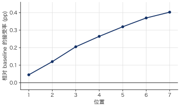{ width="50%" }

### 3.2 MLA 与历史窗口 {#mla}

MLA 的可训练参数从 615.2M 降至 612.1M，\(\tau\) 下降 0.45%，差距未随 draft 位置明显扩大。

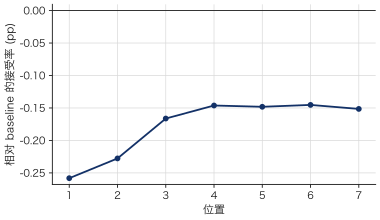{ width="50%" }

MLA 的压缩表示每层每 token 包含 \(512+64=576\) 个数，约为 GQA 的 \(1/3.6\)。当前实现缓存展开后的 K/V，这一比例不代表实际 KV cache 的节省。

进一步缩短历史窗口会降低接受长度，窗口越小损失越大。SWA128 相对 MLA 的 \(\tau\) 下降 5.47%，且差距在训练早期已出现。块内双向 attention 无法完全补偿历史信息的减少。

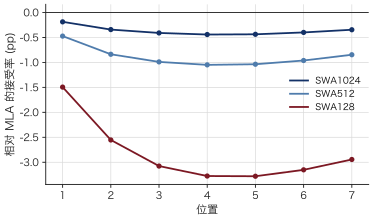{ width="50%" }

### 3.3 Anchor 输入与块内 K/V {#anchor-kv}

Context-only 和 all-mask 的 \(\tau\) 分别下降 1.76% 和 1.61%，但影响的位置不同：移除块内 K/V 主要影响后续位置，移除 anchor 输入主要影响首位置。两组均保留 Markov head 的前驱 token 输入。

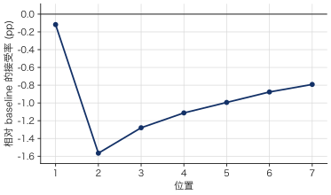{ width="50%" }

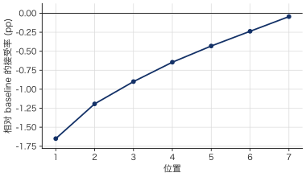{ width="50%" }

### 3.4 三层 aux {#aux}

减少特征层使输入投影参数从 32.77M 降至 19.66M，总可训练参数减少 2.13%，代价是 \(\tau\) 下降 1.52%，后续位置受影响更大。

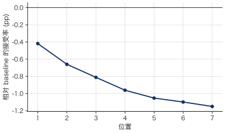{ width="50%" }

训练过程曲线

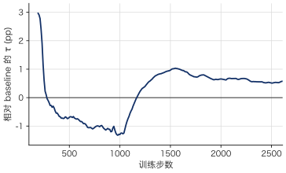{ width="50%" }

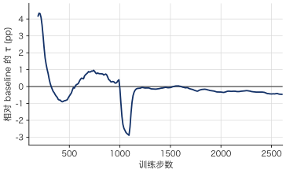{ width="50%" }

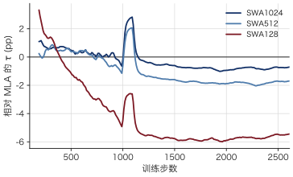{ width="50%" }

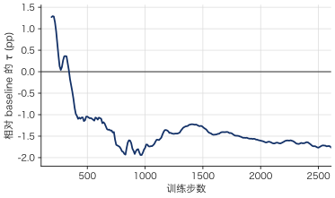{ width="50%" }

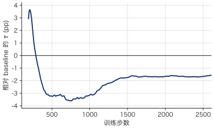{ width="50%" }

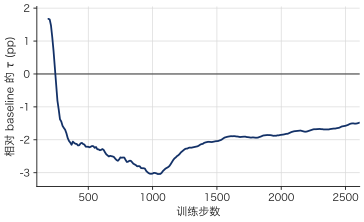{ width="50%" }

## 4 Evaluation {#evaluation}

### 4.1 Settings {#settings}

生成评测使用 Qwen3-4B 的 non-thinking 模式，draft 每轮提出 7 个候选 token。

训练数据集

训练消融使用 Open PerfectBlend。我们用 Qwen3-4B 在 non-thinking 模式下重新生成回复，采样参数为 `temperature=0.7`、`top-p=0.8`、`top-k=20`、`min-p=0`，每条回复最多生成 4,096 个 token。重新生成后共有 1,339,875 个训练样本。

训练方式

Offline 和 online 训练均使用预先生成的对话样本，由冻结的 Qwen3-4B 提供 target hidden states。每个样本最多采样 512 个 anchor，仅监督回复部分。Baseline 的损失为 \(0.1L_{\mathrm{CE}}+0.9L_{\mathrm{L1}}+L_{\mathrm{conf}}\)，位置权重为 \(\exp(-i/4)\)，其中 \(i=0,\ldots,6\)。

- **Offline training** 用于第 2 节的训练消融。训练前先计算全部样本的 target hidden states，写入约 38 TB 的磁盘缓存，后续各轮训练复用这份缓存。Draft 使用 4 张 GPU，每卡 micro-batch 为 1，梯度累积 128 次，global batch size 为 \(4\times1\times128=512\)。峰值学习率为 \(6\times10^{-4}\)，warmup 占完整 26,160 步学习率计划的 4%。消融实验实际训练 2,616 个 optimizer step，约 1 个 epoch。

- **Online training** 由 SGLang 在训练期间计算 target hidden states，SpecForge 从缓冲区读取并训练 draft。Target 计算下一批数据时，draft 可以并行训练当前批。MAL vs. Epochs 的 baseline 使用 7 张 GPU 训练 draft，每卡 micro-batch 为 4，梯度累积 18 次，global batch size 为 \(7\times4\times18=504\)。Markov MLA 和 Markov GQA 的对比实验也采用 online training。

测试数据集

- **GSM8K** 收录小学数学应用题，通常需要多步算术运算才能得到答案。两种设置都使用全部 1,319 道测试题。本文脚本用 `Question: …` 给出当前题目，在下一行用 `Answer:` 引出回答。0-shot 直接使用这一提示。5-shot 在每道测试题前附上相同的五组示例，取自训练集前五道题及其完整解答。[数据集](https://github.com/openai/grade-school-math)
- **HumanEval** 包含 164 道 Python 函数补全题，每题给出函数签名和文档字符串，要求模型补全函数实现。[数据集](https://github.com/openai/human-eval)
- **MT-Bench** 包含 80 组双轮对话。每组先给出一个问题，第二轮保留首轮问答作为上下文，再提出追问。[论文](https://arxiv.org/abs/2306.05685)
- **MATH-500** 收录从 MATH 测试集选出的 500 道竞赛数学题，涵盖代数、几何、数论等七个主题。本文使用全部 500 道题评测数学推理过程中的 draft token 接受率。[数据集](https://huggingface.co/datasets/HuggingFaceH4/MATH-500)
- **AIME 2024** 收录 2024 年美国数学邀请赛（AIME I 和 AIME II）的全部 30 道题，每题的答案都是 0 至 999 的整数。本文对 AIME 和 MATH-500 使用相同的提示，要求模型逐步推理，并将最终答案写在 `\boxed{}` 中。[数据集](https://huggingface.co/datasets/Maxwell-Jia/AIME_2024)

Metrics

训练时，设 \(p_i\)、\(q_i\) 分别为第 \(i\) 个位置的 target 与 draft 分布。概率采样的接受率为

$$
a_i
=\sum_v\min\bigl(p_i(v),q_i(v)\bigr)
=1-\tfrac12\lVert p_i-q_i\rVert_1.\tag{1}
$$

估算的平均接受长度 \(\tau\) 由各位置接受率的前缀乘积计算，包含一个 bonus token：

$$
\tau
=1+\sum_{i=0}^{6}\prod_{j=0}^{i}a_j.\tag{2}
$$

生成评测直接统计接受的 draft token 总数（`accepted`）和验证轮数（`rounds`）。实测平均接受长度 MAL 按 `1 + accepted / rounds` 计算，其中 1 表示 bonus token。MOL 为每题平均输出的 token 数。`pos-i` 表示前 $i$ 个候选 token 全部被接受的轮次占比。

### 4.2 MAL vs. Epochs {#mal-vs-epochs}

Baseline 在每个 epoch 包含 2658 个训练 step。pos-$k$ 表示一次起草中前 $k$ 个 token 连续被接受的比例。除 GSM8K (5-shot) 外，第 1–10 个 epoch 的结果使用 `VLLM_BATCH_INVARIANT=1` 评测。MIT 和 MOT 分别为每个成功请求的平均输入和输出 token 数；MT-Bench 合并两轮统计。

GSM8K

Temperature = 0

<figure class="dspark-table-figure" markdown="1">

| Epochs | T | Top-p | Top-k | Draft 采样 | **MAL** | pos-1 | pos-2 | pos-3 | pos-4 | pos-5 | pos-6 | pos-7 | MIT | MOT |
| --- | :---: | ---: | ---: | --- | :---: | ---: | ---: | ---: | ---: | ---: | ---: | ---: | ---: | ---: |
| 1 {: data-conditional="91.74% 90.73% 90.42% 90.65% 89.52% 89.04% 88.52%"} | 0.0 | 1.0 | -1 | greedy | **5.8202** | 91.74% | 83.23% | 75.25% | 68.22% | 61.07% | 54.38% | 48.13% | 77.03 | 252.23 |
| 2 {: data-conditional="92.82% 92.02% 91.57% 91.62% 91.21% 90.69% 90.04%"} | 0.0 | 1.0 | -1 | greedy | **6.0613** | 92.82% | 85.42% | 78.22% | 71.66% | 65.36% | 59.28% | 53.37% | 77.03 | 252.23 |
| 3 {: data-conditional="93.07% 92.64% 92.15% 92.19% 91.55% 91.39% 90.64%"} | 0.0 | 1.0 | -1 | greedy | **6.1585** | 93.07% | 86.22% | 79.45% | 73.24% | 67.05% | 61.28% | 55.54% | 77.03 | 252.23 |
| 4 {: data-conditional="93.61% 92.86% 92.50% 92.75% 92.05% 91.57% 91.16%"} | 0.0 | 1.0 | -1 | greedy | **6.2431** | 93.61% | 86.92% | 80.40% | 74.57% | 68.65% | 62.86% | 57.30% | 77.03 | 252.23 |
| 5 {: data-conditional="93.88% 93.31% 92.58% 92.86% 92.31% 91.91% 91.47%"} | 0.0 | 1.0 | -1 | greedy | **6.2975** | 93.88% | 87.60% | 81.10% | 75.31% | 69.52% | 63.90% | 58.45% | 77.03 | 252.23 |
| 6 {: data-conditional="93.97% 93.26% 92.76% 92.88% 92.35% 92.04% 91.71%"} | 0.0 | 1.0 | -1 | greedy | **6.3119** | 93.97% | 87.64% | 81.30% | 75.51% | 69.73% | 64.18% | 58.86% | 77.03 | 252.23 |
| 7 {: data-conditional="94.02% 93.43% 92.84% 93.01% 92.44% 92.28% 91.81%"} | 0.0 | 1.0 | -1 | greedy | **6.3348** | 94.02% | 87.84% | 81.55% | 75.85% | 70.12% | 64.70% | 59.40% | 77.03 | 252.23 |
| 8 {: data-conditional="94.13% 93.40% 92.87% 93.10% 92.47% 92.33% 91.96%"} | 0.0 | 1.0 | -1 | greedy | <u>**6.3463**</u> | 94.13% | 87.92% | 81.65% | 76.02% | 70.30% | 64.91% | 59.69% | 77.03 | 252.23 |
| 9 {: data-conditional="94.10% 93.33% 92.90% 92.97% 92.50% 92.33% 91.82%"} | 0.0 | 1.0 | -1 | greedy | **6.3381** | 94.10% | 87.83% | 81.59% | 75.86% | 70.17% | 64.78% | 59.48% | 77.03 | 252.23 |
| 10 {: data-conditional="94.06% 93.35% 92.92% 93.03% 92.40% 92.30% 91.70%"} | 0.0 | 1.0 | -1 | greedy | **6.3355** | 94.06% | 87.80% | 81.58% | 75.90% | 70.13% | 64.73% | 59.36% | 77.03 | 252.23 |

<figcaption>GSM8K 各 epoch 的接受率（T = 0，Greedy draft）</figcaption>
</figure>

Temperature = 1

<figure class="dspark-table-figure" markdown="1">

| Epochs | T | Top-p | Top-k | Draft 采样 | **MAL** | pos-1 | pos-2 | pos-3 | pos-4 | pos-5 | pos-6 | pos-7 | MIT | MOT |
| --- | :---: | ---: | ---: | --- | :---: | ---: | ---: | ---: | ---: | ---: | ---: | ---: | ---: | ---: |
| 1 {: data-conditional="88.87% 88.23% 88.48% 89.02% 88.63% 87.96% 87.89%"} | 1.0 | 1.0 | -1 | greedy | **5.4361** | 88.87% | 78.41% | 69.37% | 61.76% | 54.74% | 48.15% | 42.32% | 77.03 | 246.99 |
| 2 {: data-conditional="89.20% 88.91% 89.54% 90.15% 89.73% 89.32% 88.72%"} | 1.0 | 1.0 | -1 | greedy | **5.5784** | 89.20% | 79.31% | 71.02% | 64.02% | 57.45% | 51.31% | 45.52% | 77.03 | 250.23 |
| 3 {: data-conditional="89.81% 89.54% 89.81% 90.55% 90.37% 90.28% 89.56%"} | 1.0 | 1.0 | -1 | greedy | **5.6808** | 89.81% | 80.41% | 72.22% | 65.40% | 59.10% | 53.35% | 47.79% | 77.03 | 247.90 |
| 4 {: data-conditional="89.95% 89.91% 90.05% 91.07% 90.66% 90.30% 90.24%"} | 1.0 | 1.0 | -1 | greedy | **5.7340** | 89.95% | 80.87% | 72.83% | 66.33% | 60.13% | 54.30% | 49.00% | 77.03 | 248.87 |
| 5 {: data-conditional="90.00% 90.17% 90.17% 91.03% 90.83% 90.47% 90.55%"} | 1.0 | 1.0 | -1 | greedy | **5.7577** | 90.00% | 81.16% | 73.18% | 66.62% | 60.51% | 54.74% | 49.57% | 77.03 | 249.77 |
| 6 {: data-conditional="90.39% 90.41% 90.42% 91.49% 91.00% 90.76% 90.55%"} | 1.0 | 1.0 | -1 | greedy | <u>**5.8152**</u> | 90.39% | 81.72% | 73.89% | 67.60% | 61.52% | 55.83% | 50.56% | 77.03 | 247.72 |
| 7 {: data-conditional="90.30% 90.21% 90.57% 91.12% 91.03% 90.63% 90.50%"} | 1.0 | 1.0 | -1 | greedy | **5.7961** | 90.30% | 81.46% | 73.78% | 67.23% | 61.20% | 55.46% | 50.19% | 77.03 | 249.79 |
| 8 {: data-conditional="90.34% 90.27% 90.26% 91.43% 90.85% 90.80% 90.65%"} | 1.0 | 1.0 | -1 | greedy | **5.7977** | 90.34% | 81.55% | 73.61% | 67.30% | 61.14% | 55.51% | 50.32% | 77.03 | 248.46 |
| 9 {: data-conditional="90.43% 90.32% 90.47% 91.27% 91.09% 90.86% 90.58%"} | 1.0 | 1.0 | -1 | greedy | **5.8129** | 90.43% | 81.68% | 73.90% | 67.45% | 61.44% | 55.82% | 50.56% | 77.03 | 248.88 |
| 10 {: data-conditional="90.30% 90.28% 90.23% 91.48% 91.08% 90.62% 90.60%"} | 1.0 | 1.0 | -1 | greedy | **5.7984** | 90.30% | 81.53% | 73.57% | 67.30% | 61.29% | 55.54% | 50.32% | 77.03 | 248.92 |

<figcaption>GSM8K 各 epoch 的接受率（T = 1，Greedy draft）</figcaption>
</figure>

<figure class="dspark-table-figure" markdown="1">

| Epochs | T | Top-p | Top-k | Draft 采样 | **MAL** | pos-1 | pos-2 | pos-3 | pos-4 | pos-5 | pos-6 | pos-7 | MIT | MOT |
| --- | :---: | ---: | ---: | --- | :---: | ---: | ---: | ---: | ---: | ---: | ---: | ---: | ---: | ---: |
| 1 {: data-conditional="90.40% 89.30% 88.52% 88.48% 87.83% 87.75% 86.46%"} | 1.0 | 1.0 | -1 | probabilistic | **5.5220** | 90.40% | 80.73% | 71.45% | 63.23% | 55.53% | 48.73% | 42.13% | 77.03 | 250.17 |
| 2 {: data-conditional="91.76% 91.01% 90.05% 90.19% 89.66% 89.41% 88.48%"} | 1.0 | 1.0 | -1 | probabilistic | **5.8165** | 91.76% | 83.52% | 75.21% | 67.83% | 60.82% | 54.38% | 48.12% | 77.03 | 250.28 |
| 3 {: data-conditional="92.50% 91.45% 91.02% 90.86% 90.22% 90.13% 89.38%"} | 1.0 | 1.0 | -1 | probabilistic | **5.9488** | 92.50% | 84.59% | 76.99% | 69.96% | 63.11% | 56.89% | 50.85% | 77.03 | 248.61 |
| 4 {: data-conditional="92.81% 92.08% 91.15% 91.47% 90.95% 90.69% 89.73%"} | 1.0 | 1.0 | -1 | probabilistic | **6.0379** | 92.81% | 85.47% | 77.91% | 71.26% | 64.81% | 58.78% | 52.75% | 77.03 | 247.32 |
| 5 {: data-conditional="93.34% 92.40% 91.56% 91.67% 91.00% 90.84% 89.97%"} | 1.0 | 1.0 | -1 | probabilistic | **6.1044** | 93.34% | 86.24% | 78.96% | 72.38% | 65.86% | 59.83% | 53.83% | 77.03 | 247.99 |
| 6 {: data-conditional="93.53% 92.28% 91.47% 91.48% 91.07% 91.05% 90.33%"} | 1.0 | 1.0 | -1 | probabilistic | **6.1080** | 93.53% | 86.31% | 78.95% | 72.23% | 65.78% | 59.89% | 54.10% | 77.03 | 252.41 |
| 7 {: data-conditional="93.41% 92.39% 91.73% 91.77% 91.24% 91.00% 90.35%"} | 1.0 | 1.0 | -1 | probabilistic | **6.1262** | 93.41% | 86.30% | 79.16% | 72.65% | 66.28% | 60.31% | 54.50% | 77.03 | 251.24 |
| 8 {: data-conditional="93.54% 92.47% 91.73% 91.83% 91.15% 91.05% 90.48%"} | 1.0 | 1.0 | -1 | probabilistic | **6.1381** | 93.54% | 86.50% | 79.34% | 72.86% | 66.41% | 60.47% | 54.71% | 77.03 | 250.11 |
| 9 {: data-conditional="93.54% 92.83% 91.79% 91.81% 91.16% 91.29% 90.62%"} | 1.0 | 1.0 | -1 | probabilistic | <u>**6.1603**</u> | 93.54% | 86.83% | 79.70% | 73.18% | 66.71% | 60.90% | 55.18% | 77.03 | 247.57 |
| 10 {: data-conditional="93.41% 92.50% 91.82% 91.61% 91.07% 91.17% 90.51%"} | 1.0 | 1.0 | -1 | probabilistic | **6.1301** | 93.41% | 86.41% | 79.34% | 72.68% | 66.19% | 60.35% | 54.62% | 77.03 | 252.26 |

<figcaption>GSM8K 各 epoch 的接受率（T = 1，Probabilistic draft）</figcaption>
</figure>

GSM8K (5-shot)

Temperature = 0

<figure class="dspark-table-figure" markdown="1">

| Epochs | T | Top-p | Top-k | Draft 采样 | **MAL** | pos-1 | pos-2 | pos-3 | pos-4 | pos-5 | pos-6 | pos-7 | MIT | MOT |
| --- | :---: | ---: | ---: | --- | :---: | ---: | ---: | ---: | ---: | ---: | ---: | ---: | ---: | ---: |
| 1 {: data-conditional="87.15% 85.97% 83.46% 79.17% 78.48% 78.19% 78.56%"} | 0.0 | 1.0 | -1 | greedy | **4.6719** | 87.15% | 74.92% | 62.53% | 49.50% | 38.85% | 30.38% | 23.86% | 735.03 | 147.46 |
| 2 {: data-conditional="87.84% 87.06% 85.59% 82.40% 81.31% 80.78% 80.99%"} | 0.0 | 1.0 | -1 | greedy | **4.9169** | 87.84% | 76.48% | 65.46% | 53.94% | 43.86% | 35.43% | 28.69% | 735.03 | 147.46 |
| 3 {: data-conditional="88.80% 88.47% 86.67% 83.60% 81.84% 81.60% 81.62%"} | 0.0 | 1.0 | -1 | greedy | **5.0800** | 88.80% | 78.56% | 68.09% | 56.92% | 46.59% | 38.01% | 31.03% | 735.03 | 147.46 |
| 4 {: data-conditional="88.98% 88.71% 86.93% 84.69% 83.41% 81.67% 81.87%"} | 0.0 | 1.0 | -1 | greedy | **5.1509** | 88.98% | 78.93% | 68.62% | 58.11% | 48.47% | 39.58% | 32.41% | 735.03 | 147.46 |
| 5 {: data-conditional="90.14% 88.60% 86.83% 84.56% 83.80% 82.49% 82.34%"} | 0.0 | 1.0 | -1 | greedy | **5.2106** | 90.14% | 79.87% | 69.35% | 58.64% | 49.14% | 40.54% | 33.38% | 735.03 | 147.46 |
| 6 {: data-conditional="90.62% 88.94% 87.04% 85.30% 83.58% 82.53% 82.41%"} | 0.0 | 1.0 | -1 | greedy | <u>**5.2654**</u> | 90.62% | 80.60% | 70.15% | 59.84% | 50.02% | 41.28% | 34.02% | 735.03 | 147.46 |
| 7 {: data-conditional="89.88% 88.61% 87.23% 85.45% 84.25% 82.32% 82.22%"} | 0.0 | 1.0 | -1 | greedy | **5.2342** | 89.88% | 79.65% | 69.47% | 59.37% | 50.02% | 41.18% | 33.86% | 735.03 | 147.46 |
| 8 {: data-conditional="90.17% 88.62% 86.99% 85.07% 84.11% 82.09% 82.47%"} | 0.0 | 1.0 | -1 | greedy | **5.2299** | 90.17% | 79.91% | 69.52% | 59.14% | 49.74% | 40.83% | 33.68% | 735.03 | 147.46 |
| 9 {: data-conditional="89.99% 88.54% 87.05% 85.16% 83.93% 82.12% 82.13%"} | 0.0 | 1.0 | -1 | greedy | **5.2181** | 89.99% | 79.68% | 69.36% | 59.07% | 49.57% | 40.71% | 33.43% | 735.03 | 147.46 |
| 10 {: data-conditional="89.95% 88.46% 86.96% 85.24% 83.83% 82.16% 82.08%"} | 0.0 | 1.0 | -1 | greedy | **5.2111** | 89.95% | 79.57% | 69.20% | 58.98% | 49.45% | 40.62% | 33.34% | 735.03 | 147.46 |

<figcaption>GSM8K (5-shot) 各 epoch 的接受率（T = 0，Greedy draft）</figcaption>
</figure>

Temperature = 1

<figure class="dspark-table-figure" markdown="1">

| Epochs | T | Top-p | Top-k | Draft 采样 | **MAL** | pos-1 | pos-2 | pos-3 | pos-4 | pos-5 | pos-6 | pos-7 | MIT | MOT |
| --- | :---: | ---: | ---: | --- | :---: | ---: | ---: | ---: | ---: | ---: | ---: | ---: | ---: | ---: |
| 1 {: data-conditional="86.90% 85.82% 83.46% 79.14% 78.31% 78.12% 78.43%"} | 1.0 | 1.0 | -1 | greedy | **4.6535** | 86.90% | 74.58% | 62.25% | 49.26% | 38.58% | 30.14% | 23.64% | 735.03 | 144.63 |
| 2 {: data-conditional="87.70% 86.82% 85.70% 82.14% 81.20% 80.68% 81.04%"} | 1.0 | 1.0 | -1 | greedy | **4.8976** | 87.70% | 76.14% | 65.25% | 53.60% | 43.52% | 35.11% | 28.45% | 735.03 | 143.62 |
| 3 {: data-conditional="88.28% 88.04% 86.63% 83.47% 82.03% 81.20% 80.93%"} | 1.0 | 1.0 | -1 | greedy | **5.0336** | 88.28% | 77.72% | 67.33% | 56.20% | 46.10% | 37.43% | 30.30% | 735.03 | 143.61 |
| 4 {: data-conditional="88.20% 88.30% 86.96% 84.36% 83.25% 81.78% 81.11%"} | 1.0 | 1.0 | -1 | greedy | **5.0896** | 88.20% | 77.88% | 67.73% | 57.13% | 47.56% | 38.90% | 31.55% | 735.03 | 144.17 |
| 5 {: data-conditional="89.47% 88.10% 86.61% 84.41% 83.58% 82.73% 82.22%"} | 1.0 | 1.0 | -1 | greedy | **5.1498** | 89.47% | 78.82% | 68.27% | 57.63% | 48.17% | 39.85% | 32.77% | 735.03 | 146.49 |
| 6 {: data-conditional="90.24% 88.46% 86.97% 85.09% 83.32% 82.42% 82.65%"} | 1.0 | 1.0 | -1 | greedy | <u>**5.2187**</u> | 90.24% | 79.83% | 69.42% | 59.07% | 49.22% | 40.57% | 33.53% | 735.03 | 145.05 |
| 7 {: data-conditional="89.11% 88.03% 87.09% 84.81% 83.99% 82.53% 82.60%"} | 1.0 | 1.0 | -1 | greedy | **5.1580** | 89.11% | 78.44% | 68.31% | 57.94% | 48.66% | 40.16% | 33.17% | 735.03 | 144.82 |
| 8 {: data-conditional="89.69% 88.33% 86.93% 84.62% 83.66% 82.41% 82.05%"} | 1.0 | 1.0 | -1 | greedy | **5.1798** | 89.69% | 79.23% | 68.87% | 58.28% | 48.76% | 40.18% | 32.97% | 735.03 | 143.43 |
| 9 {: data-conditional="89.42% 88.53% 87.02% 85.31% 83.89% 82.69% 81.81%"} | 1.0 | 1.0 | -1 | greedy | **5.1965** | 89.42% | 79.16% | 68.88% | 58.77% | 49.30% | 40.77% | 33.35% | 735.03 | 147.86 |
| 10 {: data-conditional="89.56% 88.43% 86.96% 85.26% 83.64% 82.70% 82.03%"} | 1.0 | 1.0 | -1 | greedy | **5.1939** | 89.56% | 79.20% | 68.87% | 58.72% | 49.11% | 40.62% | 33.32% | 735.03 | 146.41 |

<figcaption>GSM8K (5-shot) 各 epoch 的接受率（T = 1，Greedy draft）</figcaption>
</figure>

<figure class="dspark-table-figure" markdown="1">

| Epochs | T | Top-p | Top-k | Draft 采样 | **MAL** | pos-1 | pos-2 | pos-3 | pos-4 | pos-5 | pos-6 | pos-7 | MIT | MOT |
| --- | :---: | ---: | ---: | --- | :---: | ---: | ---: | ---: | ---: | ---: | ---: | ---: | ---: | ---: |
| 1 {: data-conditional="86.64% 85.01% 82.33% 78.17% 76.86% 77.05% 76.98%"} | 1.0 | 1.0 | -1 | probabilistic | **4.5444** | 86.64% | 73.65% | 60.64% | 47.40% | 36.43% | 28.07% | 21.61% | 735.03 | 145.70 |
| 2 {: data-conditional="87.78% 86.54% 84.61% 81.27% 80.02% 79.78% 79.02%"} | 1.0 | 1.0 | -1 | probabilistic | **4.8179** | 87.78% | 75.97% | 64.28% | 52.24% | 41.81% | 33.35% | 26.35% | 735.03 | 143.80 |
| 3 {: data-conditional="88.57% 87.75% 86.02% 82.80% 81.12% 80.78% 79.75%"} | 1.0 | 1.0 | -1 | probabilistic | **4.9861** | 88.57% | 77.72% | 66.86% | 55.36% | 44.90% | 36.27% | 28.93% | 735.03 | 144.87 |
| 4 {: data-conditional="88.84% 88.20% 86.16% 83.82% 82.29% 80.47% 81.14%"} | 1.0 | 1.0 | -1 | probabilistic | **5.0572** | 88.84% | 78.35% | 67.51% | 56.58% | 46.56% | 37.47% | 30.41% | 735.03 | 143.72 |
| 5 {: data-conditional="89.96% 87.94% 86.06% 83.72% 82.55% 81.07% 81.30%"} | 1.0 | 1.0 | -1 | probabilistic | **5.1041** | 89.96% | 79.12% | 68.09% | 57.01% | 47.06% | 38.15% | 31.02% | 735.03 | 143.95 |
| 6 {: data-conditional="90.43% 88.47% 86.73% 84.64% 82.56% 81.64% 80.92%"} | 1.0 | 1.0 | -1 | probabilistic | <u>**5.1866**</u> | 90.43% | 80.01% | 69.39% | 58.73% | 48.49% | 39.59% | 32.03% | 735.03 | 144.54 |
| 7 {: data-conditional="89.53% 88.26% 86.75% 84.78% 83.54% 81.64% 81.35%"} | 1.0 | 1.0 | -1 | probabilistic | **5.1565** | 89.53% | 79.02% | 68.55% | 58.12% | 48.55% | 39.64% | 32.24% | 735.03 | 143.74 |
| 8 {: data-conditional="90.00% 88.57% 86.64% 84.68% 83.18% 82.26% 80.77%"} | 1.0 | 1.0 | -1 | probabilistic | **5.1824** | 90.00% | 79.71% | 69.06% | 58.48% | 48.65% | 40.02% | 32.32% | 735.03 | 143.96 |
| 9 {: data-conditional="89.78% 88.24% 86.64% 84.59% 83.05% 81.55% 81.00%"} | 1.0 | 1.0 | -1 | probabilistic | **5.1509** | 89.78% | 79.22% | 68.64% | 58.06% | 48.22% | 39.33% | 31.85% | 735.03 | 143.41 |
| 10 {: data-conditional="89.68% 88.23% 86.70% 84.60% 83.11% 81.39% 80.99%"} | 1.0 | 1.0 | -1 | probabilistic | **5.1473** | 89.68% | 79.13% | 68.60% | 58.04% | 48.23% | 39.26% | 31.80% | 735.03 | 143.54 |

<figcaption>GSM8K (5-shot) 各 epoch 的接受率（T = 1，Probabilistic draft）</figcaption>
</figure>

HumanEval

Temperature = 0

<figure class="dspark-table-figure" markdown="1">

| Epochs | T | Top-p | Top-k | Draft 采样 | **MAL** | pos-1 | pos-2 | pos-3 | pos-4 | pos-5 | pos-6 | pos-7 | MIT | MOT |
| --- | :---: | ---: | ---: | --- | :---: | ---: | ---: | ---: | ---: | ---: | ---: | ---: | ---: | ---: |
| 1 {: data-conditional="87.62% 86.65% 85.73% 86.33% 85.10% 85.67% 79.70%"} | 0.0 | 1.0 | -1 | greedy | **5.0629** | 87.62% | 75.93% | 65.09% | 56.20% | 47.82% | 40.97% | 32.65% | 167.22 | 355.60 |
| 2 {: data-conditional="88.95% 88.74% 88.34% 88.15% 88.21% 87.75% 84.21%"} | 0.0 | 1.0 | -1 | greedy | **5.4094** | 88.95% | 78.94% | 69.73% | 61.47% | 54.22% | 47.58% | 40.06% | 167.22 | 355.60 |
| 3 {: data-conditional="90.44% 88.46% 89.62% 89.61% 89.16% 89.29% 87.20%"} | 0.0 | 1.0 | -1 | greedy | **5.5943** | 90.44% | 80.01% | 71.70% | 64.25% | 57.28% | 51.15% | 44.60% | 167.22 | 355.60 |
| 4 {: data-conditional="91.10% 88.92% 90.66% 90.09% 89.18% 89.90% 88.70%"} | 0.0 | 1.0 | -1 | greedy | **5.7081** | 91.10% | 81.01% | 73.44% | 66.16% | 59.00% | 53.05% | 47.05% | 167.22 | 355.60 |
| 5 {: data-conditional="91.66% 89.47% 90.85% 89.99% 90.45% 90.57% 88.61%"} | 0.0 | 1.0 | -1 | greedy | **5.7945** | 91.66% | 82.01% | 74.50% | 67.05% | 60.64% | 54.92% | 48.67% | 167.22 | 355.60 |
| 6 {: data-conditional="91.99% 89.35% 90.82% 90.61% 90.56% 90.87% 89.00%"} | 0.0 | 1.0 | -1 | greedy | **5.8293** | 91.99% | 82.20% | 74.65% | 67.64% | 61.25% | 55.66% | 49.54% | 167.22 | 355.60 |
| 7 {: data-conditional="91.67% 89.72% 91.03% 91.03% 90.37% 90.98% 89.64%"} | 0.0 | 1.0 | -1 | greedy | **5.8479** | 91.67% | 82.24% | 74.87% | 68.15% | 61.59% | 56.04% | 50.24% | 167.22 | 355.60 |
| 8 {: data-conditional="92.06% 89.68% 91.22% 91.28% 90.71% 90.99% 89.51%"} | 0.0 | 1.0 | -1 | greedy | **5.8856** | 92.06% | 82.56% | 75.31% | 68.74% | 62.36% | 56.74% | 50.79% | 167.22 | 355.60 |
| 9 {: data-conditional="91.99% 90.03% 91.10% 91.01% 91.33% 90.93% 89.44%"} | 0.0 | 1.0 | -1 | greedy | <u>**5.8965**</u> | 91.99% | 82.82% | 75.44% | 68.66% | 62.71% | 57.02% | 51.00% | 167.22 | 355.60 |
| 10 {: data-conditional="91.96% 89.77% 91.13% 90.90% 91.25% 90.91% 89.26%"} | 0.0 | 1.0 | -1 | greedy | **5.8791** | 91.96% | 82.56% | 75.24% | 68.39% | 62.40% | 56.73% | 50.63% | 167.22 | 355.60 |

<figcaption>HumanEval 各 epoch 的接受率（T = 0，Greedy draft）</figcaption>
</figure>

Temperature = 1

<figure class="dspark-table-figure" markdown="1">

| Epochs | T | Top-p | Top-k | Draft 采样 | **MAL** | pos-1 | pos-2 | pos-3 | pos-4 | pos-5 | pos-6 | pos-7 | MIT | MOT |
| --- | :---: | ---: | ---: | --- | :---: | ---: | ---: | ---: | ---: | ---: | ---: | ---: | ---: | ---: |
| 1 {: data-conditional="85.85% 85.43% 85.39% 85.75% 85.43% 86.14% 80.80%"} | 1.0 | 1.0 | -1 | greedy | **4.9283** | 85.85% | 73.34% | 62.62% | 53.70% | 45.87% | 39.51% | 31.93% | 167.22 | 349.41 |
| 2 {: data-conditional="87.21% 87.33% 87.42% 87.98% 88.48% 87.39% 84.23%"} | 1.0 | 1.0 | -1 | greedy | **5.2380** | 87.21% | 76.16% | 66.58% | 58.58% | 51.83% | 45.29% | 38.15% | 167.22 | 355.56 |
| 3 {: data-conditional="89.27% 87.15% 89.17% 88.80% 89.73% 88.63% 87.34%"} | 1.0 | 1.0 | -1 | greedy | **5.4508** | 89.27% | 77.79% | 69.37% | 61.60% | 55.27% | 48.99% | 42.79% | 167.22 | 347.03 |
| 4 {: data-conditional="89.09% 87.69% 89.56% 89.88% 88.98% 89.57% 88.35%"} | 1.0 | 1.0 | -1 | greedy | **5.5037** | 89.09% | 78.12% | 69.96% | 62.88% | 55.95% | 50.11% | 44.27% | 167.22 | 352.19 |
| 5 {: data-conditional="90.21% 88.74% 90.38% 89.92% 90.55% 89.67% 89.35%"} | 1.0 | 1.0 | -1 | greedy | **5.6665** | 90.21% | 80.06% | 72.36% | 65.06% | 58.92% | 52.83% | 47.21% | 167.22 | 337.01 |
| 6 {: data-conditional="90.20% 88.99% 90.29% 90.50% 90.59% 90.45% 89.06%"} | 1.0 | 1.0 | -1 | greedy | <u>**5.6954**</u> | 90.20% | 80.26% | 72.47% | 65.59% | 59.41% | 53.74% | 47.86% | 167.22 | 348.15 |
| 7 {: data-conditional="90.05% 88.56% 90.04% 91.09% 90.63% 90.24% 89.95%"} | 1.0 | 1.0 | -1 | greedy | **5.6793** | 90.05% | 79.75% | 71.81% | 65.41% | 59.28% | 53.50% | 48.12% | 167.22 | 347.78 |
| 8 {: data-conditional="89.99% 88.71% 90.43% 90.59% 90.88% 90.32% 89.78%"} | 1.0 | 1.0 | -1 | greedy | **5.6867** | 89.99% | 79.82% | 72.18% | 65.39% | 59.43% | 53.67% | 48.19% | 167.22 | 344.46 |
| 9 {: data-conditional="90.13% 88.62% 89.91% 90.71% 90.91% 90.19% 89.67%"} | 1.0 | 1.0 | -1 | greedy | **5.6750** | 90.13% | 79.87% | 71.81% | 65.14% | 59.22% | 53.41% | 47.90% | 167.22 | 349.93 |
| 10 {: data-conditional="90.27% 88.44% 89.62% 90.20% 90.69% 90.47% 89.43%"} | 1.0 | 1.0 | -1 | greedy | **5.6506** | 90.27% | 79.84% | 71.55% | 64.54% | 58.54% | 52.96% | 47.36% | 167.22 | 350.20 |

<figcaption>HumanEval 各 epoch 的接受率（T = 1，Greedy draft）</figcaption>
</figure>

<figure class="dspark-table-figure" markdown="1">

| Epochs | T | Top-p | Top-k | Draft 采样 | **MAL** | pos-1 | pos-2 | pos-3 | pos-4 | pos-5 | pos-6 | pos-7 | MIT | MOT |
| --- | :---: | ---: | ---: | --- | :---: | ---: | ---: | ---: | ---: | ---: | ---: | ---: | ---: | ---: |
| 1 {: data-conditional="87.32% 86.36% 85.55% 85.49% 83.89% 83.83% 79.57%"} | 1.0 | 1.0 | -1 | probabilistic | **4.9830** | 87.32% | 75.41% | 64.51% | 55.15% | 46.27% | 38.78% | 30.86% | 167.22 | 343.87 |
| 2 {: data-conditional="89.51% 88.21% 87.69% 87.94% 86.96% 85.75% 83.43%"} | 1.0 | 1.0 | -1 | probabilistic | **5.3483** | 89.51% | 78.96% | 69.24% | 60.89% | 52.95% | 45.40% | 37.88% | 167.22 | 350.66 |
| 3 {: data-conditional="90.35% 88.34% 88.45% 89.13% 88.28% 88.75% 85.66%"} | 1.0 | 1.0 | -1 | probabilistic | **5.5077** | 90.35% | 79.82% | 70.60% | 62.93% | 55.55% | 49.30% | 42.23% | 167.22 | 351.16 |
| 4 {: data-conditional="90.63% 89.23% 89.82% 89.54% 88.35% 89.05% 87.49%"} | 1.0 | 1.0 | -1 | probabilistic | **5.6256** | 90.63% | 80.87% | 72.63% | 65.04% | 57.46% | 51.17% | 44.77% | 167.22 | 346.99 |
| 5 {: data-conditional="91.42% 89.47% 90.47% 90.27% 89.48% 89.86% 88.05%"} | 1.0 | 1.0 | -1 | probabilistic | **5.7476** | 91.42% | 81.79% | 74.00% | 66.80% | 59.77% | 53.70% | 47.28% | 167.22 | 343.23 |
| 6 {: data-conditional="91.62% 90.01% 90.72% 89.95% 89.99% 89.99% 88.54%"} | 1.0 | 1.0 | -1 | probabilistic | **5.7951** | 91.62% | 82.47% | 74.82% | 67.30% | 60.56% | 54.50% | 48.25% | 167.22 | 344.15 |
| 7 {: data-conditional="91.55% 90.06% 90.00% 90.36% 90.48% 90.12% 88.57%"} | 1.0 | 1.0 | -1 | probabilistic | **5.7900** | 91.55% | 82.44% | 74.20% | 67.05% | 60.67% | 54.67% | 48.42% | 167.22 | 348.27 |
| 8 {: data-conditional="91.87% 89.86% 90.55% 90.39% 89.40% 90.12% 88.64%"} | 1.0 | 1.0 | -1 | probabilistic | **5.7988** | 91.87% | 82.56% | 74.76% | 67.58% | 60.41% | 54.45% | 48.26% | 167.22 | 342.80 |
| 9 {: data-conditional="91.69% 89.92% 90.60% 90.52% 90.85% 90.93% 89.30%"} | 1.0 | 1.0 | -1 | probabilistic | <u>**5.8363**</u> | 91.69% | 82.45% | 74.70% | 67.62% | 61.43% | 55.86% | 49.88% | 167.22 | 346.57 |
| 10 {: data-conditional="91.62% 89.76% 90.27% 90.13% 91.11% 90.91% 89.12%"} | 1.0 | 1.0 | -1 | probabilistic | **5.8081** | 91.62% | 82.25% | 74.24% | 66.91% | 60.97% | 55.42% | 49.40% | 167.22 | 341.73 |

<figcaption>HumanEval 各 epoch 的接受率（T = 1，Probabilistic draft）</figcaption>
</figure>

MT-Bench

Temperature = 0

<figure class="dspark-table-figure" markdown="1">

| Epochs | T | Top-p | Top-k | Draft 采样 | **MAL** | pos-1 | pos-2 | pos-3 | pos-4 | pos-5 | pos-6 | pos-7 | MIT | MOT |
| --- | :---: | ---: | ---: | --- | :---: | ---: | ---: | ---: | ---: | ---: | ---: | ---: | ---: | ---: |
| 1 {: data-conditional="71.61% 69.08% 69.93% 73.04% 73.74% 75.83% 77.08%"} | 0.0 | 1.0 | -1 | greedy | **3.2461** | 71.61% | 49.47% | 34.60% | 25.27% | 18.63% | 14.13% | 10.89% | 330.07 | 496.62 |
| 2 {: data-conditional="74.43% 72.49% 72.77% 74.19% 76.16% 77.21% 77.52%"} | 0.0 | 1.0 | -1 | greedy | **3.4935** | 74.43% | 53.95% | 39.26% | 29.13% | 22.18% | 17.13% | 13.28% | 330.07 | 496.62 |
| 3 {: data-conditional="76.33% 74.19% 73.95% 75.41% 76.69% 77.93% 79.62%"} | 0.0 | 1.0 | -1 | greedy | **3.6453** | 76.33% | 56.63% | 41.88% | 31.58% | 24.22% | 18.87% | 15.03% | 330.07 | 496.62 |
| 4 {: data-conditional="77.34% 74.96% 74.37% 76.15% 77.80% 79.42% 79.70%"} | 0.0 | 1.0 | -1 | greedy | **3.7325** | 77.34% | 57.97% | 43.11% | 32.83% | 25.54% | 20.29% | 16.17% | 330.07 | 496.62 |
| 5 {: data-conditional="78.25% 76.00% 75.48% 76.40% 77.96% 78.90% 79.41%"} | 0.0 | 1.0 | -1 | greedy | **3.8150** | 78.25% | 59.48% | 44.89% | 34.30% | 26.74% | 21.09% | 16.75% | 330.07 | 496.62 |
| 6 {: data-conditional="78.59% 76.72% 75.48% 77.14% 77.71% 79.50% 79.44%"} | 0.0 | 1.0 | -1 | greedy | **3.8570** | 78.59% | 60.30% | 45.51% | 35.11% | 27.28% | 21.69% | 17.23% | 330.07 | 496.62 |
| 7 {: data-conditional="78.85% 76.65% 76.43% 77.19% 77.68% 80.08% 80.33%"} | 0.0 | 1.0 | -1 | greedy | **3.8882** | 78.85% | 60.44% | 46.19% | 35.65% | 27.70% | 22.18% | 17.82% | 330.07 | 496.62 |
| 8 {: data-conditional="79.05% 77.04% 76.37% 77.19% 77.89% 80.50% 80.62%"} | 0.0 | 1.0 | -1 | greedy | **3.9095** | 79.05% | 60.89% | 46.50% | 35.90% | 27.96% | 22.51% | 18.15% | 330.07 | 496.62 |
| 9 {: data-conditional="79.42% 76.94% 76.55% 77.41% 78.05% 79.86% 80.40%"} | 0.0 | 1.0 | -1 | greedy | <u>**3.9248**</u> | 79.42% | 61.10% | 46.78% | 36.21% | 28.26% | 22.57% | 18.15% | 330.07 | 496.62 |
| 10 {: data-conditional="79.27% 77.09% 76.39% 77.28% 78.24% 79.73% 80.07%"} | 0.0 | 1.0 | -1 | greedy | **3.9189** | 79.27% | 61.11% | 46.68% | 36.08% | 28.23% | 22.51% | 18.02% | 330.07 | 496.62 |

<figcaption>MT-Bench 各 epoch 的接受率（T = 0，Greedy draft）</figcaption>
</figure>

Temperature = 1

<figure class="dspark-table-figure" markdown="1">

| Epochs | T | Top-p | Top-k | Draft 采样 | **MAL** | pos-1 | pos-2 | pos-3 | pos-4 | pos-5 | pos-6 | pos-7 | MIT | MOT |
| --- | :---: | ---: | ---: | --- | :---: | ---: | ---: | ---: | ---: | ---: | ---: | ---: | ---: | ---: |
| 1 {: data-conditional="67.03% 66.29% 66.87% 69.94% 72.13% 74.59% 74.68%"} | 1.0 | 1.0 | -1 | greedy | **2.9649** | 67.03% | 44.44% | 29.71% | 20.78% | 14.99% | 11.18% | 8.35% | 349.34 | 522.31 |
| 2 {: data-conditional="69.79% 68.83% 70.29% 72.40% 73.56% 76.35% 76.71%"} | 1.0 | 1.0 | -1 | greedy | **3.1830** | 69.79% | 48.04% | 33.77% | 24.45% | 17.98% | 13.73% | 10.53% | 322.69 | 489.39 |
| 3 {: data-conditional="71.00% 70.54% 70.88% 73.18% 74.74% 76.94% 77.98%"} | 1.0 | 1.0 | -1 | greedy | **3.2858** | 71.00% | 50.09% | 35.50% | 25.98% | 19.42% | 14.94% | 11.65% | 335.27 | 500.48 |
| 4 {: data-conditional="71.96% 71.50% 71.99% 74.99% 76.66% 78.81% 78.97%"} | 1.0 | 1.0 | -1 | greedy | **3.3955** | 71.96% | 51.45% | 37.04% | 27.77% | 21.29% | 16.78% | 13.25% | 325.48 | 505.32 |
| 5 {: data-conditional="71.87% 71.55% 72.94% 74.06% 75.71% 79.01% 77.29%"} | 1.0 | 1.0 | -1 | greedy | **3.3907** | 71.87% | 51.42% | 37.51% | 27.78% | 21.03% | 16.62% | 12.84% | 335.57 | 521.44 |
| 6 {: data-conditional="72.07% 71.96% 72.09% 74.43% 76.78% 77.66% 78.73%"} | 1.0 | 1.0 | -1 | greedy | **3.4018** | 72.07% | 51.86% | 37.39% | 27.83% | 21.37% | 16.59% | 13.06% | 334.04 | 494.40 |
| 7 {: data-conditional="73.14% 72.47% 72.71% 75.23% 76.84% 78.03% 78.05%"} | 1.0 | 1.0 | -1 | greedy | **3.4692** | 73.14% | 53.01% | 38.54% | 29.00% | 22.28% | 17.39% | 13.57% | 339.16 | 508.23 |
| 8 {: data-conditional="73.37% 71.80% 73.16% 74.53% 76.48% 77.04% 79.39%"} | 1.0 | 1.0 | -1 | greedy | **3.4566** | 73.37% | 52.69% | 38.54% | 28.72% | 21.97% | 16.92% | 13.44% | 340.86 | 522.06 |
| 9 {: data-conditional="73.42% 72.70% 73.34% 75.11% 76.56% 78.18% 78.88%"} | 1.0 | 1.0 | -1 | greedy | <u>**3.4934**</u> | 73.42% | 53.38% | 39.15% | 29.40% | 22.51% | 17.60% | 13.88% | 328.59 | 502.01 |
| 10 {: data-conditional="72.65% 72.13% 72.06% 74.64% 76.42% 77.87% 79.46%"} | 1.0 | 1.0 | -1 | greedy | **3.4262** | 72.65% | 52.40% | 37.76% | 28.18% | 21.54% | 16.77% | 13.33% | 328.86 | 492.82 |

<figcaption>MT-Bench 各 epoch 的接受率（T = 1，Greedy draft）</figcaption>
</figure>

<figure class="dspark-table-figure" markdown="1">

| Epochs | T | Top-p | Top-k | Draft 采样 | **MAL** | pos-1 | pos-2 | pos-3 | pos-4 | pos-5 | pos-6 | pos-7 | MIT | MOT |
| --- | :---: | ---: | ---: | --- | :---: | ---: | ---: | ---: | ---: | ---: | ---: | ---: | ---: | ---: |
| 1 {: data-conditional="69.11% 67.42% 67.66% 69.32% 71.36% 72.78% 73.46%"} | 1.0 | 1.0 | -1 | probabilistic | **3.0439** | 69.11% | 46.60% | 31.53% | 21.86% | 15.60% | 11.35% | 8.34% | 318.62 | 479.18 |
| 2 {: data-conditional="73.21% 70.79% 70.23% 71.29% 72.66% 74.08% 75.98%"} | 1.0 | 1.0 | -1 | probabilistic | **3.3082** | 73.21% | 51.83% | 36.40% | 25.95% | 18.85% | 13.97% | 10.61% | 332.81 | 488.57 |
| 3 {: data-conditional="75.20% 72.59% 72.24% 72.92% 74.66% 74.51% 77.03%"} | 1.0 | 1.0 | -1 | probabilistic | **3.4775** | 75.20% | 54.58% | 39.43% | 28.75% | 21.47% | 16.00% | 12.32% | 330.44 | 504.91 |
| 4 {: data-conditional="76.16% 73.66% 73.73% 73.60% 74.21% 76.21% 76.23%"} | 1.0 | 1.0 | -1 | probabilistic | **3.5701** | 76.16% | 56.10% | 41.36% | 30.45% | 22.59% | 17.22% | 13.12% | 325.13 | 494.75 |
| 5 {: data-conditional="76.74% 74.12% 73.42% 73.75% 76.21% 76.09% 76.65%"} | 1.0 | 1.0 | -1 | probabilistic | **3.6120** | 76.74% | 56.88% | 41.76% | 30.80% | 23.47% | 17.86% | 13.69% | 322.40 | 490.70 |
| 6 {: data-conditional="77.28% 73.79% 73.56% 74.82% 75.40% 76.83% 78.74%"} | 1.0 | 1.0 | -1 | probabilistic | **3.6380** | 77.28% | 57.03% | 41.95% | 31.38% | 23.66% | 18.18% | 14.31% | 337.52 | 493.89 |
| 7 {: data-conditional="77.86% 75.45% 74.03% 75.65% 76.14% 77.90% 77.59%"} | 1.0 | 1.0 | -1 | probabilistic | **3.7268** | 77.86% | 58.74% | 43.49% | 32.90% | 25.05% | 19.51% | 15.14% | 341.94 | 523.95 |
| 8 {: data-conditional="77.78% 75.58% 74.33% 76.14% 76.08% 76.77% 78.73%"} | 1.0 | 1.0 | -1 | probabilistic | <u>**3.7357**</u> | 77.78% | 58.78% | 43.70% | 33.27% | 25.31% | 19.43% | 15.30% | 328.54 | 500.29 |
| 9 {: data-conditional="78.09% 74.74% 74.27% 75.51% 76.07% 77.63% 78.72%"} | 1.0 | 1.0 | -1 | probabilistic | **3.7196** | 78.09% | 58.36% | 43.34% | 32.73% | 24.90% | 19.33% | 15.21% | 312.28 | 476.64 |
| 10 {: data-conditional="77.77% 75.87% 74.25% 74.49% 75.33% 76.66% 77.87%"} | 1.0 | 1.0 | -1 | probabilistic | **3.7131** | 77.77% | 59.00% | 43.81% | 32.63% | 24.58% | 18.84% | 14.67% | 326.39 | 488.98 |

<figcaption>MT-Bench 各 epoch 的接受率（T = 1，Probabilistic draft）</figcaption>
</figure>

MATH-500

Temperature = 0

<figure class="dspark-table-figure" markdown="1">

| Epochs | T | Top-p | Top-k | Draft 采样 | **MAL** | pos-1 | pos-2 | pos-3 | pos-4 | pos-5 | pos-6 | pos-7 | MIT | MOT |
| --- | :---: | ---: | ---: | --- | :---: | ---: | ---: | ---: | ---: | ---: | ---: | ---: | ---: | ---: |
| 1 {: data-conditional="91.18% 90.11% 89.93% 89.85% 90.08% 89.33% 88.14%"} | 0.0 | 1.0 | -1 | greedy | **5.7393** | 91.18% | 82.16% | 73.89% | 66.39% | 59.80% | 53.42% | 47.09% | 98.16 | 920.65 |
| 2 {: data-conditional="92.44% 91.43% 91.52% 91.53% 91.37% 90.94% 90.19%"} | 0.0 | 1.0 | -1 | greedy | **6.0163** | 92.44% | 84.51% | 77.34% | 70.79% | 64.68% | 58.82% | 53.05% | 98.16 | 920.65 |
| 3 {: data-conditional="93.08% 92.05% 92.07% 92.06% 92.02% 92.02% 90.87%"} | 0.0 | 1.0 | -1 | greedy | **6.1447** | 93.08% | 85.68% | 78.89% | 72.62% | 66.83% | 61.50% | 55.88% | 98.16 | 920.65 |
| 4 {: data-conditional="93.48% 92.69% 92.46% 92.41% 92.61% 91.92% 91.28%"} | 0.0 | 1.0 | -1 | greedy | **6.2337** | 93.48% | 86.64% | 80.11% | 74.03% | 68.56% | 63.02% | 57.52% | 98.16 | 920.65 |
| 5 {: data-conditional="93.88% 93.18% 92.60% 92.66% 92.85% 92.26% 91.88%"} | 0.0 | 1.0 | -1 | greedy | **6.3050** | 93.88% | 87.48% | 81.00% | 75.06% | 69.69% | 64.30% | 59.08% | 98.16 | 920.65 |
| 6 {: data-conditional="94.02% 93.37% 92.97% 93.09% 92.92% 92.53% 91.83%"} | 0.0 | 1.0 | -1 | greedy | **6.3526** | 94.02% | 87.78% | 81.61% | 75.97% | 70.59% | 65.32% | 59.98% | 98.16 | 920.65 |
| 7 {: data-conditional="94.29% 93.46% 93.16% 93.08% 92.99% 92.74% 91.89%"} | 0.0 | 1.0 | -1 | greedy | **6.3845** | 94.29% | 88.13% | 82.10% | 76.42% | 71.06% | 65.90% | 60.56% | 98.16 | 920.65 |
| 8 {: data-conditional="94.41% 93.59% 93.10% 93.10% 93.00% 92.87% 92.28%"} | 0.0 | 1.0 | -1 | greedy | **6.4006** | 94.41% | 88.36% | 82.26% | 76.59% | 71.23% | 66.15% | 61.05% | 98.16 | 920.65 |
| 9 {: data-conditional="94.43% 93.57% 93.27% 93.18% 93.09% 92.81% 92.27%"} | 0.0 | 1.0 | -1 | greedy | <u>**6.4103**</u> | 94.43% | 88.35% | 82.41% | 76.79% | 71.49% | 66.35% | 61.22% | 98.16 | 920.65 |
| 10 {: data-conditional="94.44% 93.59% 93.29% 93.18% 93.00% 92.80% 92.20%"} | 0.0 | 1.0 | -1 | greedy | **6.4097** | 94.44% | 88.38% | 82.45% | 76.82% | 71.45% | 66.30% | 61.13% | 98.16 | 920.65 |

<figcaption>MATH-500 各 epoch 的接受率（T = 0，Greedy draft）</figcaption>
</figure>

Temperature = 1

<figure class="dspark-table-figure" markdown="1">

| Epochs | T | Top-p | Top-k | Draft 采样 | **MAL** | pos-1 | pos-2 | pos-3 | pos-4 | pos-5 | pos-6 | pos-7 | MIT | MOT |
| --- | :---: | ---: | ---: | --- | :---: | ---: | ---: | ---: | ---: | ---: | ---: | ---: | ---: | ---: |
| 1 {: data-conditional="80.27% 82.62% 84.68% 86.13% 86.46% 85.95% 84.85%"} | 1.0 | 1.0 | -1 | greedy | **4.5941** | 80.27% | 66.32% | 56.16% | 48.37% | 41.82% | 35.95% | 30.50% | 98.16 | 876.64 |
| 2 {: data-conditional="80.77% 83.52% 86.12% 87.03% 87.86% 87.46% 87.15%"} | 1.0 | 1.0 | -1 | greedy | **4.7402** | 80.77% | 67.46% | 58.10% | 50.56% | 44.42% | 38.85% | 33.86% | 98.16 | 916.68 |
| 3 {: data-conditional="81.47% 84.03% 86.30% 87.88% 88.75% 88.54% 87.51%"} | 1.0 | 1.0 | -1 | greedy | **4.8354** | 81.47% | 68.46% | 59.08% | 51.92% | 46.08% | 40.80% | 35.71% | 98.16 | 899.90 |
| 4 {: data-conditional="81.68% 84.09% 86.61% 88.06% 88.78% 88.47% 88.19%"} | 1.0 | 1.0 | -1 | greedy | **4.8619** | 81.68% | 68.69% | 59.49% | 52.39% | 46.51% | 41.15% | 36.29% | 98.16 | 876.71 |
| 5 {: data-conditional="81.77% 84.54% 86.90% 88.46% 89.44% 88.99% 88.23%"} | 1.0 | 1.0 | -1 | greedy | **4.9121** | 81.77% | 69.12% | 60.07% | 53.13% | 47.52% | 42.29% | 37.31% | 98.16 | 909.00 |
| 6 {: data-conditional="82.65% 85.07% 87.35% 88.82% 89.50% 89.22% 89.26%"} | 1.0 | 1.0 | -1 | greedy | <u>**5.0021**</u> | 82.65% | 70.31% | 61.42% | 54.56% | 48.83% | 43.56% | 38.88% | 98.16 | 899.08 |
| 7 {: data-conditional="82.21% 84.91% 87.21% 88.59% 89.05% 89.42% 89.15%"} | 1.0 | 1.0 | -1 | greedy | **4.9612** | 82.21% | 69.81% | 60.88% | 53.94% | 48.03% | 42.95% | 38.29% | 98.16 | 936.80 |
| 8 {: data-conditional="82.12% 84.70% 86.97% 88.56% 88.78% 89.08% 88.95%"} | 1.0 | 1.0 | -1 | greedy | **4.9339** | 82.12% | 69.56% | 60.50% | 53.58% | 47.57% | 42.37% | 37.69% | 98.16 | 894.88 |
| 9 {: data-conditional="82.39% 84.92% 87.51% 88.83% 89.45% 89.34% 88.88%"} | 1.0 | 1.0 | -1 | greedy | **4.9872** | 82.39% | 69.97% | 61.23% | 54.39% | 48.65% | 43.46% | 38.63% | 98.16 | 904.55 |
| 10 {: data-conditional="82.28% 85.10% 87.47% 88.76% 89.31% 89.29% 89.02%"} | 1.0 | 1.0 | -1 | greedy | **4.9842** | 82.28% | 70.02% | 61.25% | 54.36% | 48.55% | 43.35% | 38.59% | 98.16 | 880.68 |

<figcaption>MATH-500 各 epoch 的接受率（T = 1，Greedy draft）</figcaption>
</figure>

<figure class="dspark-table-figure" markdown="1">

| Epochs | T | Top-p | Top-k | Draft 采样 | **MAL** | pos-1 | pos-2 | pos-3 | pos-4 | pos-5 | pos-6 | pos-7 | MIT | MOT |
| --- | :---: | ---: | ---: | --- | :---: | ---: | ---: | ---: | ---: | ---: | ---: | ---: | ---: | ---: |
| 1 {: data-conditional="86.90% 85.77% 85.69% 85.86% 85.93% 85.07% 84.19%"} | 1.0 | 1.0 | -1 | probabilistic | **5.0110** | 86.90% | 74.53% | 63.87% | 54.84% | 47.12% | 40.09% | 33.75% | 98.16 | 890.55 |
| 2 {: data-conditional="88.30% 87.36% 87.53% 87.69% 87.32% 87.32% 86.17%"} | 1.0 | 1.0 | -1 | probabilistic | **5.2793** | 88.30% | 77.14% | 67.52% | 59.21% | 51.70% | 45.14% | 38.90% | 98.16 | 909.76 |
| 3 {: data-conditional="89.22% 88.31% 88.00% 88.01% 88.23% 87.93% 87.30%"} | 1.0 | 1.0 | -1 | probabilistic | **5.4089** | 89.22% | 78.79% | 69.34% | 61.02% | 53.84% | 47.34% | 41.33% | 98.16 | 911.74 |
| 4 {: data-conditional="89.64% 88.59% 88.58% 88.50% 88.73% 88.44% 87.60%"} | 1.0 | 1.0 | -1 | probabilistic | **5.4854** | 89.64% | 79.41% | 70.35% | 62.26% | 55.24% | 48.85% | 42.79% | 98.16 | 868.32 |
| 5 {: data-conditional="90.17% 89.19% 88.98% 89.10% 89.12% 89.16% 88.26%"} | 1.0 | 1.0 | -1 | probabilistic | **5.5808** | 90.17% | 80.42% | 71.56% | 63.75% | 56.81% | 50.66% | 44.71% | 98.16 | 880.81 |
| 6 {: data-conditional="90.83% 89.63% 89.19% 89.34% 89.33% 89.02% 88.34%"} | 1.0 | 1.0 | -1 | probabilistic | **5.6484** | 90.83% | 81.42% | 72.61% | 64.88% | 57.95% | 51.59% | 45.57% | 98.16 | 870.80 |
| 7 {: data-conditional="90.73% 89.62% 89.19% 89.31% 89.32% 89.38% 88.67%"} | 1.0 | 1.0 | -1 | probabilistic | **5.6479** | 90.73% | 81.32% | 72.53% | 64.78% | 57.86% | 51.71% | 45.86% | 98.16 | 878.80 |
| 8 {: data-conditional="90.85% 89.85% 89.31% 89.41% 89.35% 89.73% 88.72%"} | 1.0 | 1.0 | -1 | probabilistic | **5.6743** | 90.85% | 81.63% | 72.90% | 65.18% | 58.24% | 52.26% | 46.37% | 98.16 | 898.26 |
| 9 {: data-conditional="91.10% 90.05% 89.47% 89.50% 89.48% 89.46% 88.94%"} | 1.0 | 1.0 | -1 | probabilistic | <u>**5.7035**</u> | 91.10% | 82.03% | 73.40% | 65.69% | 58.78% | 52.59% | 46.77% | 98.16 | 878.65 |
| 10 {: data-conditional="91.05% 90.18% 89.44% 89.31% 89.53% 89.38% 88.72%"} | 1.0 | 1.0 | -1 | probabilistic | **5.6996** | 91.05% | 82.11% | 73.44% | 65.59% | 58.72% | 52.49% | 46.57% | 98.16 | 899.28 |

<figcaption>MATH-500 各 epoch 的接受率（T = 1，Probabilistic draft）</figcaption>
</figure>

AIME 2024

Temperature = 0

<figure class="dspark-table-figure" markdown="1">

| Epochs | T | Top-p | Top-k | Draft 采样 | **MAL** | pos-1 | pos-2 | pos-3 | pos-4 | pos-5 | pos-6 | pos-7 | MIT | MOT |
| --- | :---: | ---: | ---: | --- | :---: | ---: | ---: | ---: | ---: | ---: | ---: | ---: | ---: | ---: |
| 1 {: data-conditional="90.33% 89.46% 89.55% 89.67% 90.01% 89.10% 88.23%"} | 0.0 | 1.0 | -1 | greedy | **5.6477** | 90.33% | 80.81% | 72.37% | 64.89% | 58.41% | 52.04% | 45.91% | 128.93 | 2963.73 |
| 2 {: data-conditional="91.74% 90.44% 91.17% 91.07% 91.15% 90.58% 89.75%"} | 0.0 | 1.0 | -1 | greedy | **5.8995** | 91.74% | 82.97% | 75.65% | 68.89% | 62.79% | 56.87% | 51.04% | 128.93 | 2963.73 |
| 3 {: data-conditional="92.39% 91.58% 91.27% 91.30% 91.94% 91.30% 90.80%"} | 0.0 | 1.0 | -1 | greedy | **6.0252** | 92.39% | 84.62% | 77.23% | 70.51% | 64.83% | 59.19% | 53.74% | 128.93 | 2963.73 |
| 4 {: data-conditional="92.78% 91.78% 91.48% 91.61% 92.86% 91.76% 91.07%"} | 0.0 | 1.0 | -1 | greedy | **6.0962** | 92.78% | 85.15% | 77.89% | 71.36% | 66.26% | 60.80% | 55.38% | 128.93 | 2963.73 |
| 5 {: data-conditional="93.29% 92.54% 91.91% 92.26% 92.30% 92.17% 91.34%"} | 0.0 | 1.0 | -1 | greedy | **6.1892** | 93.29% | 86.33% | 79.35% | 73.20% | 67.57% | 62.28% | 56.89% | 128.93 | 2963.73 |
| 6 {: data-conditional="93.28% 92.74% 92.10% 92.62% 92.75% 92.17% 91.42%"} | 0.0 | 1.0 | -1 | greedy | **6.2242** | 93.28% | 86.50% | 79.67% | 73.79% | 68.44% | 63.08% | 57.66% | 128.93 | 2963.73 |
| 7 {: data-conditional="93.46% 93.05% 92.20% 92.58% 92.96% 92.01% 91.73%"} | 0.0 | 1.0 | -1 | greedy | **6.2558** | 93.46% | 86.96% | 80.18% | 74.23% | 69.01% | 63.50% | 58.24% | 128.93 | 2963.73 |
| 8 {: data-conditional="93.78% 92.87% 92.32% 92.58% 92.96% 92.58% 91.71%"} | 0.0 | 1.0 | -1 | greedy | **6.2773** | 93.78% | 87.09% | 80.40% | 74.44% | 69.20% | 64.06% | 58.75% | 128.93 | 2963.73 |
| 9 {: data-conditional="93.67% 93.04% 92.31% 92.65% 93.02% 92.26% 92.03%"} | 0.0 | 1.0 | -1 | greedy | **6.2796** | 93.67% | 87.15% | 80.45% | 74.53% | 69.33% | 63.96% | 58.87% | 128.93 | 2963.73 |
| 10 {: data-conditional="93.75% 93.13% 92.31% 92.63% 92.93% 92.40% 91.81%"} | 0.0 | 1.0 | -1 | greedy | <u>**6.2860**</u> | 93.75% | 87.30% | 80.59% | 74.65% | 69.37% | 64.10% | 58.85% | 128.93 | 2963.73 |

<figcaption>AIME 2024 各 epoch 的接受率（T = 0，Greedy draft）</figcaption>
</figure>

Temperature = 1

<figure class="dspark-table-figure" markdown="1">

| Epochs | T | Top-p | Top-k | Draft 采样 | **MAL** | pos-1 | pos-2 | pos-3 | pos-4 | pos-5 | pos-6 | pos-7 | MIT | MOT |
| --- | :---: | ---: | ---: | --- | :---: | ---: | ---: | ---: | ---: | ---: | ---: | ---: | ---: | ---: |
| 1 {: data-conditional="73.45% 75.35% 78.79% 81.13% 81.80% 80.92% 80.04%"} | 1.0 | 1.0 | -1 | greedy | **3.7885** | 73.45% | 55.34% | 43.60% | 35.38% | 28.94% | 23.41% | 18.74% | 128.93 | 2754.93 |
| 2 {: data-conditional="74.80% 78.10% 81.33% 82.70% 83.75% 83.17% 82.65%"} | 1.0 | 1.0 | -1 | greedy | **4.0291** | 74.80% | 58.41% | 47.51% | 39.29% | 32.91% | 27.37% | 22.62% | 128.93 | 3030.87 |
| 3 {: data-conditional="74.42% 78.69% 81.50% 82.56% 84.05% 83.53% 84.05%"} | 1.0 | 1.0 | -1 | greedy | **4.0419** | 74.42% | 58.57% | 47.74% | 39.41% | 33.12% | 27.67% | 23.26% | 128.93 | 2863.17 |
| 4 {: data-conditional="74.95% 77.71% 80.90% 82.28% 83.60% 83.66% 83.38%"} | 1.0 | 1.0 | -1 | greedy | **4.0125** | 74.95% | 58.25% | 47.13% | 38.78% | 32.42% | 27.12% | 22.61% | 128.93 | 2714.17 |
| 5 {: data-conditional="75.48% 79.01% 81.08% 83.30% 83.37% 83.49% 82.69%"} | 1.0 | 1.0 | -1 | greedy | **4.0857** | 75.48% | 59.64% | 48.36% | 40.28% | 33.59% | 28.04% | 23.19% | 128.93 | 2648.90 |
| 6 {: data-conditional="76.60% 80.02% 82.67% 83.59% 85.31% 85.35% 84.80%"} | 1.0 | 1.0 | -1 | greedy | <u>**4.2407**</u> | 76.60% | 61.30% | 50.68% | 42.36% | 36.14% | 30.84% | 26.16% | 128.93 | 2704.77 |
| 7 {: data-conditional="74.61% 78.59% 81.28% 83.46% 84.24% 84.76% 84.53%"} | 1.0 | 1.0 | -1 | greedy | **4.0662** | 74.61% | 58.64% | 47.66% | 39.78% | 33.51% | 28.40% | 24.01% | 128.93 | 3058.17 |
| 8 {: data-conditional="75.26% 78.41% 81.39% 83.19% 84.08% 84.22% 83.83%"} | 1.0 | 1.0 | -1 | greedy | **4.0784** | 75.26% | 59.01% | 48.02% | 39.95% | 33.59% | 28.29% | 23.71% | 128.93 | 2783.63 |
| 9 {: data-conditional="75.83% 79.30% 82.25% 83.69% 85.68% 84.86% 84.82%"} | 1.0 | 1.0 | -1 | greedy | **4.1790** | 75.83% | 60.13% | 49.46% | 41.39% | 35.47% | 30.10% | 25.53% | 128.93 | 2698.27 |
| 10 {: data-conditional="76.39% 79.32% 81.69% 83.48% 84.99% 85.02% 85.35%"} | 1.0 | 1.0 | -1 | greedy | **4.1827** | 76.39% | 60.59% | 49.50% | 41.32% | 35.12% | 29.86% | 25.48% | 128.93 | 2386.87 |

<figcaption>AIME 2024 各 epoch 的接受率（T = 1，Greedy draft）</figcaption>
</figure>

<figure class="dspark-table-figure" markdown="1">

| Epochs | T | Top-p | Top-k | Draft 采样 | **MAL** | pos-1 | pos-2 | pos-3 | pos-4 | pos-5 | pos-6 | pos-7 | MIT | MOT |
| --- | :---: | ---: | ---: | --- | :---: | ---: | ---: | ---: | ---: | ---: | ---: | ---: | ---: | ---: |
| 1 {: data-conditional="83.06% 81.88% 81.33% 81.13% 81.28% 80.62% 80.67%"} | 1.0 | 1.0 | -1 | probabilistic | **4.4083** | 83.06% | 68.00% | 55.31% | 44.87% | 36.47% | 29.40% | 23.72% | 128.93 | 2897.80 |
| 2 {: data-conditional="84.23% 83.35% 82.33% 81.82% 83.42% 82.16% 82.07%"} | 1.0 | 1.0 | -1 | probabilistic | **4.5800** | 84.23% | 70.20% | 57.80% | 47.29% | 39.45% | 32.42% | 26.60% | 128.93 | 2667.17 |
| 3 {: data-conditional="85.62% 84.28% 84.17% 83.20% 84.69% 83.52% 82.40%"} | 1.0 | 1.0 | -1 | probabilistic | **4.7704** | 85.62% | 72.16% | 60.74% | 50.53% | 42.80% | 35.74% | 29.45% | 128.93 | 2817.67 |
| 4 {: data-conditional="85.95% 84.94% 84.12% 83.81% 84.02% 83.38% 82.78%"} | 1.0 | 1.0 | -1 | probabilistic | **4.8102** | 85.95% | 73.01% | 61.42% | 51.47% | 43.25% | 36.06% | 29.85% | 128.93 | 2759.43 |
| 5 {: data-conditional="86.98% 85.10% 84.50% 85.05% 84.74% 84.71% 83.56%"} | 1.0 | 1.0 | -1 | probabilistic | **4.9192** | 86.98% | 74.02% | 62.55% | 53.20% | 45.08% | 38.19% | 31.91% | 128.93 | 2675.77 |
| 6 {: data-conditional="87.03% 85.65% 85.25% 84.13% 84.75% 85.00% 84.38%"} | 1.0 | 1.0 | -1 | probabilistic | **4.9493** | 87.03% | 74.55% | 63.55% | 53.47% | 45.31% | 38.52% | 32.50% | 128.93 | 2747.07 |
| 7 {: data-conditional="88.28% 86.01% 84.96% 85.51% 85.08% 84.35% 84.31%"} | 1.0 | 1.0 | -1 | probabilistic | <u>**5.0377**</u> | 88.28% | 75.93% | 64.51% | 55.16% | 46.93% | 39.59% | 33.38% | 128.93 | 2429.60 |
| 8 {: data-conditional="87.59% 85.22% 83.81% 84.10% 84.27% 84.08% 83.12%"} | 1.0 | 1.0 | -1 | probabilistic | **4.8999** | 87.59% | 74.64% | 62.55% | 52.61% | 44.33% | 37.28% | 30.98% | 128.93 | 2676.00 |
| 9 {: data-conditional="87.56% 85.83% 84.46% 84.63% 85.35% 85.06% 83.32%"} | 1.0 | 1.0 | -1 | probabilistic | **4.9723** | 87.56% | 75.15% | 63.47% | 53.71% | 45.84% | 38.99% | 32.49% | 128.93 | 2688.40 |
| 10 {: data-conditional="87.11% 86.31% 85.96% 85.25% 84.92% 84.54% 84.03%"} | 1.0 | 1.0 | -1 | probabilistic | **5.0160** | 87.11% | 75.18% | 64.63% | 55.10% | 46.79% | 39.56% | 33.24% | 128.93 | 2575.07 |

<figcaption>AIME 2024 各 epoch 的接受率（T = 1，Probabilistic draft）</figcaption>
</figure>

### 4.3 MAL vs. Sampling/Verification {#vs}

T 表示 target temperature，Top-p、Top-k 为 target 截断参数，min-p 固定为 0。Probabilistic draft 使用相同温度，但不做 top-p/top-k 截断；greedy draft 取最大概率 token。T=0 时两者均采用 greedy。使用 huggingface上 `deepseek-ai/dspark_qwen3_4b_block7`官方权重。

<figure class="dspark-table-figure" markdown="1">

| T | Top-p | Top-k | Draft 采样 | **MAL** | pos-1 | pos-2 | pos-3 | pos-4 | pos-5 | pos-6 | pos-7 | MOL |
| :---: | ---: | ---: | --- | :---: | ---: | ---: | ---: | ---: | ---: | ---: | ---: | :---: |
| 1.0 | 1.0 | -1 | probabilistic | **6.1511** | 93.63% | 86.72% | 79.56% | 73.08% | 66.52% | 60.68% | 54.92% | 248.38 |
| 1.0 | 1.0 | -1 | greedy | **5.8528** | 90.82% | 82.53% | 74.72% | 68.03% | 61.80% | 56.39% | 51.00% | 247.51 |
| 0.7 | 0.8 | 20 | probabilistic | **6.2480** | 93.65% | 87.11% | 80.51% | 74.49% | 68.52% | 63.03% | 57.49% | 247.77 |
| 0.7 | 0.8 | 20 | greedy | **6.2437** | 93.43% | 86.86% | 80.05% | 74.34% | 68.54% | 63.24% | 57.91% | 251.56 |
| 0.0 | 1.0 | -1 | greedy | **6.3085** | 94.02% | 87.69% | 81.16% | 75.44% | 69.54% | 64.18% | 58.82% | 248.44 |

<figcaption>官方 DSpark 权重在不同采样设置下的接受率</figcaption>
</figure>

在 T=0.7、top-p=0.8、top-k=20 时，两种 draft 采样方式的 MAL 接近。T=1、无截断时，probabilistic 比 greedy 提高约 5.1%，而输出长度接近。Draft 采样方式的收益取决于 target 的采样设置。

### 4.4 MAL vs. Attention {#mal-vs-attention}

GQA baseline 采用 online training，以下结果来自 step 2616（约 1 个 epoch）的 checkpoint。本节所有配置均使用 vLLM 的批次不变模式（`VLLM_BATCH_INVARIANT=1`）评测。MIT 和 MOT 分别为每个成功请求的平均输入和输出 token 数，MT-Bench 按两轮请求合并计算。

GSM8K

Temperature = 0

<figure class="dspark-table-figure" markdown="1">

| Attention | T | Top-p | Top-k | Draft 采样 | **MAL** | pos-1 | pos-2 | pos-3 | pos-4 | pos-5 | pos-6 | pos-7 | MIT | MOT |
| --- | :---: | ---: | ---: | --- | :---: | ---: | ---: | ---: | ---: | ---: | ---: | ---: | ---: | ---: |
| GQA {: data-conditional="91.64% 90.59% 90.17% 90.65% 89.63% 89.35% 88.77%"} | 0.0 | 1.0 | -1 | greedy | <u>**5.8081**</u> | 91.64% | 83.02% | 74.86% | 67.86% | 60.83% | 54.35% | 48.25% | 77.03 | 252.23 |
| MLA {: data-conditional="91.19% 90.42% 90.02% 90.16% 89.40% 89.00% 88.48%"} | 0.0 | 1.0 | -1 | greedy | **5.7496** | 91.19% | 82.46% | 74.22% | 66.92% | 59.82% | 53.24% | 47.11% | 77.03 | 252.23 |
| MLA + SWA1024 {: data-conditional="91.48% 90.44% 89.99% 90.23% 89.46% 89.13% 88.34%"} | 0.0 | 1.0 | -1 | greedy | **5.7684** | 91.48% | 82.74% | 74.46% | 67.18% | 60.10% | 53.57% | 47.32% | 77.03 | 252.23 |
| MLA + SWA512 {: data-conditional="91.54% 90.32% 90.05% 90.21% 89.62% 88.78% 88.03%"} | 0.0 | 1.0 | -1 | greedy | **5.7646** | 91.54% | 82.67% | 74.44% | 67.15% | 60.18% | 53.43% | 47.04% | 77.03 | 252.23 |
| MLA + SWA128 {: data-conditional="90.45% 89.22% 88.69% 88.75% 88.08% 87.88% 86.97%"} | 0.0 | 1.0 | -1 | greedy | **5.5412** | 90.45% | 80.70% | 71.57% | 63.52% | 55.95% | 49.17% | 42.76% | 77.03 | 252.23 |

<figcaption>GSM8K 不同 attention 配置的接受率（T = 0，Greedy draft）</figcaption>
</figure>

Temperature = 1

<figure class="dspark-table-figure" markdown="1">

| Attention | T | Top-p | Top-k | Draft 采样 | **MAL** | pos-1 | pos-2 | pos-3 | pos-4 | pos-5 | pos-6 | pos-7 | MIT | MOT |
| --- | :---: | ---: | ---: | --- | :---: | ---: | ---: | ---: | ---: | ---: | ---: | ---: | ---: | ---: |
| GQA {: data-conditional="88.22% 87.86% 88.12% 89.04% 88.44% 87.98% 87.30%"} | 1.0 | 1.0 | -1 | greedy | <u>**5.3723**</u> | 88.22% | 77.51% | 68.30% | 60.81% | 53.78% | 47.32% | 41.31% | 77.03 | 247.23 |
| MLA {: data-conditional="87.60% 87.43% 87.90% 88.67% 87.92% 87.98% 86.71%"} | 1.0 | 1.0 | -1 | greedy | **5.2992** | 87.60% | 76.59% | 67.33% | 59.70% | 52.49% | 46.18% | 40.04% | 77.03 | 249.08 |
| MLA + SWA1024 {: data-conditional="87.90% 87.64% 88.08% 88.81% 87.96% 87.99% 87.33%"} | 1.0 | 1.0 | -1 | greedy | **5.3339** | 87.90% | 77.03% | 67.85% | 60.26% | 53.00% | 46.63% | 40.72% | 77.03 | 250.69 |
| MLA + SWA512 {: data-conditional="88.05% 87.92% 88.40% 88.72% 87.88% 87.91% 87.53%"} | 1.0 | 1.0 | -1 | greedy | **5.3590** | 88.05% | 77.41% | 68.43% | 60.71% | 53.35% | 46.90% | 41.05% | 77.03 | 246.24 |
| MLA + SWA128 {: data-conditional="87.06% 86.67% 86.73% 87.50% 87.04% 87.01% 85.94%"} | 1.0 | 1.0 | -1 | greedy | **5.1569** | 87.06% | 75.45% | 65.44% | 57.26% | 49.84% | 43.36% | 37.27% | 77.03 | 248.10 |

<figcaption>GSM8K 不同 attention 配置的接受率（T = 1，Greedy draft）</figcaption>
</figure>

<figure class="dspark-table-figure" markdown="1">

| Attention | T | Top-p | Top-k | Draft 采样 | **MAL** | pos-1 | pos-2 | pos-3 | pos-4 | pos-5 | pos-6 | pos-7 | MIT | MOT |
| --- | :---: | ---: | ---: | --- | :---: | ---: | ---: | ---: | ---: | ---: | ---: | ---: | ---: | ---: |
| GQA {: data-conditional="90.46% 89.21% 88.63% 88.62% 87.87% 87.53% 86.27%"} | 1.0 | 1.0 | -1 | probabilistic | **5.5257** | 90.46% | 80.70% | 71.52% | 63.38% | 55.70% | 48.75% | 42.06% | 77.03 | 250.60 |
| MLA {: data-conditional="90.47% 88.98% 88.59% 88.54% 87.89% 86.97% 86.34%"} | 1.0 | 1.0 | -1 | probabilistic | **5.5090** | 90.47% | 80.51% | 71.32% | 63.15% | 55.50% | 48.27% | 41.68% | 77.03 | 246.62 |
| MLA + SWA1024 {: data-conditional="90.14% 89.06% 88.68% 88.70% 87.57% 86.99% 86.30%"} | 1.0 | 1.0 | -1 | probabilistic | **5.4968** | 90.14% | 80.28% | 71.20% | 63.15% | 55.30% | 48.10% | 41.51% | 77.03 | 250.66 |
| MLA + SWA512 {: data-conditional="90.49% 89.17% 88.70% 88.63% 88.06% 87.27% 86.73%"} | 1.0 | 1.0 | -1 | probabilistic | <u>**5.5308**</u> | 90.49% | 80.69% | 71.57% | 63.43% | 55.86% | 48.75% | 42.28% | 77.03 | 248.10 |
| MLA + SWA128 {: data-conditional="89.25% 87.78% 87.28% 87.22% 86.60% 86.12% 85.68%"} | 1.0 | 1.0 | -1 | probabilistic | **5.2986** | 89.25% | 78.35% | 68.38% | 59.64% | 51.65% | 44.48% | 38.11% | 77.03 | 249.15 |

<figcaption>GSM8K 不同 attention 配置的接受率（T = 1，Probabilistic draft）</figcaption>
</figure>

HumanEval

Temperature = 0

<figure class="dspark-table-figure" markdown="1">

| Attention | T | Top-p | Top-k | Draft 采样 | **MAL** | pos-1 | pos-2 | pos-3 | pos-4 | pos-5 | pos-6 | pos-7 | MIT | MOT |
| --- | :---: | ---: | ---: | --- | :---: | ---: | ---: | ---: | ---: | ---: | ---: | ---: | ---: | ---: |
| GQA {: data-conditional="87.90% 86.65% 85.28% 86.29% 85.70% 85.40% 80.63%"} | 0.0 | 1.0 | -1 | greedy | <u>**5.0720**</u> | 87.90% | 76.16% | 64.95% | 56.05% | 48.03% | 41.02% | 33.08% | 167.22 | 355.60 |
| MLA {: data-conditional="87.37% 85.38% 86.38% 84.48% 83.97% 84.50% 81.35%"} | 0.0 | 1.0 | -1 | greedy | **4.9656** | 87.37% | 74.59% | 64.43% | 54.43% | 45.71% | 38.62% | 31.42% | 167.22 | 355.60 |
| MLA + SWA1024 {: data-conditional="87.79% 85.35% 85.85% 85.06% 85.30% 84.05% 80.98%"} | 0.0 | 1.0 | -1 | greedy | **4.9943** | 87.79% | 74.93% | 64.33% | 54.71% | 46.67% | 39.23% | 31.77% | 167.22 | 355.60 |
| MLA + SWA512 {: data-conditional="87.64% 85.69% 84.97% 84.58% 83.98% 84.09% 78.65%"} | 0.0 | 1.0 | -1 | greedy | **4.9392** | 87.64% | 75.10% | 63.80% | 53.97% | 45.32% | 38.11% | 29.98% | 167.22 | 355.60 |
| MLA + SWA128 {: data-conditional="83.51% 78.23% 79.07% 76.43% 78.25% 77.21% 75.49%"} | 0.0 | 1.0 | -1 | greedy | **4.1271** | 83.51% | 65.32% | 51.65% | 39.48% | 30.89% | 23.85% | 18.01% | 167.22 | 355.60 |

<figcaption>HumanEval 不同 attention 配置的接受率（T = 0，Greedy draft）</figcaption>
</figure>

Temperature = 1

<figure class="dspark-table-figure" markdown="1">

| Attention | T | Top-p | Top-k | Draft 采样 | **MAL** | pos-1 | pos-2 | pos-3 | pos-4 | pos-5 | pos-6 | pos-7 | MIT | MOT |
| --- | :---: | ---: | ---: | --- | :---: | ---: | ---: | ---: | ---: | ---: | ---: | ---: | ---: | ---: |
| GQA {: data-conditional="86.34% 85.77% 85.08% 86.15% 85.74% 84.77% 80.79%"} | 1.0 | 1.0 | -1 | greedy | <u>**4.9558**</u> | 86.34% | 74.06% | 63.01% | 54.29% | 46.54% | 39.46% | 31.88% | 167.22 | 349.23 |
| MLA {: data-conditional="85.66% 84.84% 85.04% 85.73% 83.96% 83.74% 82.16%"} | 1.0 | 1.0 | -1 | greedy | **4.8544** | 85.66% | 72.67% | 61.80% | 52.98% | 44.48% | 37.25% | 30.60% | 167.22 | 340.86 |
| MLA + SWA1024 {: data-conditional="85.62% 85.16% 84.83% 84.54% 84.61% 84.46% 81.51%"} | 1.0 | 1.0 | -1 | greedy | **4.8475** | 85.62% | 72.91% | 61.85% | 52.29% | 44.24% | 37.37% | 30.46% | 167.22 | 359.45 |
| MLA + SWA512 {: data-conditional="86.00% 84.97% 84.25% 85.25% 84.17% 84.01% 80.05%"} | 1.0 | 1.0 | -1 | greedy | **4.8413** | 86.00% | 73.07% | 61.57% | 52.49% | 44.18% | 37.11% | 29.71% | 167.22 | 346.05 |
| MLA + SWA128 {: data-conditional="82.79% 78.21% 77.83% 76.69% 77.17% 77.81% 75.66%"} | 1.0 | 1.0 | -1 | greedy | **4.0716** | 82.79% | 64.75% | 50.39% | 38.64% | 29.82% | 23.21% | 17.56% | 167.22 | 350.45 |

<figcaption>HumanEval 不同 attention 配置的接受率（T = 1，Greedy draft）</figcaption>
</figure>

<figure class="dspark-table-figure" markdown="1">

| Attention | T | Top-p | Top-k | Draft 采样 | **MAL** | pos-1 | pos-2 | pos-3 | pos-4 | pos-5 | pos-6 | pos-7 | MIT | MOT |
| --- | :---: | ---: | ---: | --- | :---: | ---: | ---: | ---: | ---: | ---: | ---: | ---: | ---: | ---: |
| GQA {: data-conditional="87.86% 85.54% 84.96% 84.79% 84.04% 83.71% 78.99%"} | 1.0 | 1.0 | -1 | probabilistic | <u>**4.9465**</u> | 87.86% | 75.15% | 63.85% | 54.14% | 45.50% | 38.08% | 30.08% | 167.22 | 342.76 |
| MLA {: data-conditional="86.86% 84.61% 84.29% 84.04% 82.08% 82.32% 79.02%"} | 1.0 | 1.0 | -1 | probabilistic | **4.8005** | 86.86% | 73.49% | 61.94% | 52.06% | 42.73% | 35.18% | 27.80% | 167.22 | 354.16 |
| MLA + SWA1024 {: data-conditional="87.33% 85.74% 84.52% 84.00% 83.20% 82.54% 77.81%"} | 1.0 | 1.0 | -1 | probabilistic | **4.8782** | 87.33% | 74.88% | 63.29% | 53.16% | 44.23% | 36.51% | 28.41% | 167.22 | 345.13 |
| MLA + SWA512 {: data-conditional="86.51% 84.59% 83.87% 83.47% 82.57% 81.98% 77.24%"} | 1.0 | 1.0 | -1 | probabilistic | **4.7607** | 86.51% | 73.18% | 61.38% | 51.23% | 42.30% | 34.68% | 26.78% | 167.22 | 356.76 |
| MLA + SWA128 {: data-conditional="83.20% 77.59% 77.20% 75.48% 76.27% 76.87% 73.67%"} | 1.0 | 1.0 | -1 | probabilistic | **4.0219** | 83.20% | 64.56% | 49.83% | 37.62% | 28.69% | 22.05% | 16.25% | 167.22 | 348.04 |

<figcaption>HumanEval 不同 attention 配置的接受率（T = 1，Probabilistic draft）</figcaption>
</figure>

MT-Bench

Temperature = 0

<figure class="dspark-table-figure" markdown="1">

| Attention | T | Top-p | Top-k | Draft 采样 | **MAL** | pos-1 | pos-2 | pos-3 | pos-4 | pos-5 | pos-6 | pos-7 | MIT | MOT |
| --- | :---: | ---: | ---: | --- | :---: | ---: | ---: | ---: | ---: | ---: | ---: | ---: | ---: | ---: |
| GQA {: data-conditional="71.35% 68.84% 69.88% 72.10% 73.55% 75.42% 76.13%"} | 0.0 | 1.0 | -1 | greedy | <u>**3.2192**</u> | 71.35% | 49.12% | 34.32% | 24.75% | 18.20% | 13.73% | 10.45% | 330.07 | 496.62 |
| MLA {: data-conditional="70.78% 68.72% 69.30% 71.62% 74.33% 74.51% 75.73%"} | 0.0 | 1.0 | -1 | greedy | **3.1872** | 70.78% | 48.64% | 33.71% | 24.14% | 17.95% | 13.37% | 10.13% | 330.07 | 496.62 |
| MLA + SWA1024 {: data-conditional="70.82% 68.58% 69.86% 72.25% 72.58% 74.26% 75.86%"} | 0.0 | 1.0 | -1 | greedy | **3.1888** | 70.82% | 48.57% | 33.93% | 24.52% | 17.79% | 13.21% | 10.02% | 330.07 | 496.62 |
| MLA + SWA512 {: data-conditional="70.41% 68.49% 68.91% 71.25% 72.82% 73.74% 74.48%"} | 0.0 | 1.0 | -1 | greedy | **3.1498** | 70.41% | 48.22% | 33.23% | 23.68% | 17.24% | 12.72% | 9.47% | 330.07 | 496.62 |
| MLA + SWA128 {: data-conditional="69.72% 66.56% 66.32% 68.17% 70.11% 71.46% 72.11%"} | 0.0 | 1.0 | -1 | greedy | **3.0069** | 69.72% | 46.41% | 30.78% | 20.98% | 14.71% | 10.51% | 7.58% | 330.07 | 496.62 |

<figcaption>MT-Bench 不同 attention 配置的接受率（T = 0，Greedy draft）</figcaption>
</figure>

Temperature = 1

<figure class="dspark-table-figure" markdown="1">

| Attention | T | Top-p | Top-k | Draft 采样 | **MAL** | pos-1 | pos-2 | pos-3 | pos-4 | pos-5 | pos-6 | pos-7 | MIT | MOT |
| --- | :---: | ---: | ---: | --- | :---: | ---: | ---: | ---: | ---: | ---: | ---: | ---: | ---: | ---: |
| GQA {: data-conditional="66.66% 64.65% 67.61% 69.79% 71.60% 73.42% 75.09%"} | 1.0 | 1.0 | -1 | greedy | <u>**2.9251**</u> | 66.66% | 43.10% | 29.14% | 20.34% | 14.56% | 10.69% | 8.03% | 332.02 | 506.57 |
| MLA {: data-conditional="66.09% 65.83% 66.94% 69.41% 71.32% 73.23% 73.20%"} | 1.0 | 1.0 | -1 | greedy | **2.9163** | 66.09% | 43.51% | 29.12% | 20.21% | 14.42% | 10.56% | 7.73% | 335.16 | 512.76 |
| MLA + SWA1024 {: data-conditional="66.25% 65.48% 66.91% 70.23% 71.38% 73.88% 74.16%"} | 1.0 | 1.0 | -1 | greedy | **2.9232** | 66.25% | 43.38% | 29.03% | 20.39% | 14.55% | 10.75% | 7.97% | 327.84 | 497.79 |
| MLA + SWA512 {: data-conditional="64.97% 64.87% 65.33% 67.76% 71.01% 72.29% 74.21%"} | 1.0 | 1.0 | -1 | greedy | **2.8322** | 64.97% | 42.14% | 27.53% | 18.65% | 13.25% | 9.58% | 7.11% | 338.49 | 504.70 |
| MLA + SWA128 {: data-conditional="65.02% 62.65% 64.04% 66.32% 68.04% 69.76% 71.51%"} | 1.0 | 1.0 | -1 | greedy | **2.7499** | 65.02% | 40.73% | 26.09% | 17.30% | 11.77% | 8.21% | 5.87% | 335.26 | 506.69 |

<figcaption>MT-Bench 不同 attention 配置的接受率（T = 1，Greedy draft）</figcaption>
</figure>

<figure class="dspark-table-figure" markdown="1">

| Attention | T | Top-p | Top-k | Draft 采样 | **MAL** | pos-1 | pos-2 | pos-3 | pos-4 | pos-5 | pos-6 | pos-7 | MIT | MOT |
| --- | :---: | ---: | ---: | --- | :---: | ---: | ---: | ---: | ---: | ---: | ---: | ---: | ---: | ---: |
| GQA {: data-conditional="68.60% 66.07% 67.83% 68.18% 70.70% 72.10% 74.08%"} | 1.0 | 1.0 | -1 | probabilistic | **2.9906** | 68.60% | 45.33% | 30.75% | 20.96% | 14.82% | 10.69% | 7.92% | 334.19 | 504.07 |
| MLA {: data-conditional="68.63% 67.04% 67.18% 69.17% 70.70% 72.07% 72.58%"} | 1.0 | 1.0 | -1 | probabilistic | <u>**3.0085**</u> | 68.63% | 46.01% | 30.91% | 21.38% | 15.12% | 10.89% | 7.91% | 336.27 | 506.57 |
| MLA + SWA1024 {: data-conditional="68.63% 66.81% 67.64% 68.59% 70.23% 72.26% 72.49%"} | 1.0 | 1.0 | -1 | probabilistic | **3.0033** | 68.63% | 45.85% | 31.01% | 21.27% | 14.94% | 10.80% | 7.83% | 334.19 | 510.62 |
| MLA + SWA512 {: data-conditional="67.90% 65.81% 66.57% 68.16% 70.63% 71.60% 73.07%"} | 1.0 | 1.0 | -1 | probabilistic | **2.9466** | 67.90% | 44.68% | 29.74% | 20.27% | 14.32% | 10.25% | 7.49% | 323.75 | 488.98 |
| MLA + SWA128 {: data-conditional="67.37% 64.62% 64.30% 66.49% 66.64% 68.58% 69.06%"} | 1.0 | 1.0 | -1 | probabilistic | **2.8430** | 67.37% | 43.54% | 27.99% | 18.61% | 12.40% | 8.51% | 5.87% | 331.40 | 507.61 |

<figcaption>MT-Bench 不同 attention 配置的接受率（T = 1，Probabilistic draft）</figcaption>
</figure>

MATH-500

Temperature = 0

<figure class="dspark-table-figure" markdown="1">

| Attention | T | Top-p | Top-k | Draft 采样 | **MAL** | pos-1 | pos-2 | pos-3 | pos-4 | pos-5 | pos-6 | pos-7 | MIT | MOT |
| --- | :---: | ---: | ---: | --- | :---: | ---: | ---: | ---: | ---: | ---: | ---: | ---: | ---: | ---: |
| GQA {: data-conditional="91.13% 89.84% 89.91% 89.91% 89.61% 89.36% 88.13%"} | 0.0 | 1.0 | -1 | greedy | <u>**5.7178**</u> | 91.13% | 81.87% | 73.61% | 66.18% | 59.30% | 52.99% | 46.70% | 98.16 | 920.65 |
| MLA {: data-conditional="90.67% 89.67% 89.78% 89.73% 89.67% 88.94% 87.68%"} | 0.0 | 1.0 | -1 | greedy | **5.6722** | 90.67% | 81.30% | 73.00% | 65.50% | 58.73% | 52.23% | 45.79% | 98.16 | 920.65 |
| MLA + SWA1024 {: data-conditional="90.69% 89.82% 89.48% 89.57% 89.52% 88.71% 87.68%"} | 0.0 | 1.0 | -1 | greedy | **5.6608** | 90.69% | 81.46% | 72.89% | 65.29% | 58.45% | 51.85% | 45.46% | 98.16 | 920.65 |
| MLA + SWA512 {: data-conditional="90.65% 89.48% 89.29% 89.27% 89.23% 88.44% 87.12%"} | 0.0 | 1.0 | -1 | greedy | **5.6203** | 90.65% | 81.12% | 72.43% | 64.66% | 57.69% | 51.03% | 44.45% | 98.16 | 920.65 |
| MLA + SWA128 {: data-conditional="89.85% 88.09% 87.09% 87.08% 86.99% 86.30% 85.38%"} | 0.0 | 1.0 | -1 | greedy | **5.3370** | 89.85% | 79.15% | 68.93% | 60.02% | 52.21% | 45.06% | 38.47% | 98.16 | 920.65 |

<figcaption>MATH-500 不同 attention 配置的接受率（T = 0，Greedy draft）</figcaption>
</figure>

Temperature = 1

<figure class="dspark-table-figure" markdown="1">

| Attention | T | Top-p | Top-k | Draft 采样 | **MAL** | pos-1 | pos-2 | pos-3 | pos-4 | pos-5 | pos-6 | pos-7 | MIT | MOT |
| --- | :---: | ---: | ---: | --- | :---: | ---: | ---: | ---: | ---: | ---: | ---: | ---: | ---: | ---: |
| GQA {: data-conditional="80.12% 82.48% 84.56% 85.69% 86.33% 85.95% 85.11%"} | 1.0 | 1.0 | -1 | greedy | <u>**4.5708**</u> | 80.12% | 66.08% | 55.88% | 47.88% | 41.34% | 35.53% | 30.24% | 98.16 | 906.51 |
| MLA {: data-conditional="79.77% 82.35% 84.52% 85.60% 85.99% 85.50% 84.95%"} | 1.0 | 1.0 | -1 | greedy | **4.5401** | 79.77% | 65.69% | 55.52% | 47.53% | 40.87% | 34.94% | 29.68% | 98.16 | 898.91 |
| MLA + SWA1024 {: data-conditional="79.41% 81.91% 83.64% 85.39% 85.82% 85.85% 84.73%"} | 1.0 | 1.0 | -1 | greedy | **4.4842** | 79.41% | 65.05% | 54.40% | 46.46% | 39.87% | 34.23% | 29.00% | 98.16 | 881.63 |
| MLA + SWA512 {: data-conditional="80.11% 82.16% 84.17% 85.97% 86.06% 85.72% 84.58%"} | 1.0 | 1.0 | -1 | greedy | **4.5478** | 80.11% | 65.81% | 55.39% | 47.62% | 40.99% | 35.13% | 29.72% | 98.16 | 869.69 |
| MLA + SWA128 {: data-conditional="79.95% 81.23% 82.71% 83.45% 84.31% 83.75% 83.03%"} | 1.0 | 1.0 | -1 | greedy | **4.3920** | 79.95% | 64.95% | 53.72% | 44.83% | 37.80% | 31.66% | 26.28% | 98.16 | 874.39 |

<figcaption>MATH-500 不同 attention 配置的接受率（T = 1，Greedy draft）</figcaption>
</figure>

<figure class="dspark-table-figure" markdown="1">

| Attention | T | Top-p | Top-k | Draft 采样 | **MAL** | pos-1 | pos-2 | pos-3 | pos-4 | pos-5 | pos-6 | pos-7 | MIT | MOT |
| --- | :---: | ---: | ---: | --- | :---: | ---: | ---: | ---: | ---: | ---: | ---: | ---: | ---: | ---: |
| GQA {: data-conditional="86.65% 85.37% 85.47% 85.56% 85.83% 85.15% 84.13%"} | 1.0 | 1.0 | -1 | probabilistic | <u>**4.9716**</u> | 86.65% | 73.97% | 63.22% | 54.09% | 46.43% | 39.54% | 33.26% | 98.16 | 904.44 |
| MLA {: data-conditional="86.16% 85.06% 85.21% 85.25% 85.64% 85.11% 83.81%"} | 1.0 | 1.0 | -1 | probabilistic | **4.9205** | 86.16% | 73.29% | 62.45% | 53.24% | 45.59% | 38.80% | 32.52% | 98.16 | 875.30 |
| MLA + SWA1024 {: data-conditional="86.25% 84.99% 84.94% 85.32% 85.67% 85.22% 83.93%"} | 1.0 | 1.0 | -1 | probabilistic | **4.9178** | 86.25% | 73.30% | 62.26% | 53.13% | 45.51% | 38.78% | 32.55% | 98.16 | 899.65 |
| MLA + SWA512 {: data-conditional="86.23% 85.05% 84.96% 85.18% 85.30% 84.79% 83.86%"} | 1.0 | 1.0 | -1 | probabilistic | **4.9083** | 86.23% | 73.34% | 62.31% | 53.08% | 45.27% | 38.39% | 32.19% | 98.16 | 897.81 |
| MLA + SWA128 {: data-conditional="85.92% 83.84% 83.45% 83.16% 83.43% 82.49% 82.22%"} | 1.0 | 1.0 | -1 | probabilistic | **4.7245** | 85.92% | 72.04% | 60.11% | 49.99% | 41.71% | 34.40% | 28.28% | 98.16 | 891.02 |

<figcaption>MATH-500 不同 attention 配置的接受率（T = 1，Probabilistic draft）</figcaption>
</figure>

AIME 2024

Temperature = 0

<figure class="dspark-table-figure" markdown="1">

| Attention | T | Top-p | Top-k | Draft 采样 | **MAL** | pos-1 | pos-2 | pos-3 | pos-4 | pos-5 | pos-6 | pos-7 | MIT | MOT |
| --- | :---: | ---: | ---: | --- | :---: | ---: | ---: | ---: | ---: | ---: | ---: | ---: | ---: | ---: |
| GQA {: data-conditional="90.21% 89.12% 89.29% 89.50% 90.14% 89.22% 88.83%"} | 0.0 | 1.0 | -1 | greedy | <u>**5.6210**</u> | 90.21% | 80.40% | 71.78% | 64.24% | 57.91% | 51.67% | 45.90% | 128.93 | 2963.73 |
| MLA {: data-conditional="89.95% 88.62% 88.88% 89.54% 89.70% 89.08% 87.65%"} | 0.0 | 1.0 | -1 | greedy | **5.5596** | 89.95% | 79.72% | 70.85% | 63.44% | 56.90% | 50.69% | 44.43% | 128.93 | 2963.73 |
| MLA + SWA1024 {: data-conditional="89.45% 88.72% 88.75% 89.08% 89.37% 88.81% 87.93%"} | 0.0 | 1.0 | -1 | greedy | **5.5170** | 89.45% | 79.37% | 70.44% | 62.75% | 56.08% | 49.80% | 43.79% | 128.93 | 2963.73 |
| MLA + SWA512 {: data-conditional="88.97% 88.03% 88.13% 88.33% 89.08% 87.82% 86.20%"} | 0.0 | 1.0 | -1 | greedy | **5.4038** | 88.97% | 78.32% | 69.02% | 60.97% | 54.31% | 47.69% | 41.11% | 128.93 | 2963.73 |
| MLA + SWA128 {: data-conditional="88.26% 86.27% 84.82% 85.46% 85.21% 84.31% 83.05%"} | 0.0 | 1.0 | -1 | greedy | **5.0380** | 88.26% | 76.14% | 64.58% | 55.19% | 47.03% | 39.65% | 32.93% | 128.93 | 2963.73 |

<figcaption>AIME 2024 不同 attention 配置的接受率（T = 0，Greedy draft）</figcaption>
</figure>

Temperature = 1

<figure class="dspark-table-figure" markdown="1">

| Attention | T | Top-p | Top-k | Draft 采样 | **MAL** | pos-1 | pos-2 | pos-3 | pos-4 | pos-5 | pos-6 | pos-7 | MIT | MOT |
| --- | :---: | ---: | ---: | --- | :---: | ---: | ---: | ---: | ---: | ---: | ---: | ---: | ---: | ---: |
| GQA {: data-conditional="73.19% 75.88% 79.19% 80.40% 81.34% 81.04% 80.50%"} | 1.0 | 1.0 | -1 | greedy | <u>**3.7891**</u> | 73.19% | 55.54% | 43.98% | 35.36% | 28.76% | 23.31% | 18.76% | 128.93 | 2769.07 |
| MLA {: data-conditional="73.12% 75.91% 78.06% 80.28% 80.79% 81.77% 79.71%"} | 1.0 | 1.0 | -1 | greedy | **3.7612** | 73.12% | 55.50% | 43.32% | 34.78% | 28.10% | 22.98% | 18.31% | 128.93 | 2527.50 |
| MLA + SWA1024 {: data-conditional="72.79% 75.67% 77.99% 80.15% 80.58% 80.43% 79.80%"} | 1.0 | 1.0 | -1 | greedy | **3.7312** | 72.79% | 55.08% | 42.95% | 34.43% | 27.74% | 22.31% | 17.80% | 128.93 | 2694.77 |
| MLA + SWA512 {: data-conditional="72.68% 74.88% 77.32% 79.40% 81.18% 80.01% 79.02%"} | 1.0 | 1.0 | -1 | greedy | **3.6856** | 72.68% | 54.42% | 42.08% | 33.41% | 27.12% | 21.70% | 17.15% | 128.93 | 2851.00 |
| MLA + SWA128 {: data-conditional="72.55% 74.83% 76.73% 77.52% 77.45% 79.03% 77.76%"} | 1.0 | 1.0 | -1 | greedy | **3.6094** | 72.55% | 54.29% | 41.66% | 32.29% | 25.01% | 19.77% | 15.37% | 128.93 | 3087.17 |

<figcaption>AIME 2024 不同 attention 配置的接受率（T = 1，Greedy draft）</figcaption>
</figure>

<figure class="dspark-table-figure" markdown="1">

| Attention | T | Top-p | Top-k | Draft 采样 | **MAL** | pos-1 | pos-2 | pos-3 | pos-4 | pos-5 | pos-6 | pos-7 | MIT | MOT |
| --- | :---: | ---: | ---: | --- | :---: | ---: | ---: | ---: | ---: | ---: | ---: | ---: | ---: | ---: |
| GQA {: data-conditional="82.12% 80.85% 80.42% 80.50% 80.66% 81.32% 79.43%"} | 1.0 | 1.0 | -1 | probabilistic | <u>**4.3014**</u> | 82.12% | 66.39% | 53.39% | 42.98% | 34.67% | 28.19% | 22.39% | 128.93 | 2783.83 |
| MLA {: data-conditional="81.61% 80.65% 80.43% 80.13% 80.00% 79.79% 79.01%"} | 1.0 | 1.0 | -1 | probabilistic | **4.2519** | 81.61% | 65.82% | 52.94% | 42.42% | 33.94% | 27.08% | 21.40% | 128.93 | 2398.60 |
| MLA + SWA1024 {: data-conditional="82.17% 80.35% 79.44% 80.18% 80.09% 78.97% 77.34%"} | 1.0 | 1.0 | -1 | probabilistic | **4.2352** | 82.17% | 66.02% | 52.44% | 42.05% | 33.68% | 26.60% | 20.57% | 128.93 | 2878.23 |
| MLA + SWA512 {: data-conditional="81.40% 79.63% 79.15% 80.08% 79.79% 79.64% 78.13%"} | 1.0 | 1.0 | -1 | probabilistic | **4.1791** | 81.40% | 64.82% | 51.31% | 41.09% | 32.78% | 26.11% | 20.40% | 128.93 | 2671.40 |
| MLA + SWA128 {: data-conditional="81.18% 78.20% 77.69% 77.00% 77.19% 76.38% 74.92%"} | 1.0 | 1.0 | -1 | probabilistic | **4.0042** | 81.18% | 63.48% | 49.32% | 37.97% | 29.31% | 22.39% | 16.77% | 128.93 | 2671.37 |

<figcaption>AIME 2024 不同 attention 配置的接受率（T = 1，Probabilistic draft）</figcaption>
</figure>

### 4.5 MAL vs. Markov-Engram {#mal-vs-markov-engram}

Markov-Engram 的 0.13M 配置（结构见 1.4 节）采用 online training，以下结果来自 step 7974（约 3 个 epoch）的 checkpoint，评测均为 greedy 验证。表中 Baseline 行为 4.2 节第 3 个 epoch 的结果，两者训练量相同。2.6M Engram 配置同样训练至 step 7974，GSM8K 包含 0-shot 和 5-shot 结果。0.13M 配置的 GSM8K 结果为 5-shot，分别与相同 shot 设置的 Baseline 对比。其他基准的设置与 4.2 节一致。

GSM8K (0-shot)

Temperature = 0

<figure class="dspark-table-figure" markdown="1">

| 模型 | T | Top-p | Top-k | Draft 采样 | **MAL** | pos-1 | pos-2 | pos-3 | pos-4 | pos-5 | pos-6 | pos-7 | MIT | MOT |
| --- | :---: | ---: | ---: | --- | :---: | ---: | ---: | ---: | ---: | ---: | ---: | ---: | ---: | ---: |
| Baseline {: data-conditional="93.07% 92.64% 92.15% 92.19% 91.55% 91.39% 90.64%"} | 0.0 | 1.0 | -1 | greedy | <u>**6.16**</u> | 93.07% | 86.22% | 79.45% | 73.24% | 67.05% | 61.28% | 55.54% | 77.03 | 252.23 |
| Markov-Engram (2.6M) {: data-conditional="93.05% 92.25% 91.66% 92.08% 91.39% 91.44% 91.02%"} | 0.0 | 1.0 | -1 | greedy | **6.12** | 93.05% | 85.84% | 78.68% | 72.44% | 66.21% | 60.54% | 55.11% | 77.03 | 252.23 |

<figcaption>GSM8K (0-shot) 上 Baseline 与 Markov-Engram (2.6M) 的接受率（均 3 epoch，T = 0，Greedy draft）</figcaption>
</figure>

Temperature = 1

<figure class="dspark-table-figure" markdown="1">

| 模型 | T | Top-p | Top-k | Draft 采样 | **MAL** | pos-1 | pos-2 | pos-3 | pos-4 | pos-5 | pos-6 | pos-7 | MIT | MOT |
| --- | :---: | ---: | ---: | --- | :---: | ---: | ---: | ---: | ---: | ---: | ---: | ---: | ---: | ---: |
| Baseline {: data-conditional="89.81% 89.54% 89.81% 90.55% 90.37% 90.28% 89.56%"} | 1.0 | 1.0 | -1 | greedy | <u>**5.68**</u> | 89.81% | 80.41% | 72.22% | 65.40% | 59.10% | 53.35% | 47.79% | 77.03 | 247.90 |
| Markov-Engram (2.6M) {: data-conditional="89.38% 89.02% 89.28% 90.43% 89.98% 89.86% 89.59%"} | 1.0 | 1.0 | -1 | greedy | **5.60** | 89.38% | 79.56% | 71.04% | 64.24% | 57.80% | 51.94% | 46.53% | 77.03 | 249.72 |

<figcaption>GSM8K (0-shot) 上 Baseline 与 Markov-Engram (2.6M) 的接受率（均 3 epoch，T = 1，Greedy draft）</figcaption>
</figure>

<figure class="dspark-table-figure" markdown="1">

| 模型 | T | Top-p | Top-k | Draft 采样 | **MAL** | pos-1 | pos-2 | pos-3 | pos-4 | pos-5 | pos-6 | pos-7 | MIT | MOT |
| --- | :---: | ---: | ---: | --- | :---: | ---: | ---: | ---: | ---: | ---: | ---: | ---: | ---: | ---: |
| Baseline {: data-conditional="92.50% 91.45% 91.02% 90.86% 90.22% 90.13% 89.38%"} | 1.0 | 1.0 | -1 | probabilistic | <u>**5.95**</u> | 92.50% | 84.59% | 76.99% | 69.96% | 63.11% | 56.89% | 50.85% | 77.03 | 248.61 |
| Markov-Engram (2.6M) {: data-conditional="92.05% 91.07% 90.86% 90.72% 90.23% 90.25% 89.62%"} | 1.0 | 1.0 | -1 | probabilistic | **5.90** | 92.05% | 83.83% | 76.17% | 69.10% | 62.35% | 56.27% | 50.43% | 77.03 | 252.21 |

<figcaption>GSM8K (0-shot) 上 Baseline 与 Markov-Engram (2.6M) 的接受率（均 3 epoch，T = 1，Probabilistic draft）</figcaption>
</figure>

GSM8K (5-shot)

Temperature = 0

<figure class="dspark-table-figure" markdown="1">

| 模型 | T | Top-p | Top-k | Draft 采样 | **MAL** | pos-1 | pos-2 | pos-3 | pos-4 | pos-5 | pos-6 | pos-7 | MIT | MOT |
| --- | :---: | ---: | ---: | --- | :---: | ---: | ---: | ---: | ---: | ---: | ---: | ---: | ---: | ---: |
| Baseline {: data-conditional="88.80% 88.47% 86.67% 83.60% 81.84% 81.60% 81.62%"} | 0.0 | 1.0 | -1 | greedy | <u>**5.08**</u> | 88.80% | 78.56% | 68.09% | 56.92% | 46.59% | 38.01% | 31.03% | 735.03 | 147.46 |
| Markov-Engram (0.13M) {: data-conditional="88.51% 87.63% 86.47% 83.74% 83.06% 82.14% 81.84%"} | 0.0 | 1.0 | -1 | greedy | **5.06** | 88.51% | 77.55% | 67.08% | 56.16% | 46.65% | 38.32% | 31.36% | 735.03 | 147.46 |
| Markov-Engram (2.6M) {: data-conditional="88.80% 87.02% 85.68% 84.03% 83.14% 81.96% 81.80%"} | 0.0 | 1.0 | -1 | greedy | **5.03** | 88.80% | 77.27% | 66.20% | 55.63% | 46.25% | 37.91% | 31.01% | 735.03 | 147.46 |

<figcaption>GSM8K (5-shot) 上 Baseline 与 Markov-Engram（0.13M、2.6M）的接受率（均 3 epoch，T = 0，Greedy draft）</figcaption>
</figure>

Temperature = 1

<figure class="dspark-table-figure" markdown="1">

| 模型 | T | Top-p | Top-k | Draft 采样 | **MAL** | pos-1 | pos-2 | pos-3 | pos-4 | pos-5 | pos-6 | pos-7 | MIT | MOT |
| --- | :---: | ---: | ---: | --- | :---: | ---: | ---: | ---: | ---: | ---: | ---: | ---: | ---: | ---: |
| Baseline {: data-conditional="88.28% 88.04% 86.63% 83.47% 82.03% 81.20% 80.93%"} | 1.0 | 1.0 | -1 | greedy | **5.03** | 88.28% | 77.72% | 67.33% | 56.20% | 46.10% | 37.43% | 30.30% | 735.03 | 143.61 |
| Markov-Engram (0.13M) {: data-conditional="88.27% 87.49% 86.32% 84.07% 82.63% 82.16% 82.50%"} | 1.0 | 1.0 | -1 | greedy | <u>**5.04**</u> | 88.27% | 77.23% | 66.67% | 56.05% | 46.31% | 38.05% | 31.38% | 735.03 | 145.27 |
| Markov-Engram (2.6M) {: data-conditional="88.42% 86.66% 85.78% 84.19% 82.95% 82.28% 81.48%"} | 1.0 | 1.0 | -1 | greedy | **5.01** | 88.42% | 76.63% | 65.73% | 55.34% | 45.90% | 37.77% | 30.77% | 735.03 | 144.74 |

<figcaption>GSM8K (5-shot) 上 Baseline 与 Markov-Engram（0.13M、2.6M）的接受率（均 3 epoch，T = 1，Greedy draft）</figcaption>
</figure>

<figure class="dspark-table-figure" markdown="1">

| 模型 | T | Top-p | Top-k | Draft 采样 | **MAL** | pos-1 | pos-2 | pos-3 | pos-4 | pos-5 | pos-6 | pos-7 | MIT | MOT |
| --- | :---: | ---: | ---: | --- | :---: | ---: | ---: | ---: | ---: | ---: | ---: | ---: | ---: | ---: |
| Baseline {: data-conditional="88.57% 87.75% 86.02% 82.80% 81.12% 80.78% 79.75%"} | 1.0 | 1.0 | -1 | probabilistic | **4.99** | 88.57% | 77.72% | 66.86% | 55.36% | 44.90% | 36.27% | 28.93% | 735.03 | 144.87 |
| Markov-Engram (0.13M) {: data-conditional="88.22% 87.23% 86.03% 83.22% 82.07% 82.20% 80.83%"} | 1.0 | 1.0 | -1 | probabilistic | <u>**4.99**</u> | 88.22% | 76.95% | 66.20% | 55.09% | 45.21% | 37.16% | 30.04% | 735.03 | 144.65 |
| Markov-Engram (2.6M) {: data-conditional="88.28% 86.51% 84.86% 82.94% 82.14% 81.40% 80.48%"} | 1.0 | 1.0 | -1 | probabilistic | **4.92** | 88.28% | 76.37% | 64.81% | 53.75% | 44.15% | 35.94% | 28.93% | 735.03 | 143.82 |

<figcaption>GSM8K (5-shot) 上 Baseline 与 Markov-Engram（0.13M、2.6M）的接受率（均 3 epoch，T = 1，Probabilistic draft）</figcaption>
</figure>

HumanEval

Temperature = 0

<figure class="dspark-table-figure" markdown="1">

| 模型 | T | Top-p | Top-k | Draft 采样 | **MAL** | pos-1 | pos-2 | pos-3 | pos-4 | pos-5 | pos-6 | pos-7 | MIT | MOT |
| --- | :---: | ---: | ---: | --- | :---: | ---: | ---: | ---: | ---: | ---: | ---: | ---: | ---: | ---: |
| Baseline {: data-conditional="90.44% 88.46% 89.62% 89.61% 89.16% 89.29% 87.20%"} | 0.0 | 1.0 | -1 | greedy | **5.59** | 90.44% | 80.01% | 71.70% | 64.25% | 57.28% | 51.15% | 44.60% | 167.22 | 355.60 |
| Markov-Engram (0.13M) {: data-conditional="90.32% 88.61% 90.40% 89.93% 89.20% 90.00% 87.95%"} | 0.0 | 1.0 | -1 | greedy | **5.64** | 90.32% | 80.04% | 72.35% | 65.06% | 58.03% | 52.21% | 45.93% | 167.22 | 355.60 |
| Markov-Engram (2.6M) {: data-conditional="90.33% 88.33% 90.36% 89.58% 90.22% 90.04% 89.20%"} | 0.0 | 1.0 | -1 | greedy | <u>**5.64**</u> | 90.33% | 79.79% | 72.09% | 64.58% | 58.27% | 52.47% | 46.80% | 167.22 | 355.60 |

<figcaption>HumanEval 上 Baseline 与 Markov-Engram 的接受率（均 3 epoch，T = 0，Greedy draft）</figcaption>
</figure>

Temperature = 1

<figure class="dspark-table-figure" markdown="1">

| 模型 | T | Top-p | Top-k | Draft 采样 | **MAL** | pos-1 | pos-2 | pos-3 | pos-4 | pos-5 | pos-6 | pos-7 | MIT | MOT |
| --- | :---: | ---: | ---: | --- | :---: | ---: | ---: | ---: | ---: | ---: | ---: | ---: | ---: | ---: |
| Baseline {: data-conditional="89.27% 87.15% 89.17% 88.80% 89.73% 88.63% 87.34%"} | 1.0 | 1.0 | -1 | greedy | **5.45** | 89.27% | 77.79% | 69.37% | 61.60% | 55.27% | 48.99% | 42.79% | 167.22 | 347.03 |
| Markov-Engram (0.13M) {: data-conditional="88.70% 88.07% 89.85% 89.68% 89.70% 88.99% 88.24%"} | 1.0 | 1.0 | -1 | greedy | <u>**5.51**</u> | 88.70% | 78.12% | 70.19% | 62.94% | 56.46% | 50.24% | 44.33% | 167.22 | 345.15 |
| Markov-Engram (2.6M) {: data-conditional="87.72% 87.21% 89.49% 89.13% 89.57% 89.79% 88.99%"} | 1.0 | 1.0 | -1 | greedy | **5.41** | 87.72% | 76.50% | 68.46% | 61.02% | 54.65% | 49.07% | 43.67% | 167.22 | 355.76 |

<figcaption>HumanEval 上 Baseline 与 Markov-Engram 的接受率（均 3 epoch，T = 1，Greedy draft）</figcaption>
</figure>

<figure class="dspark-table-figure" markdown="1">

| 模型 | T | Top-p | Top-k | Draft 采样 | **MAL** | pos-1 | pos-2 | pos-3 | pos-4 | pos-5 | pos-6 | pos-7 | MIT | MOT |
| --- | :---: | ---: | ---: | --- | :---: | ---: | ---: | ---: | ---: | ---: | ---: | ---: | ---: | ---: |
| Baseline {: data-conditional="90.35% 88.34% 88.45% 89.13% 88.28% 88.75% 85.66%"} | 1.0 | 1.0 | -1 | probabilistic | **5.51** | 90.35% | 79.82% | 70.60% | 62.93% | 55.55% | 49.30% | 42.23% | 167.22 | 351.16 |
| Markov-Engram (0.13M) {: data-conditional="90.69% 88.54% 88.96% 89.34% 87.82% 88.76% 87.23%"} | 1.0 | 1.0 | -1 | probabilistic | **5.55** | 90.69% | 80.29% | 71.42% | 63.79% | 56.03% | 49.73% | 43.38% | 167.22 | 347.61 |
| Markov-Engram (2.6M) {: data-conditional="89.79% 88.38% 89.73% 89.54% 89.29% 88.37% 87.77%"} | 1.0 | 1.0 | -1 | probabilistic | <u>**5.56**</u> | 89.79% | 79.36% | 71.21% | 63.76% | 56.93% | 50.31% | 44.16% | 167.22 | 342.12 |

<figcaption>HumanEval 上 Baseline 与 Markov-Engram 的接受率（均 3 epoch，T = 1，Probabilistic draft）</figcaption>
</figure>

MT-Bench

Temperature = 0

<figure class="dspark-table-figure" markdown="1">

| 模型 | T | Top-p | Top-k | Draft 采样 | **MAL** | pos-1 | pos-2 | pos-3 | pos-4 | pos-5 | pos-6 | pos-7 | MIT | MOT |
| --- | :---: | ---: | ---: | --- | :---: | ---: | ---: | ---: | ---: | ---: | ---: | ---: | ---: | ---: |
| Baseline {: data-conditional="76.33% 74.19% 73.95% 75.41% 76.69% 77.93% 79.62%"} | 0.0 | 1.0 | -1 | greedy | **3.65** | 76.33% | 56.63% | 41.88% | 31.58% | 24.22% | 18.87% | 15.03% | 330.07 | 496.62 |
| Markov-Engram (0.13M) {: data-conditional="76.54% 74.46% 75.19% 76.50% 77.09% 78.61% 78.90%"} | 0.0 | 1.0 | -1 | greedy | **3.70** | 76.54% | 56.99% | 42.85% | 32.78% | 25.27% | 19.87% | 15.68% | 330.08 | 496.63 |
| Markov-Engram (2.6M) {: data-conditional="76.88% 74.37% 75.24% 76.17% 77.25% 78.82% 79.44%"} | 0.0 | 1.0 | -1 | greedy | <u>**3.71**</u> | 76.88% | 57.17% | 43.02% | 32.77% | 25.31% | 19.95% | 15.85% | 330.07 | 496.62 |

<figcaption>MT-Bench 上 Baseline 与 Markov-Engram 的接受率（均 3 epoch，T = 0，Greedy draft）</figcaption>
</figure>

Temperature = 1

<figure class="dspark-table-figure" markdown="1">

| 模型 | T | Top-p | Top-k | Draft 采样 | **MAL** | pos-1 | pos-2 | pos-3 | pos-4 | pos-5 | pos-6 | pos-7 | MIT | MOT |
| --- | :---: | ---: | ---: | --- | :---: | ---: | ---: | ---: | ---: | ---: | ---: | ---: | ---: | ---: |
| Baseline {: data-conditional="71.00% 70.54% 70.88% 73.18% 74.74% 76.94% 77.98%"} | 1.0 | 1.0 | -1 | greedy | **3.29** | 71.00% | 50.09% | 35.50% | 25.98% | 19.42% | 14.94% | 11.65% | 335.27 | 500.48 |
| Markov-Engram (0.13M) {: data-conditional="70.87% 70.20% 71.52% 73.36% 74.19% 77.20% 78.62%"} | 1.0 | 1.0 | -1 | greedy | **3.28** | 70.87% | 49.75% | 35.58% | 26.10% | 19.36% | 14.95% | 11.75% | 329.58 | 493.81 |
| Markov-Engram (2.6M) {: data-conditional="70.86% 70.73% 71.57% 73.14% 76.16% 76.83% 78.19%"} | 1.0 | 1.0 | -1 | greedy | <u>**3.30**</u> | 70.86% | 50.12% | 35.87% | 26.23% | 19.98% | 15.35% | 12.00% | 331.12 | 500.81 |

<figcaption>MT-Bench 上 Baseline 与 Markov-Engram 的接受率（均 3 epoch，T = 1，Greedy draft）</figcaption>
</figure>

<figure class="dspark-table-figure" markdown="1">

| 模型 | T | Top-p | Top-k | Draft 采样 | **MAL** | pos-1 | pos-2 | pos-3 | pos-4 | pos-5 | pos-6 | pos-7 | MIT | MOT |
| --- | :---: | ---: | ---: | --- | :---: | ---: | ---: | ---: | ---: | ---: | ---: | ---: | ---: | ---: |
| Baseline {: data-conditional="75.20% 72.59% 72.24% 72.92% 74.66% 74.51% 77.03%"} | 1.0 | 1.0 | -1 | probabilistic | **3.48** | 75.20% | 54.58% | 39.43% | 28.75% | 21.47% | 16.00% | 12.32% | 330.44 | 504.91 |
| Markov-Engram (0.13M) {: data-conditional="74.71% 72.93% 72.78% 73.36% 75.24% 75.72% 77.53%"} | 1.0 | 1.0 | -1 | probabilistic | <u>**3.49**</u> | 74.71% | 54.49% | 39.68% | 29.09% | 21.89% | 16.57% | 12.85% | 336.36 | 513.70 |
| Markov-Engram (2.6M) {: data-conditional="74.42% 72.75% 72.84% 73.63% 75.13% 77.09% 78.31%"} | 1.0 | 1.0 | -1 | probabilistic | **3.49** | 74.42% | 54.14% | 39.44% | 29.04% | 21.82% | 16.82% | 13.17% | 318.55 | 473.82 |

<figcaption>MT-Bench 上 Baseline 与 Markov-Engram 的接受率（均 3 epoch，T = 1，Probabilistic draft）</figcaption>
</figure>

MATH-500

Temperature = 0

<figure class="dspark-table-figure" markdown="1">

| 模型 | T | Top-p | Top-k | Draft 采样 | **MAL** | pos-1 | pos-2 | pos-3 | pos-4 | pos-5 | pos-6 | pos-7 | MIT | MOT |
| --- | :---: | ---: | ---: | --- | :---: | ---: | ---: | ---: | ---: | ---: | ---: | ---: | ---: | ---: |
| Baseline {: data-conditional="93.08% 92.05% 92.07% 92.06% 92.02% 92.02% 90.87%"} | 0.0 | 1.0 | -1 | greedy | **6.14** | 93.08% | 85.68% | 78.89% | 72.62% | 66.83% | 61.50% | 55.88% | 98.16 | 920.65 |
| Markov-Engram (0.13M) {: data-conditional="93.00% 92.29% 92.32% 92.43% 92.37% 92.01% 91.44%"} | 0.0 | 1.0 | -1 | greedy | **6.18** | 93.00% | 85.83% | 79.24% | 73.23% | 67.64% | 62.26% | 56.93% | 98.16 | 920.65 |
| Markov-Engram (2.6M) {: data-conditional="93.10% 92.32% 92.31% 92.42% 92.29% 91.95% 91.51%"} | 0.0 | 1.0 | -1 | greedy | <u>**6.19**</u> | 93.10% | 85.95% | 79.34% | 73.32% | 67.67% | 62.23% | 56.95% | 98.16 | 920.65 |

<figcaption>MATH-500 上 Baseline 与 Markov-Engram 的接受率（均 3 epoch，T = 0，Greedy draft）</figcaption>
</figure>

Temperature = 1

<figure class="dspark-table-figure" markdown="1">

| 模型 | T | Top-p | Top-k | Draft 采样 | **MAL** | pos-1 | pos-2 | pos-3 | pos-4 | pos-5 | pos-6 | pos-7 | MIT | MOT |
| --- | :---: | ---: | ---: | --- | :---: | ---: | ---: | ---: | ---: | ---: | ---: | ---: | ---: | ---: |
| Baseline {: data-conditional="81.47% 84.03% 86.30% 87.88% 88.75% 88.54% 87.51%"} | 1.0 | 1.0 | -1 | greedy | **4.84** | 81.47% | 68.46% | 59.08% | 51.92% | 46.08% | 40.80% | 35.71% | 98.16 | 899.90 |
| Markov-Engram (0.13M) {: data-conditional="81.48% 84.24% 86.54% 87.80% 88.46% 88.28% 88.27%"} | 1.0 | 1.0 | -1 | greedy | **4.85** | 81.48% | 68.64% | 59.40% | 52.15% | 46.14% | 40.74% | 35.95% | 98.16 | 869.76 |
| Markov-Engram (2.6M) {: data-conditional="81.55% 84.63% 86.80% 88.37% 88.55% 88.68% 88.28%"} | 1.0 | 1.0 | -1 | greedy | <u>**4.89**</u> | 81.55% | 69.02% | 59.91% | 52.94% | 46.88% | 41.57% | 36.70% | 98.16 | 909.67 |

<figcaption>MATH-500 上 Baseline 与 Markov-Engram 的接受率（均 3 epoch，T = 1，Greedy draft）</figcaption>
</figure>

<figure class="dspark-table-figure" markdown="1">

| 模型 | T | Top-p | Top-k | Draft 采样 | **MAL** | pos-1 | pos-2 | pos-3 | pos-4 | pos-5 | pos-6 | pos-7 | MIT | MOT |
| --- | :---: | ---: | ---: | --- | :---: | ---: | ---: | ---: | ---: | ---: | ---: | ---: | ---: | ---: |
| Baseline {: data-conditional="89.22% 88.31% 88.00% 88.01% 88.23% 87.93% 87.30%"} | 1.0 | 1.0 | -1 | probabilistic | **5.41** | 89.22% | 78.79% | 69.34% | 61.02% | 53.84% | 47.34% | 41.33% | 98.16 | 911.74 |
| Markov-Engram (0.13M) {: data-conditional="89.42% 88.36% 88.58% 88.77% 88.90% 88.81% 88.38%"} | 1.0 | 1.0 | -1 | probabilistic | **5.48** | 89.42% | 79.01% | 69.99% | 62.12% | 55.23% | 49.05% | 43.36% | 98.16 | 875.20 |
| Markov-Engram (2.6M) {: data-conditional="89.40% 88.68% 88.63% 88.68% 89.06% 88.47% 88.30%"} | 1.0 | 1.0 | -1 | probabilistic | <u>**5.49**</u> | 89.40% | 79.28% | 70.26% | 62.31% | 55.49% | 49.09% | 43.35% | 98.16 | 889.68 |

<figcaption>MATH-500 上 Baseline 与 Markov-Engram 的接受率（均 3 epoch，T = 1，Probabilistic draft）</figcaption>
</figure>

AIME 2024

Temperature = 0

<figure class="dspark-table-figure" markdown="1">

| 模型 | T | Top-p | Top-k | Draft 采样 | **MAL** | pos-1 | pos-2 | pos-3 | pos-4 | pos-5 | pos-6 | pos-7 | MIT | MOT |
| --- | :---: | ---: | ---: | --- | :---: | ---: | ---: | ---: | ---: | ---: | ---: | ---: | ---: | ---: |
| Baseline {: data-conditional="92.39% 91.58% 91.27% 91.30% 91.94% 91.30% 90.80%"} | 0.0 | 1.0 | -1 | greedy | **6.03** | 92.39% | 84.62% | 77.23% | 70.51% | 64.83% | 59.19% | 53.74% | 128.93 | 2963.73 |
| Markov-Engram (0.13M) {: data-conditional="92.08% 91.25% 91.85% 91.78% 92.06% 91.80% 90.94%"} | 0.0 | 1.0 | -1 | greedy | **6.04** | 92.08% | 84.02% | 77.17% | 70.82% | 65.20% | 59.86% | 54.44% | 128.93 | 2963.73 |
| Markov-Engram (2.6M) {: data-conditional="92.53% 90.90% 91.75% 92.15% 91.91% 92.25% 90.61%"} | 0.0 | 1.0 | -1 | greedy | <u>**6.05**</u> | 92.53% | 84.11% | 77.17% | 71.11% | 65.36% | 60.29% | 54.63% | 128.93 | 2963.73 |

<figcaption>AIME 2024 上 Baseline 与 Markov-Engram 的接受率（均 3 epoch，T = 0，Greedy draft）</figcaption>
</figure>

Temperature = 1

<figure class="dspark-table-figure" markdown="1">

| 模型 | T | Top-p | Top-k | Draft 采样 | **MAL** | pos-1 | pos-2 | pos-3 | pos-4 | pos-5 | pos-6 | pos-7 | MIT | MOT |
| --- | :---: | ---: | ---: | --- | :---: | ---: | ---: | ---: | ---: | ---: | ---: | ---: | ---: | ---: |
| Baseline {: data-conditional="74.42% 78.69% 81.50% 82.56% 84.05% 83.53% 84.05%"} | 1.0 | 1.0 | -1 | greedy | **4.04** | 74.42% | 58.57% | 47.74% | 39.41% | 33.12% | 27.67% | 23.26% | 128.93 | 2863.17 |
| Markov-Engram (0.13M) {: data-conditional="75.63% 78.99% 81.60% 83.47% 84.85% 84.22% 83.24%"} | 1.0 | 1.0 | -1 | greedy | <u>**4.13**</u> | 75.63% | 59.75% | 48.73% | 40.69% | 34.52% | 29.07% | 24.21% | 128.93 | 2840.43 |
| Markov-Engram (2.6M) {: data-conditional="72.49% 76.79% 79.24% 82.21% 83.74% 83.59% 83.04%"} | 1.0 | 1.0 | -1 | greedy | **3.85** | 72.49% | 55.67% | 44.11% | 36.26% | 30.36% | 25.38% | 21.08% | 128.93 | 2684.70 |

<figcaption>AIME 2024 上 Baseline 与 Markov-Engram 的接受率（均 3 epoch，T = 1，Greedy draft）</figcaption>
</figure>

<figure class="dspark-table-figure" markdown="1">

| 模型 | T | Top-p | Top-k | Draft 采样 | **MAL** | pos-1 | pos-2 | pos-3 | pos-4 | pos-5 | pos-6 | pos-7 | MIT | MOT |
| --- | :---: | ---: | ---: | --- | :---: | ---: | ---: | ---: | ---: | ---: | ---: | ---: | ---: | ---: |
| Baseline {: data-conditional="85.62% 84.28% 84.17% 83.20% 84.69% 83.52% 82.40%"} | 1.0 | 1.0 | -1 | probabilistic | **4.77** | 85.62% | 72.16% | 60.74% | 50.53% | 42.80% | 35.74% | 29.45% | 128.93 | 2817.67 |
| Markov-Engram (0.13M) {: data-conditional="85.83% 84.46% 85.07% 85.16% 85.15% 84.06% 84.22%"} | 1.0 | 1.0 | -1 | probabilistic | **4.86** | 85.83% | 72.49% | 61.65% | 52.51% | 44.71% | 37.58% | 31.65% | 128.93 | 2593.07 |
| Markov-Engram (2.6M) {: data-conditional="86.71% 86.00% 85.05% 86.03% 84.75% 84.60% 83.66%"} | 1.0 | 1.0 | -1 | probabilistic | <u>**4.97**</u> | 86.71% | 74.57% | 63.42% | 54.56% | 46.23% | 39.11% | 32.72% | 128.93 | 2520.67 |

<figcaption>AIME 2024 上 Baseline 与 Markov-Engram 的接受率（均 3 epoch，T = 1，Probabilistic draft）</figcaption>
</figure>

以下分析对应 Markov-Engram (0.13M) 配置及其 GSM8K 5-shot 结果。相同训练量（3 epoch）下，Markov-Engram 在 15 组对比中的 13 组 MAL 高于 baseline，且收益随输出变长而扩大：GSM8K（5-shot）基本持平（-0.5%–+0.1%），HumanEval 高 0.8%–1.1%，MT-Bench 高 0.4%–1.5%（T = 1 greedy 持平），MATH-500 高 0.2%–1.3%，AIME 高 0.2%–2.1%。

各基准上 T = 0 的 MAL 均最高，随 temperature 升高而下降，输出长度也随之变短。T = 1 时 probabilistic draft 一致高于 greedy draft，两者差距随任务变长而扩大：GSM8K（5-shot，MOT 约 145）上 greedy 反而略高 1.0%，HumanEval（MOT 约 350）高 0.8%，MT-Bench（MOT 约 500）高 6.4%，MATH-500（MOT 约 870）高 13.1%，AIME（MOT 约 2600–2900）高 17.9%，且差距主要来自 pos-1（如 AIME 85.8% vs. 75.6%）。长输出任务上 target 分布更平坦，greedy draft 的概率质量更集中，拒绝采样损失更大；n-gram 记忆对短输出的 GSM8K 帮助有限（T = 0 时 MAL 5.06，低于 HumanEval 的 5.64），与 4.2 节 GSM8K 5-shot 接受率整体偏低的现象一致。

### 4.6 MAL vs. Markov Engram (1/10 Train Set) {#mal-vs-engram-subset}

使用 1/10 训练集训练 Markov-Engram，checkpoint 为 step 2659。Baseline 对照结果同样来自 step 2659，分别标为 Baseline (AdamW) 和 Baseline (Muon)，表示使用 AdamW 和 Muon 的两组实验。比较三组 2-gram / 3-gram 词表大小，分别为 0.131M / 0.262M、1.31M / 2.62M 和 2.62M / 5.24M。表中分别简写为 0.13M、1.3M 和 2.6M，对应上述三组 2-gram / 3-gram 词表大小。原 0.131M / 0.262M 配置各有 8 个哈希头、每头 16 维。GSM8K 使用 0-shot；所有结果均为 top-p = 1、top-k = -1。表中 pos-1 至 pos-7 为连续接受率，MIT、MOT 分别为平均输入、输出 token 数。

“1.3M (Engram-only)” 配置从 Baseline (AdamW) step 2659 初始化，冻结 backbone 和 Markov，仅训练 1.3M Engram；以下使用该实验的 step 2659 checkpoint。

“1.3M (Muon + AdamW)” 配置中，Baseline 部分使用 Muon，Engram 使用 AdamW，以下结果来自 step 2659 checkpoint。

GSM8K (0-shot)

Temperature = 0

<figure class="dspark-table-figure" markdown="1">

| 模型 | T | Top-p | Top-k | Draft 采样 | **MAL** | pos-1 | pos-2 | pos-3 | pos-4 | pos-5 | pos-6 | pos-7 | MIT | MOT |
| --- | :---: | ---: | ---: | --- | :---: | ---: | ---: | ---: | ---: | ---: | ---: | ---: | ---: | ---: |
| Baseline (AdamW) {: data-conditional="91.38% 89.87% 89.08% 89.62% 88.65% 87.82% 87.40%"} | 0.0 | 1.0 | -1 | greedy | <u>**5.66**</u> | 91.38% | 82.12% | 73.15% | 65.55% | 58.12% | 51.04% | 44.61% | 77.03 | 252.23 |
| Baseline (Muon) {: data-conditional="91.38% 89.81% 89.01% 89.22% 88.39% 87.96% 87.09%"} | 0.0 | 1.0 | -1 | greedy | **5.64** | 91.38% | 82.07% | 73.05% | 65.18% | 57.61% | 50.67% | 44.13% | 77.03 | 252.23 |
| 0.13M {: data-conditional="91.01% 89.56% 88.98% 89.54% 88.50% 88.44% 87.58%"} | 0.0 | 1.0 | -1 | greedy | **5.63** | 91.01% | 81.50% | 72.52% | 64.94% | 57.47% | 50.83% | 44.51% | 77.03 | 252.23 |
| 1.3M {: data-conditional="90.41% 88.86% 88.53% 88.78% 88.46% 88.23% 87.63%"} | 0.0 | 1.0 | -1 | greedy | **5.53** | 90.41% | 80.34% | 71.13% | 63.15% | 55.86% | 49.28% | 43.19% | 77.03 | 252.23 |
| 2.6M {: data-conditional="90.37% 89.04% 88.62% 89.06% 88.07% 88.12% 87.51%"} | 0.0 | 1.0 | -1 | greedy | **5.54** | 90.37% | 80.46% | 71.30% | 63.50% | 55.93% | 49.28% | 43.13% | 77.03 | 252.23 |
| 1.3M (Engram-only) {: data-conditional="91.07% 89.71% 89.12% 89.45% 88.55% 87.80% 87.87%"} | 0.0 | 1.0 | -1 | greedy | **5.63** | 91.07% | 81.70% | 72.81% | 65.12% | 57.66% | 50.63% | 44.49% | 77.03 | 252.23 |
| 1.3M (Muon + AdamW) {: data-conditional="90.17% 88.81% 88.35% 88.86% 87.86% 87.91% 87.25%"} | 0.0 | 1.0 | -1 | greedy | **5.50** | 90.17% | 80.08% | 70.75% | 62.87% | 55.23% | 48.56% | 42.36% | 77.03 | 252.23 |

<figcaption>GSM8K (0-shot) 上 Baseline 与 Markov-Engram 的接受率（1/10 训练集，step 2659，T = 0，Greedy draft）</figcaption>
</figure>

Temperature = 1

<figure class="dspark-table-figure" markdown="1">

| 模型 | T | Top-p | Top-k | Draft 采样 | **MAL** | pos-1 | pos-2 | pos-3 | pos-4 | pos-5 | pos-6 | pos-7 | MIT | MOT |
| --- | :---: | ---: | ---: | --- | :---: | ---: | ---: | ---: | ---: | ---: | ---: | ---: | ---: | ---: |
| Baseline (AdamW) {: data-conditional="88.08% 87.05% 87.28% 87.94% 87.25% 86.43% 86.67%"} | 1.0 | 1.0 | -1 | greedy | <u>**5.25**</u> | 88.08% | 76.67% | 66.92% | 58.85% | 51.34% | 44.38% | 38.46% | 77.03 | 249.39 |
| Baseline (Muon) {: data-conditional="87.81% 87.17% 86.90% 87.66% 87.38% 86.48% 86.37%"} | 1.0 | 1.0 | -1 | greedy | **5.22** | 87.81% | 76.54% | 66.52% | 58.31% | 50.95% | 44.06% | 38.06% | 77.03 | 247.36 |
| 0.13M {: data-conditional="87.54% 86.77% 87.00% 87.90% 87.58% 86.92% 86.89%"} | 1.0 | 1.0 | -1 | greedy | **5.21** | 87.54% | 75.96% | 66.09% | 58.09% | 50.88% | 44.22% | 38.42% | 77.03 | 248.78 |
| 1.3M {: data-conditional="87.39% 86.13% 86.59% 87.64% 87.30% 86.83% 86.56%"} | 1.0 | 1.0 | -1 | greedy | **5.16** | 87.39% | 75.27% | 65.18% | 57.12% | 49.87% | 43.30% | 37.48% | 77.03 | 247.69 |
| 2.6M {: data-conditional="86.95% 86.09% 86.35% 87.76% 86.71% 86.85% 86.41%"} | 1.0 | 1.0 | -1 | greedy | **5.12** | 86.95% | 74.86% | 64.64% | 56.73% | 49.19% | 42.73% | 36.92% | 77.03 | 250.25 |
| 1.3M (Engram-only) {: data-conditional="87.96% 87.06% 87.09% 88.04% 87.34% 86.96% 86.18%"} | 1.0 | 1.0 | -1 | greedy | **5.24** | 87.96% | 76.58% | 66.69% | 58.72% | 51.29% | 44.60% | 38.43% | 77.03 | 248.24 |
| 1.3M (Muon + AdamW) {: data-conditional="86.77% 86.05% 86.24% 87.27% 86.76% 86.78% 86.56%"} | 1.0 | 1.0 | -1 | greedy | **5.10** | 86.77% | 74.66% | 64.39% | 56.19% | 48.75% | 42.30% | 36.62% | 77.03 | 246.71 |

<figcaption>GSM8K (0-shot) 上 Baseline 与 Markov-Engram 的接受率（1/10 训练集，step 2659，T = 1，Greedy draft）</figcaption>
</figure>

<figure class="dspark-table-figure" markdown="1">

| 模型 | T | Top-p | Top-k | Draft 采样 | **MAL** | pos-1 | pos-2 | pos-3 | pos-4 | pos-5 | pos-6 | pos-7 | MIT | MOT |
| --- | :---: | ---: | ---: | --- | :---: | ---: | ---: | ---: | ---: | ---: | ---: | ---: | ---: | ---: |
| Baseline (AdamW) {: data-conditional="90.09% 88.10% 87.71% 87.88% 87.00% 86.42% 85.74%"} | 1.0 | 1.0 | -1 | probabilistic | <u>**5.39**</u> | 90.09% | 79.37% | 69.61% | 61.18% | 53.22% | 46.00% | 39.44% | 77.03 | 251.35 |
| Baseline (Muon) {: data-conditional="89.90% 88.23% 87.66% 87.20% 86.81% 86.08% 85.40%"} | 1.0 | 1.0 | -1 | probabilistic | **5.36** | 89.90% | 79.32% | 69.53% | 60.63% | 52.63% | 45.31% | 38.69% | 77.03 | 249.53 |
| 0.13M {: data-conditional="89.80% 87.78% 87.56% 87.62% 87.46% 86.96% 85.92%"} | 1.0 | 1.0 | -1 | probabilistic | **5.37** | 89.80% | 78.83% | 69.03% | 60.48% | 52.90% | 46.00% | 39.52% | 77.03 | 248.27 |
| 1.3M {: data-conditional="89.01% 87.29% 86.77% 87.59% 87.24% 86.99% 86.27%"} | 1.0 | 1.0 | -1 | probabilistic | **5.28** | 89.01% | 77.70% | 67.42% | 59.05% | 51.51% | 44.81% | 38.66% | 77.03 | 246.97 |
| 2.6M {: data-conditional="88.97% 87.45% 87.08% 87.36% 87.07% 86.83% 86.12%"} | 1.0 | 1.0 | -1 | probabilistic | **5.29** | 88.97% | 77.81% | 67.75% | 59.19% | 51.54% | 44.75% | 38.54% | 77.03 | 248.78 |
| 1.3M (Engram-only) {: data-conditional="89.77% 87.77% 87.59% 87.64% 86.91% 86.96% 85.94%"} | 1.0 | 1.0 | -1 | probabilistic | **5.36** | 89.77% | 78.79% | 69.01% | 60.48% | 52.56% | 45.71% | 39.29% | 77.03 | 251.86 |
| 1.3M (Muon + AdamW) {: data-conditional="88.65% 86.85% 86.86% 87.49% 86.96% 86.57% 86.03%"} | 1.0 | 1.0 | -1 | probabilistic | **5.24** | 88.65% | 76.99% | 66.87% | 58.51% | 50.88% | 44.04% | 37.89% | 77.03 | 248.78 |

<figcaption>GSM8K (0-shot) 上 Baseline 与 Markov-Engram 的接受率（1/10 训练集，step 2659，T = 1，Probabilistic draft）</figcaption>
</figure>

GSM8K (0-shot) 模块输出 logits 分析

GSM8K 取 64 道题、共 512 个固定前缀，另取 Open PerfectBlend 的 64 条样本作训练集对照。同一数据集内，四个模型使用相同的前缀和训练端辅助特征（trainer aux）。模型栏中的两个数分别表示 2-gram 和 3-gram 的表大小。对每个预测位置，将 target 与 draft 的 logits 分别按 T = 1 转成概率分布，再按[式（1）](#eq-token-overlap)计算重叠度。Head 增益为修正后重叠度减去 backbone 重叠度。结果先在题内对前缀取平均，再对题目等权平均。末列 \(\tau\) 表示每轮预期接受长度（token/轮，含一个 bonus token），分别用 Backbone 或 Head 修正后七个位置的平均重叠度按[式（2）](#eq-prefix-tau)估算。诊断脚本的 `teacher_forced_tau` 先逐前缀计算 τ，再按题平均。

<figure class="dspark-table-figure" markdown="1">

| 指标 | 模型 | pos-1 | pos-2 | pos-3 | pos-4 | pos-5 | pos-6 | pos-7 | \(\tau\) |
| --- | --- | ---: | ---: | ---: | ---: | ---: | ---: | ---: | ---: |
| Backbone 重叠度（%） | Baseline (AdamW) | 83.66 | 71.15 | 60.20 | 57.72 | 48.83 | 43.29 | 35.54 | 3.16 |
| Backbone 重叠度（%） | 0.131M / 0.262M | 82.17 | 66.77 | 52.16 | 48.21 | 43.41 | 36.80 | 30.18 | 2.88 |
| Backbone 重叠度（%） | 1.31M / 2.62M | 81.94 | 65.47 | 52.40 | 47.43 | 42.02 | 35.09 | 28.49 | 2.85 |
| Backbone 重叠度（%） | 1.3M (Engram-only) | 83.66 | 71.15 | 60.20 | 57.72 | 48.83 | 43.29 | 35.54 | 3.16 |
| Head 修正后重叠度（%） | Baseline (AdamW) | 92.31 | 91.07 | 86.30 | 84.77 | 80.67 | 77.17 | 73.21 | 5.26 |
| Head 修正后重叠度（%） | 0.131M / 0.262M | 92.29 | 90.54 | 86.09 | 86.03 | 81.49 | 79.45 | 75.30 | 5.30 |
| Head 修正后重叠度（%） | 1.31M / 2.62M | 92.01 | 89.10 | 85.83 | 85.69 | 81.31 | 79.10 | 74.48 | 5.21 |
| Head 修正后重叠度（%） | 1.3M (Engram-only) | 92.34 | 90.81 | 86.04 | 85.67 | 81.94 | 78.88 | 74.13 | 5.30 |
| Head 增益（百分点） | Baseline (AdamW) | 8.65 | 19.92 | 26.11 | 27.04 | 31.84 | 33.88 | 37.66 | — |
| Head 增益（百分点） | 0.131M / 0.262M | 10.12 | 23.77 | 33.93 | 37.82 | 38.08 | 42.65 | 45.11 | — |
| Head 增益（百分点） | 1.31M / 2.62M | 10.07 | 23.63 | 33.43 | 38.26 | 39.29 | 44.00 | 45.99 | — |
| Head 增益（百分点） | 1.3M (Engram-only) | 8.68 | 19.66 | 25.84 | 27.95 | 33.11 | 35.59 | 38.59 | — |

<figcaption>GSM8K（0-shot），step 2659。pos-1 对应诊断脚本的 pos-0（首个预测 token）。</figcaption>
</figure>

**Open PerfectBlend 训练集对照**

<figure class="dspark-table-figure" markdown="1">

| 指标 | 模型 | pos-1 | pos-2 | pos-3 | pos-4 | pos-5 | pos-6 | pos-7 | \(\tau\) |
| --- | --- | ---: | ---: | ---: | ---: | ---: | ---: | ---: | ---: |
| Backbone 重叠度（%） | Baseline (AdamW) | 77.18 | 59.94 | 59.27 | 52.91 | 46.49 | 38.26 | 32.49 | 2.76 |
| Backbone 重叠度（%） | 0.131M / 0.262M | 71.76 | 51.85 | 48.83 | 48.67 | 38.85 | 31.88 | 24.90 | 2.41 |
| Backbone 重叠度（%） | 1.31M / 2.62M | 71.48 | 50.12 | 49.62 | 46.27 | 36.58 | 31.28 | 23.68 | 2.37 |
| Backbone 重叠度（%） | 1.3M (Engram-only) | 77.18 | 59.94 | 59.27 | 52.91 | 46.49 | 38.26 | 32.49 | 2.76 |
| Head 修正后重叠度（%） | Baseline (AdamW) | 89.79 | 84.93 | 82.82 | 77.91 | 76.48 | 74.05 | 71.19 | 4.64 |
| Head 修正后重叠度（%） | 0.131M / 0.262M | 89.45 | 86.17 | 84.68 | 80.15 | 79.68 | 77.70 | 74.62 | 4.82 |
| Head 修正后重叠度（%） | 1.31M / 2.62M | 89.94 | 87.78 | 87.12 | 82.68 | 82.90 | 81.34 | 78.14 | 5.10 |
| Head 修正后重叠度（%） | 1.3M (Engram-only) | 90.64 | 87.81 | 86.75 | 82.89 | 82.02 | 80.85 | 76.87 | 5.11 |
| Head 增益（百分点） | Baseline (AdamW) | 12.60 | 24.99 | 23.55 | 25.00 | 30.00 | 35.79 | 38.70 | — |
| Head 增益（百分点） | 0.131M / 0.262M | 17.70 | 34.32 | 35.84 | 31.48 | 40.84 | 45.82 | 49.73 | — |
| Head 增益（百分点） | 1.31M / 2.62M | 18.46 | 37.66 | 37.50 | 36.41 | 46.32 | 50.07 | 54.46 | — |
| Head 增益（百分点） | 1.3M (Engram-only) | 13.46 | 27.87 | 27.47 | 29.98 | 35.53 | 42.59 | 44.38 | — |

<figcaption>Open PerfectBlend 训练集对照，step 2659。pos-1 对应诊断脚本的 pos-0（首个预测 token）。</figcaption>
</figure>

两组样本上，Engram-only 与 Baseline 的 backbone 重叠度在七个位置均一致。Open PerfectBlend 上，联合训练的 1.31M 表的 head 增益在七个位置都超过小表，修正后的重叠度比小表高 0.49–3.65 个百分点。GSM8K 上，大表的 head 增益仅在 pos-4 至 pos-7 超过小表，这四个位置的额外增益均未补足 backbone 的差距。与 Baseline 相比，Engram-only 在 Open PerfectBlend 七个位置的修正后重叠度均有提升（+0.86 至 +6.80 个百分点）。在 GSM8K 上，前三个位置的差值依次为 +0.03、−0.26、−0.26 个百分点，后四个位置提高了 0.90 至 1.71 个百分点。Engram-only 相对 Baseline 的估算 τ 在 Open PerfectBlend 上增加 0.47 token/轮，在 GSM8K 上增加 0.04 token/轮。

Open PerfectBlend (regen)

“1.3M (Engram-only, L1-only)” 从 Baseline (AdamW) step 2659 初始化，冻结 backbone 和 Markov，仅训练 1.3M Engram。训练使用纯 L1 loss（L1 权重 1.0，CE 权重 0），学习率为 `3e-3`，以下结果来自该实验的 step 2659 checkpoint。

Temperature = 0

<figure class="dspark-table-figure" markdown="1">

| 模型 | T | Top-p | Top-k | Draft 采样 | **MAL** | pos-1 | pos-2 | pos-3 | pos-4 | pos-5 | pos-6 | pos-7 | MIT | MOT |
| --- | :---: | ---: | ---: | --- | :---: | ---: | ---: | ---: | ---: | ---: | ---: | ---: | ---: | ---: |
| Baseline (AdamW) {: data-conditional="79.49% 78.60% 79.74% 81.84% 83.67% 84.76% 84.78%"} | 0.0 | 1.0 | -1 | greedy | **4.20** | 79.49% | 62.47% | 49.82% | 40.77% | 34.11% | 28.91% | 24.51% | 501.05 | 579.35 |
| 1.3M (Engram-only) {: data-conditional="79.04% 79.04% 80.83% 82.41% 84.10% 85.16% 85.55%"} | 0.0 | 1.0 | -1 | greedy | <u>**4.24**</u> | 79.04% | 62.48% | 50.50% | 41.62% | 35.00% | 29.81% | 25.50% | 501.05 | 579.35 |
| 1.3M (Engram-only, L1-only) {: data-conditional="79.11% 79.08% 80.60% 82.66% 84.22% 85.32% 85.66%"} | 0.0 | 1.0 | -1 | greedy | <u>**4.24**</u> | 79.11% | 62.56% | 50.43% | 41.68% | 35.10% | 29.95% | 25.65% | 501.05 | 579.35 |

<figcaption>Open PerfectBlend (regen) 上 Baseline 与 1.3M Engram-only 的接受率（1/10 训练集，step 2659，T = 0，Greedy draft）</figcaption>
</figure>

Temperature = 1

<figure class="dspark-table-figure" markdown="1">

| 模型 | T | Top-p | Top-k | Draft 采样 | **MAL** | pos-1 | pos-2 | pos-3 | pos-4 | pos-5 | pos-6 | pos-7 | MIT | MOT |
| --- | :---: | ---: | ---: | --- | :---: | ---: | ---: | ---: | ---: | ---: | ---: | ---: | ---: | ---: |
| Baseline (AdamW) {: data-conditional="72.81% 73.31% 76.00% 77.94% 80.13% 81.05% 80.68%"} | 1.0 | 1.0 | -1 | greedy | <u>**3.61**</u> | 72.81% | 53.38% | 40.57% | 31.62% | 25.34% | 20.53% | 16.57% | 501.05 | 561.22 |
| 1.3M (Engram-only) {: data-conditional="71.59% 73.07% 76.52% 79.01% 80.06% 81.47% 82.91%"} | 1.0 | 1.0 | -1 | greedy | **3.59** | 71.59% | 52.31% | 40.03% | 31.62% | 25.32% | 20.62% | 17.10% | 501.05 | 544.63 |
| 1.3M (Engram-only, L1-only) {: data-conditional="72.17% 73.26% 75.93% 79.13% 81.22% 81.86% 82.79%"} | 1.0 | 1.0 | -1 | greedy | <u>**3.61**</u> | 72.17% | 52.87% | 40.14% | 31.77% | 25.80% | 21.12% | 17.48% | 501.05 | 550.32 |

<figcaption>Open PerfectBlend (regen) 上 Baseline 与 1.3M Engram-only 的接受率（1/10 训练集，step 2659，T = 1，Greedy draft）</figcaption>
</figure>

<figure class="dspark-table-figure" markdown="1">

| 模型 | T | Top-p | Top-k | Draft 采样 | **MAL** | pos-1 | pos-2 | pos-3 | pos-4 | pos-5 | pos-6 | pos-7 | MIT | MOT |
| --- | :---: | ---: | ---: | --- | :---: | ---: | ---: | ---: | ---: | ---: | ---: | ---: | ---: | ---: |
| Baseline (AdamW) {: data-conditional="75.87% 74.82% 76.34% 78.34% 79.17% 80.85% 80.56%"} | 1.0 | 1.0 | -1 | probabilistic | **3.76** | 75.87% | 56.77% | 43.33% | 33.95% | 26.88% | 21.73% | 17.51% | 501.05 | 532.78 |
| 1.3M (Engram-only) {: data-conditional="76.01% 75.37% 77.39% 80.02% 80.79% 81.77% 82.60%"} | 1.0 | 1.0 | -1 | probabilistic | <u>**3.85**</u> | 76.01% | 57.29% | 44.34% | 35.48% | 28.66% | 23.44% | 19.36% | 501.05 | 578.09 |
| 1.3M (Engram-only, L1-only) {: data-conditional="76.03% 75.36% 76.58% 78.75% 80.16% 81.64% 81.78%"} | 1.0 | 1.0 | -1 | probabilistic | **3.81** | 76.03% | 57.29% | 43.87% | 34.55% | 27.70% | 22.61% | 18.49% | 501.05 | 552.37 |

<figcaption>Open PerfectBlend (regen) 上 Baseline 与 1.3M Engram-only 的接受率（1/10 训练集，step 2659，T = 1，Probabilistic draft）</figcaption>
</figure>

对于原 1.3M (Engram-only) 配置，在 Open PerfectBlend 的固定训练回答上，Engram-only 相比 Baseline 的首位重叠度提高 0.86 个百分点，估算 τ 增加 0.47 token/轮。在线重新生成回答时（T = 1，probabilistic draft），首位接受率提高 0.14 个百分点，实测 MAL 增加 0.09 token/轮。

HumanEval

Temperature = 0

<figure class="dspark-table-figure" markdown="1">

| 模型 | T | Top-p | Top-k | Draft 采样 | **MAL** | pos-1 | pos-2 | pos-3 | pos-4 | pos-5 | pos-6 | pos-7 | MIT | MOT |
| --- | :---: | ---: | ---: | --- | :---: | ---: | ---: | ---: | ---: | ---: | ---: | ---: | ---: | ---: |
| Baseline (AdamW) {: data-conditional="87.10% 85.68% 83.82% 83.89% 83.03% 82.78% 79.55%"} | 0.0 | 1.0 | -1 | greedy | **4.85** | 87.10% | 74.62% | 62.55% | 52.48% | 43.57% | 36.07% | 28.69% | 167.22 | 355.60 |
| Baseline (Muon) {: data-conditional="86.68% 85.18% 84.42% 83.64% 83.65% 82.52% 78.95%"} | 0.0 | 1.0 | -1 | greedy | **4.83** | 86.68% | 73.84% | 62.33% | 52.14% | 43.61% | 35.99% | 28.41% | 167.22 | 355.60 |
| 0.13M {: data-conditional="86.54% 85.32% 85.20% 85.04% 83.19% 83.44% 81.30%"} | 0.0 | 1.0 | -1 | greedy | <u>**4.89**</u> | 86.54% | 73.84% | 62.91% | 53.50% | 44.51% | 37.14% | 30.19% | 167.22 | 355.60 |
| 1.3M {: data-conditional="86.09% 84.68% 84.84% 84.01% 83.43% 83.05% 81.19%"} | 0.0 | 1.0 | -1 | greedy | **4.81** | 86.09% | 72.90% | 61.85% | 51.96% | 43.35% | 36.00% | 29.23% | 167.22 | 355.60 |
| 2.6M {: data-conditional="85.37% 84.80% 84.63% 83.95% 82.83% 83.31% 80.34%"} | 0.0 | 1.0 | -1 | greedy | **4.77** | 85.37% | 72.39% | 61.27% | 51.43% | 42.60% | 35.49% | 28.51% | 167.22 | 355.60 |
| 1.3M (Engram-only) {: data-conditional="86.79% 85.28% 84.00% 85.03% 83.82% 83.66% 80.20%"} | 0.0 | 1.0 | -1 | greedy | **4.87** | 86.79% | 74.02% | 62.18% | 52.87% | 44.32% | 37.08% | 29.74% | 167.22 | 355.60 |
| 1.3M (Muon + AdamW) {: data-conditional="84.74% 83.72% 84.05% 83.01% 83.34% 83.09% 80.73%"} | 0.0 | 1.0 | -1 | greedy | **4.68** | 84.74% | 70.94% | 59.63% | 49.50% | 41.25% | 34.28% | 27.67% | 167.22 | 355.60 |

<figcaption>HumanEval 上 Baseline 与 Markov-Engram 的接受率（1/10 训练集，step 2659，T = 0，Greedy draft）</figcaption>
</figure>

Temperature = 1

<figure class="dspark-table-figure" markdown="1">

| 模型 | T | Top-p | Top-k | Draft 采样 | **MAL** | pos-1 | pos-2 | pos-3 | pos-4 | pos-5 | pos-6 | pos-7 | MIT | MOT |
| --- | :---: | ---: | ---: | --- | :---: | ---: | ---: | ---: | ---: | ---: | ---: | ---: | ---: | ---: |
| Baseline (AdamW) {: data-conditional="85.65% 84.17% 83.90% 83.98% 83.13% 82.95% 79.45%"} | 1.0 | 1.0 | -1 | greedy | **4.74** | 85.65% | 72.09% | 60.48% | 50.80% | 42.23% | 35.03% | 27.83% | 167.22 | 347.82 |
| Baseline (Muon) {: data-conditional="84.76% 84.00% 83.76% 83.42% 83.02% 82.15% 79.85%"} | 1.0 | 1.0 | -1 | greedy | **4.68** | 84.76% | 71.20% | 59.63% | 49.74% | 41.30% | 33.93% | 27.09% | 167.22 | 345.84 |
| 0.13M {: data-conditional="85.30% 84.60% 84.01% 85.06% 83.07% 83.10% 81.30%"} | 1.0 | 1.0 | -1 | greedy | **4.77** | 85.30% | 72.16% | 60.63% | 51.57% | 42.84% | 35.60% | 28.94% | 167.22 | 343.09 |
| 1.3M {: data-conditional="84.77% 83.87% 84.45% 83.57% 82.90% 82.81% 81.82%"} | 1.0 | 1.0 | -1 | greedy | **4.70** | 84.77% | 71.10% | 60.04% | 50.17% | 41.59% | 34.44% | 28.18% | 167.22 | 347.73 |
| 2.6M {: data-conditional="83.65% 83.35% 84.22% 82.45% 82.67% 83.28% 81.61%"} | 1.0 | 1.0 | -1 | greedy | **4.61** | 83.65% | 69.72% | 58.72% | 48.41% | 40.02% | 33.33% | 27.20% | 167.22 | 345.39 |
| 1.3M (Engram-only) {: data-conditional="85.93% 84.79% 84.63% 85.46% 83.93% 84.00% 80.12%"} | 1.0 | 1.0 | -1 | greedy | <u>**4.84**</u> | 85.93% | 72.85% | 61.66% | 52.69% | 44.22% | 37.15% | 29.76% | 167.22 | 344.32 |
| 1.3M (Muon + AdamW) {: data-conditional="83.62% 82.74% 83.49% 83.01% 82.21% 83.36% 80.71%"} | 1.0 | 1.0 | -1 | greedy | **4.57** | 83.62% | 69.19% | 57.76% | 47.95% | 39.42% | 32.86% | 26.52% | 167.22 | 353.85 |

<figcaption>HumanEval 上 Baseline 与 Markov-Engram 的接受率（1/10 训练集，step 2659，T = 1，Greedy draft）</figcaption>
</figure>

<figure class="dspark-table-figure" markdown="1">

| 模型 | T | Top-p | Top-k | Draft 采样 | **MAL** | pos-1 | pos-2 | pos-3 | pos-4 | pos-5 | pos-6 | pos-7 | MIT | MOT |
| --- | :---: | ---: | ---: | --- | :---: | ---: | ---: | ---: | ---: | ---: | ---: | ---: | ---: | ---: |
| Baseline (AdamW) {: data-conditional="86.13% 84.83% 82.98% 83.37% 81.44% 81.36% 79.32%"} | 1.0 | 1.0 | -1 | probabilistic | **4.72** | 86.13% | 73.07% | 60.63% | 50.55% | 41.17% | 33.49% | 26.57% | 167.22 | 352.62 |
| Baseline (Muon) {: data-conditional="86.48% 84.58% 83.46% 83.09% 81.87% 81.00% 77.62%"} | 1.0 | 1.0 | -1 | probabilistic | **4.73** | 86.48% | 73.14% | 61.05% | 50.73% | 41.53% | 33.64% | 26.11% | 167.22 | 342.90 |
| 0.13M {: data-conditional="86.24% 83.98% 82.95% 83.20% 81.62% 82.14% 79.63%"} | 1.0 | 1.0 | -1 | probabilistic | **4.70** | 86.24% | 72.42% | 60.07% | 49.98% | 40.79% | 33.51% | 26.68% | 167.22 | 347.13 |
| 1.3M {: data-conditional="85.99% 83.81% 83.37% 82.47% 81.87% 80.91% 80.87%"} | 1.0 | 1.0 | -1 | probabilistic | **4.68** | 85.99% | 72.06% | 60.08% | 49.55% | 40.57% | 32.82% | 26.55% | 167.22 | 351.60 |
| 2.6M {: data-conditional="85.40% 84.05% 82.91% 82.57% 80.57% 81.66% 79.63%"} | 1.0 | 1.0 | -1 | probabilistic | **4.64** | 85.40% | 71.78% | 59.52% | 49.14% | 39.60% | 32.33% | 25.75% | 167.22 | 345.56 |
| 1.3M (Engram-only) {: data-conditional="86.08% 84.53% 83.68% 83.99% 82.16% 82.86% 78.24%"} | 1.0 | 1.0 | -1 | probabilistic | <u>**4.75**</u> | 86.08% | 72.76% | 60.88% | 51.14% | 42.02% | 34.81% | 27.24% | 167.22 | 341.71 |
| 1.3M (Muon + AdamW) {: data-conditional="84.26% 82.41% 82.16% 82.19% 82.67% 81.89% 79.65%"} | 1.0 | 1.0 | -1 | probabilistic | **4.53** | 84.26% | 69.44% | 57.05% | 46.89% | 38.76% | 31.74% | 25.28% | 167.22 | 343.87 |

<figcaption>HumanEval 上 Baseline 与 Markov-Engram 的接受率（1/10 训练集，step 2659，T = 1，Probabilistic draft）</figcaption>
</figure>

MT-Bench

Temperature = 0

<figure class="dspark-table-figure" markdown="1">

| 模型 | T | Top-p | Top-k | Draft 采样 | **MAL** | pos-1 | pos-2 | pos-3 | pos-4 | pos-5 | pos-6 | pos-7 | MIT | MOT |
| --- | :---: | ---: | ---: | --- | :---: | ---: | ---: | ---: | ---: | ---: | ---: | ---: | ---: | ---: |
| Baseline (AdamW) {: data-conditional="70.82% 68.11% 69.11% 71.15% 73.16% 74.29% 73.68%"} | 0.0 | 1.0 | -1 | greedy | **3.16** | 70.82% | 48.24% | 33.34% | 23.72% | 17.35% | 12.89% | 9.50% | 330.07 | 496.62 |
| Baseline (Muon) {: data-conditional="71.47% 68.75% 69.81% 71.10% 72.65% 73.68% 75.24%"} | 0.0 | 1.0 | -1 | greedy | <u>**3.20**</u> | 71.47% | 49.13% | 34.30% | 24.39% | 17.72% | 13.05% | 9.82% | 330.07 | 496.62 |
| 0.13M {: data-conditional="70.58% 68.28% 68.99% 71.79% 73.23% 74.45% 75.48%"} | 0.0 | 1.0 | -1 | greedy | **3.16** | 70.58% | 48.19% | 33.25% | 23.87% | 17.48% | 13.01% | 9.82% | 330.07 | 496.62 |
| 1.3M {: data-conditional="69.26% 67.61% 69.20% 70.23% 72.85% 74.95% 75.60%"} | 0.0 | 1.0 | -1 | greedy | **3.10** | 69.26% | 46.83% | 32.40% | 22.76% | 16.58% | 12.43% | 9.39% | 330.07 | 496.62 |
| 2.6M {: data-conditional="69.00% 67.28% 68.82% 71.27% 73.57% 74.64% 74.98%"} | 0.0 | 1.0 | -1 | greedy | **3.09** | 69.00% | 46.42% | 31.95% | 22.77% | 16.75% | 12.50% | 9.37% | 330.07 | 496.62 |
| 1.3M (Engram-only) {: data-conditional="69.71% 67.99% 68.95% 71.47% 73.07% 75.17% 74.40%"} | 0.0 | 1.0 | -1 | greedy | **3.13** | 69.71% | 47.40% | 32.68% | 23.36% | 17.07% | 12.83% | 9.55% | 330.07 | 496.62 |
| 1.3M (Muon + AdamW) {: data-conditional="69.27% 67.44% 69.13% 71.21% 72.89% 74.29% 77.03%"} | 0.0 | 1.0 | -1 | greedy | **3.10** | 69.27% | 46.72% | 32.29% | 23.00% | 16.76% | 12.45% | 9.59% | 330.07 | 496.62 |

<figcaption>MT-Bench 上 Baseline 与 Markov-Engram 的接受率（1/10 训练集，step 2659，T = 0，Greedy draft）</figcaption>
</figure>

Temperature = 1

<figure class="dspark-table-figure" markdown="1">

| 模型 | T | Top-p | Top-k | Draft 采样 | **MAL** | pos-1 | pos-2 | pos-3 | pos-4 | pos-5 | pos-6 | pos-7 | MIT | MOT |
| --- | :---: | ---: | ---: | --- | :---: | ---: | ---: | ---: | ---: | ---: | ---: | ---: | ---: | ---: |
| Baseline (AdamW) {: data-conditional="65.28% 64.38% 66.48% 69.52% 70.71% 73.23% 73.51%"} | 1.0 | 1.0 | -1 | greedy | **2.86** | 65.28% | 42.03% | 27.94% | 19.42% | 13.73% | 10.06% | 7.39% | 330.11 | 498.74 |
| Baseline (Muon) {: data-conditional="66.82% 65.26% 66.92% 69.30% 71.03% 72.58% 74.31%"} | 1.0 | 1.0 | -1 | greedy | **2.92** | 66.82% | 43.60% | 29.18% | 20.22% | 14.36% | 10.42% | 7.75% | 329.79 | 497.97 |
| 0.13M {: data-conditional="66.03% 65.20% 67.27% 69.97% 72.03% 73.54% 75.12%"} | 1.0 | 1.0 | -1 | greedy | **2.92** | 66.03% | 43.05% | 28.96% | 20.26% | 14.60% | 10.73% | 8.06% | 320.32 | 494.94 |
| 1.3M {: data-conditional="65.30% 66.19% 67.73% 71.15% 72.78% 75.86% 79.19%"} | 1.0 | 1.0 | -1 | greedy | <u>**2.94**</u> | 65.30% | 43.22% | 29.28% | 20.83% | 15.16% | 11.50% | 9.11% | 337.48 | 520.59 |
| 2.6M {: data-conditional="63.92% 64.23% 66.75% 69.03% 71.19% 73.66% 73.03%"} | 1.0 | 1.0 | -1 | greedy | **2.82** | 63.92% | 41.06% | 27.40% | 18.92% | 13.47% | 9.92% | 7.25% | 329.76 | 500.44 |
| 1.3M (Engram-only) {: data-conditional="65.53% 64.69% 66.11% 68.25% 70.82% 73.40% 74.64%"} | 1.0 | 1.0 | -1 | greedy | **2.86** | 65.53% | 42.39% | 28.03% | 19.13% | 13.54% | 9.94% | 7.42% | 323.81 | 493.34 |
| 1.3M (Muon + AdamW) {: data-conditional="63.80% 63.90% 65.91% 68.89% 70.77% 73.30% 73.55%"} | 1.0 | 1.0 | -1 | greedy | **2.80** | 63.80% | 40.77% | 26.87% | 18.51% | 13.10% | 9.60% | 7.06% | 330.79 | 495.62 |

<figcaption>MT-Bench 上 Baseline 与 Markov-Engram 的接受率（1/10 训练集，step 2659，T = 1，Greedy draft）</figcaption>
</figure>

<figure class="dspark-table-figure" markdown="1">

| 模型 | T | Top-p | Top-k | Draft 采样 | **MAL** | pos-1 | pos-2 | pos-3 | pos-4 | pos-5 | pos-6 | pos-7 | MIT | MOT |
| --- | :---: | ---: | ---: | --- | :---: | ---: | ---: | ---: | ---: | ---: | ---: | ---: | ---: | ---: |
| Baseline (AdamW) {: data-conditional="67.99% 66.42% 66.99% 68.02% 70.83% 71.09% 72.08%"} | 1.0 | 1.0 | -1 | probabilistic | **2.96** | 67.99% | 45.15% | 30.25% | 20.58% | 14.57% | 10.36% | 7.47% | 335.18 | 505.76 |
| Baseline (Muon) {: data-conditional="69.71% 67.00% 66.79% 68.78% 70.02% 72.82% 72.65%"} | 1.0 | 1.0 | -1 | probabilistic | <u>**3.03**</u> | 69.71% | 46.71% | 31.20% | 21.46% | 15.02% | 10.94% | 7.95% | 326.97 | 497.37 |
| 0.13M {: data-conditional="68.05% 65.98% 67.02% 70.13% 71.61% 73.33% 74.94%"} | 1.0 | 1.0 | -1 | probabilistic | **2.99** | 68.05% | 44.90% | 30.09% | 21.10% | 15.11% | 11.08% | 8.30% | 322.75 | 489.38 |
| 1.3M {: data-conditional="65.94% 64.93% 66.51% 69.41% 70.59% 71.52% 74.06%"} | 1.0 | 1.0 | -1 | probabilistic | **2.88** | 65.94% | 42.81% | 28.47% | 19.76% | 13.95% | 9.98% | 7.39% | 334.64 | 500.05 |
| 2.6M {: data-conditional="66.23% 65.43% 67.18% 69.41% 71.72% 72.40% 74.71%"} | 1.0 | 1.0 | -1 | probabilistic | **2.92** | 66.23% | 43.33% | 29.11% | 20.21% | 14.49% | 10.49% | 7.84% | 316.76 | 482.38 |
| 1.3M (Engram-only) {: data-conditional="66.98% 65.52% 66.81% 68.79% 69.73% 71.95% 73.38%"} | 1.0 | 1.0 | -1 | probabilistic | **2.92** | 66.98% | 43.89% | 29.32% | 20.17% | 14.06% | 10.12% | 7.43% | 338.79 | 509.46 |
| 1.3M (Muon + AdamW) {: data-conditional="67.02% 64.73% 66.33% 68.17% 70.76% 73.23% 76.10%"} | 1.0 | 1.0 | -1 | probabilistic | **2.91** | 67.02% | 43.39% | 28.78% | 19.62% | 13.88% | 10.17% | 7.74% | 327.56 | 503.23 |

<figcaption>MT-Bench 上 Baseline 与 Markov-Engram 的接受率（1/10 训练集，step 2659，T = 1，Probabilistic draft）</figcaption>
</figure>

MATH-500

Temperature = 0

<figure class="dspark-table-figure" markdown="1">

| 模型 | T | Top-p | Top-k | Draft 采样 | **MAL** | pos-1 | pos-2 | pos-3 | pos-4 | pos-5 | pos-6 | pos-7 | MIT | MOT |
| --- | :---: | ---: | ---: | --- | :---: | ---: | ---: | ---: | ---: | ---: | ---: | ---: | ---: | ---: |
| Baseline (AdamW) {: data-conditional="91.01% 89.58% 89.54% 89.31% 89.33% 88.74% 87.47%"} | 0.0 | 1.0 | -1 | greedy | **5.66** | 91.01% | 81.52% | 73.00% | 65.19% | 58.24% | 51.68% | 45.20% | 98.16 | 920.65 |
| Baseline (Muon) {: data-conditional="91.22% 89.95% 89.59% 89.31% 89.02% 88.55% 87.17%"} | 0.0 | 1.0 | -1 | greedy | <u>**5.68**</u> | 91.22% | 82.06% | 73.51% | 65.65% | 58.44% | 51.75% | 45.11% | 98.16 | 920.65 |
| 0.13M {: data-conditional="90.98% 89.50% 89.54% 89.74% 89.70% 89.03% 88.36%"} | 0.0 | 1.0 | -1 | greedy | <u>**5.68**</u> | 90.98% | 81.43% | 72.92% | 65.43% | 58.69% | 52.25% | 46.17% | 98.16 | 920.65 |
| 1.3M {: data-conditional="90.85% 89.39% 89.51% 89.68% 89.37% 89.02% 88.09%"} | 0.0 | 1.0 | -1 | greedy | **5.66** | 90.85% | 81.21% | 72.69% | 65.19% | 58.26% | 51.86% | 45.69% | 98.16 | 920.65 |
| 2.6M {: data-conditional="90.95% 89.33% 89.51% 89.68% 89.54% 88.84% 87.97%"} | 0.0 | 1.0 | -1 | greedy | **5.66** | 90.95% | 81.24% | 72.72% | 65.22% | 58.40% | 51.88% | 45.64% | 98.16 | 920.65 |
| 1.3M (Engram-only) {: data-conditional="90.95% 89.63% 89.75% 89.75% 89.32% 89.14% 87.95%"} | 0.0 | 1.0 | -1 | greedy | <u>**5.68**</u> | 90.95% | 81.52% | 73.16% | 65.66% | 58.65% | 52.28% | 45.98% | 98.16 | 920.65 |
| 1.3M (Muon + AdamW) {: data-conditional="91.03% 89.66% 89.63% 89.71% 89.49% 88.61% 87.98%"} | 0.0 | 1.0 | -1 | greedy | <u>**5.68**</u> | 91.03% | 81.63% | 73.16% | 65.63% | 58.74% | 52.04% | 45.79% | 98.16 | 920.65 |

<figcaption>MATH-500 上 Baseline 与 Markov-Engram 的接受率（1/10 训练集，step 2659，T = 0，Greedy draft）</figcaption>
</figure>

Temperature = 1

<figure class="dspark-table-figure" markdown="1">

| 模型 | T | Top-p | Top-k | Draft 采样 | **MAL** | pos-1 | pos-2 | pos-3 | pos-4 | pos-5 | pos-6 | pos-7 | MIT | MOT |
| --- | :---: | ---: | ---: | --- | :---: | ---: | ---: | ---: | ---: | ---: | ---: | ---: | ---: | ---: |
| Baseline (AdamW) {: data-conditional="79.78% 81.74% 84.10% 84.88% 85.40% 85.09% 84.32%"} | 1.0 | 1.0 | -1 | greedy | **4.48** | 79.78% | 65.21% | 54.84% | 46.55% | 39.75% | 33.82% | 28.52% | 98.16 | 900.70 |
| Baseline (Muon) {: data-conditional="80.31% 82.13% 83.99% 85.15% 85.69% 85.15% 83.83%"} | 1.0 | 1.0 | -1 | greedy | <u>**4.53**</u> | 80.31% | 65.96% | 55.40% | 47.17% | 40.42% | 34.42% | 28.85% | 98.16 | 864.20 |
| 0.13M {: data-conditional="79.63% 81.78% 84.14% 85.37% 85.81% 85.54% 85.01%"} | 1.0 | 1.0 | -1 | greedy | **4.50** | 79.63% | 65.12% | 54.79% | 46.78% | 40.14% | 34.34% | 29.19% | 98.16 | 886.73 |
| 1.3M {: data-conditional="79.50% 81.43% 84.41% 85.59% 86.03% 85.36% 85.14%"} | 1.0 | 1.0 | -1 | greedy | **4.49** | 79.50% | 64.74% | 54.65% | 46.77% | 40.24% | 34.35% | 29.25% | 98.16 | 882.04 |
| 2.6M {: data-conditional="79.57% 81.75% 84.04% 85.58% 85.91% 85.47% 85.11%"} | 1.0 | 1.0 | -1 | greedy | **4.50** | 79.57% | 65.05% | 54.67% | 46.78% | 40.19% | 34.35% | 29.24% | 98.16 | 897.03 |
| 1.3M (Engram-only) {: data-conditional="79.49% 81.64% 83.76% 85.12% 85.83% 85.54% 84.73%"} | 1.0 | 1.0 | -1 | greedy | **4.47** | 79.49% | 64.90% | 54.36% | 46.27% | 39.71% | 33.97% | 28.78% | 98.16 | 922.22 |
| 1.3M (Muon + AdamW) {: data-conditional="79.43% 81.11% 83.52% 84.68% 85.21% 85.14% 84.55%"} | 1.0 | 1.0 | -1 | greedy | **4.43** | 79.43% | 64.42% | 53.81% | 45.57% | 38.83% | 33.06% | 27.95% | 98.16 | 915.81 |

<figcaption>MATH-500 上 Baseline 与 Markov-Engram 的接受率（1/10 训练集，step 2659，T = 1，Greedy draft）</figcaption>
</figure>

<figure class="dspark-table-figure" markdown="1">

| 模型 | T | Top-p | Top-k | Draft 采样 | **MAL** | pos-1 | pos-2 | pos-3 | pos-4 | pos-5 | pos-6 | pos-7 | MIT | MOT |
| --- | :---: | ---: | ---: | --- | :---: | ---: | ---: | ---: | ---: | ---: | ---: | ---: | ---: | ---: |
| Baseline (AdamW) {: data-conditional="86.51% 84.86% 84.89% 84.81% 85.01% 84.68% 83.68%"} | 1.0 | 1.0 | -1 | probabilistic | **4.90** | 86.51% | 73.41% | 62.32% | 52.86% | 44.93% | 38.05% | 31.84% | 98.16 | 915.11 |
| Baseline (Muon) {: data-conditional="86.50% 84.77% 84.55% 84.55% 84.58% 84.34% 83.12%"} | 1.0 | 1.0 | -1 | probabilistic | **4.87** | 86.50% | 73.32% | 61.99% | 52.41% | 44.33% | 37.39% | 31.08% | 98.16 | 938.87 |
| 0.13M {: data-conditional="86.72% 85.19% 85.52% 85.54% 86.08% 85.39% 84.77%"} | 1.0 | 1.0 | -1 | probabilistic | <u>**4.98**</u> | 86.72% | 73.88% | 63.18% | 54.04% | 46.52% | 39.72% | 33.67% | 98.16 | 874.72 |
| 1.3M {: data-conditional="85.97% 84.70% 85.08% 85.24% 85.68% 85.30% 84.37%"} | 1.0 | 1.0 | -1 | probabilistic | **4.90** | 85.97% | 72.82% | 61.95% | 52.81% | 45.24% | 38.60% | 32.56% | 98.16 | 906.59 |
| 2.6M {: data-conditional="86.14% 84.90% 85.20% 85.44% 85.57% 85.49% 84.48%"} | 1.0 | 1.0 | -1 | probabilistic | **4.92** | 86.14% | 73.13% | 62.31% | 53.24% | 45.56% | 38.94% | 32.90% | 98.16 | 922.73 |
| 1.3M (Engram-only) {: data-conditional="86.18% 84.92% 85.20% 85.48% 85.24% 85.07% 84.18%"} | 1.0 | 1.0 | -1 | probabilistic | **4.92** | 86.18% | 73.18% | 62.35% | 53.30% | 45.43% | 38.65% | 32.53% | 98.16 | 906.54 |
| 1.3M (Muon + AdamW) {: data-conditional="86.52% 84.88% 85.45% 85.45% 85.98% 85.43% 84.34%"} | 1.0 | 1.0 | -1 | probabilistic | **4.95** | 86.52% | 73.44% | 62.76% | 53.63% | 46.11% | 39.39% | 33.23% | 98.16 | 874.12 |

<figcaption>MATH-500 上 Baseline 与 Markov-Engram 的接受率（1/10 训练集，step 2659，T = 1，Probabilistic draft）</figcaption>
</figure>

AIME

Temperature = 0

<figure class="dspark-table-figure" markdown="1">

| 模型 | T | Top-p | Top-k | Draft 采样 | **MAL** | pos-1 | pos-2 | pos-3 | pos-4 | pos-5 | pos-6 | pos-7 | MIT | MOT |
| --- | :---: | ---: | ---: | --- | :---: | ---: | ---: | ---: | ---: | ---: | ---: | ---: | ---: | ---: |
| Baseline (AdamW) {: data-conditional="89.83% 88.94% 88.98% 89.06% 88.62% 88.42% 87.28%"} | 0.0 | 1.0 | -1 | greedy | **5.53** | 89.83% | 79.90% | 71.09% | 63.31% | 56.11% | 49.61% | 43.30% | 128.93 | 2963.73 |
| Baseline (Muon) {: data-conditional="90.45% 88.67% 88.57% 88.66% 88.52% 88.53% 86.16%"} | 0.0 | 1.0 | -1 | greedy | **5.52** | 90.45% | 80.21% | 71.04% | 62.99% | 55.75% | 49.36% | 42.53% | 128.93 | 2963.73 |
| 0.13M {: data-conditional="90.07% 88.85% 89.18% 89.15% 89.23% 88.91% 87.27%"} | 0.0 | 1.0 | -1 | greedy | <u>**5.56**</u> | 90.07% | 80.03% | 71.37% | 63.63% | 56.77% | 50.48% | 44.05% | 128.93 | 2963.73 |
| 1.3M {: data-conditional="89.74% 88.36% 88.78% 88.57% 88.60% 88.27% 87.45%"} | 0.0 | 1.0 | -1 | greedy | **5.48** | 89.74% | 79.30% | 70.40% | 62.36% | 55.25% | 48.77% | 42.64% | 128.93 | 2963.73 |
| 2.6M {: data-conditional="89.74% 88.56% 88.72% 88.99% 89.05% 88.57% 87.38%"} | 0.0 | 1.0 | -1 | greedy | **5.51** | 89.74% | 79.47% | 70.50% | 62.74% | 55.87% | 49.49% | 43.24% | 128.93 | 2963.73 |
| 1.3M (Engram-only) {: data-conditional="89.88% 88.74% 89.07% 89.27% 89.00% 88.59% 87.82%"} | 0.0 | 1.0 | -1 | greedy | **5.54** | 89.88% | 79.75% | 71.04% | 63.42% | 56.44% | 50.00% | 43.91% | 128.93 | 2963.73 |
| 1.3M (Muon + AdamW) {: data-conditional="89.67% 88.77% 88.79% 88.21% 88.37% 88.30% 85.06%"} | 0.0 | 1.0 | -1 | greedy | **5.47** | 89.67% | 79.59% | 70.67% | 62.34% | 55.09% | 48.65% | 41.38% | 128.93 | 2963.73 |

<figcaption>AIME 上 Baseline 与 Markov-Engram 的接受率（1/10 训练集，step 2659，T = 0，Greedy draft）</figcaption>
</figure>

Temperature = 1

<figure class="dspark-table-figure" markdown="1">

| 模型 | T | Top-p | Top-k | Draft 采样 | **MAL** | pos-1 | pos-2 | pos-3 | pos-4 | pos-5 | pos-6 | pos-7 | MIT | MOT |
| --- | :---: | ---: | ---: | --- | :---: | ---: | ---: | ---: | ---: | ---: | ---: | ---: | ---: | ---: |
| Baseline (AdamW) {: data-conditional="72.56% 74.83% 78.14% 79.73% 80.35% 79.87% 78.40%"} | 1.0 | 1.0 | -1 | greedy | **3.69** | 72.56% | 54.30% | 42.43% | 33.83% | 27.18% | 21.71% | 17.02% | 128.93 | 2748.53 |
| Baseline (Muon) {: data-conditional="72.80% 75.33% 77.48% 78.51% 80.40% 78.53% 78.77%"} | 1.0 | 1.0 | -1 | greedy | **3.68** | 72.80% | 54.84% | 42.49% | 33.36% | 26.82% | 21.06% | 16.59% | 128.93 | 2802.27 |
| 0.13M {: data-conditional="74.10% 76.32% 78.77% 80.08% 80.96% 80.60% 81.46%"} | 1.0 | 1.0 | -1 | greedy | <u>**3.82**</u> | 74.10% | 56.55% | 44.55% | 35.67% | 28.88% | 23.27% | 18.96% | 128.93 | 2599.00 |
| 1.3M {: data-conditional="71.48% 74.18% 77.13% 78.53% 80.52% 80.44% 80.04%"} | 1.0 | 1.0 | -1 | greedy | **3.61** | 71.48% | 53.03% | 40.90% | 32.12% | 25.86% | 20.80% | 16.65% | 128.93 | 2656.23 |
| 2.6M {: data-conditional="72.51% 74.73% 77.78% 80.05% 80.79% 80.23% 79.72%"} | 1.0 | 1.0 | -1 | greedy | **3.69** | 72.51% | 54.18% | 42.14% | 33.74% | 27.26% | 21.87% | 17.43% | 128.93 | 2784.53 |
| 1.3M (Engram-only) {: data-conditional="72.22% 75.82% 78.61% 80.66% 80.98% 81.27% 80.87%"} | 1.0 | 1.0 | -1 | greedy | **3.74** | 72.22% | 54.76% | 43.04% | 34.72% | 28.12% | 22.85% | 18.48% | 128.93 | 2743.33 |
| 1.3M (Muon + AdamW) {: data-conditional="73.45% 76.11% 79.22% 79.60% 80.66% 80.29% 79.76%"} | 1.0 | 1.0 | -1 | greedy | **3.78** | 73.45% | 55.91% | 44.29% | 35.25% | 28.43% | 22.83% | 18.21% | 128.93 | 2938.67 |

<figcaption>AIME 上 Baseline 与 Markov-Engram 的接受率（1/10 训练集，step 2659，T = 1，Greedy draft）</figcaption>
</figure>

<figure class="dspark-table-figure" markdown="1">

| 模型 | T | Top-p | Top-k | Draft 采样 | **MAL** | pos-1 | pos-2 | pos-3 | pos-4 | pos-5 | pos-6 | pos-7 | MIT | MOT |
| --- | :---: | ---: | ---: | --- | :---: | ---: | ---: | ---: | ---: | ---: | ---: | ---: | ---: | ---: |
| Baseline (AdamW) {: data-conditional="82.38% 80.86% 80.01% 79.67% 79.15% 79.25% 77.90%"} | 1.0 | 1.0 | -1 | probabilistic | **4.26** | 82.38% | 66.61% | 53.29% | 42.46% | 33.61% | 26.64% | 20.75% | 128.93 | 2636.63 |
| Baseline (Muon) {: data-conditional="82.76% 80.41% 79.96% 79.84% 80.09% 78.92% 77.96%"} | 1.0 | 1.0 | -1 | probabilistic | <u>**4.27**</u> | 82.76% | 66.55% | 53.21% | 42.49% | 34.03% | 26.85% | 20.94% | 128.93 | 2501.80 |
| 0.13M {: data-conditional="82.03% 79.87% 80.07% 80.67% 80.00% 79.78% 78.96%"} | 1.0 | 1.0 | -1 | probabilistic | **4.25** | 82.03% | 65.51% | 52.46% | 42.32% | 33.86% | 27.01% | 21.33% | 128.93 | 2863.47 |
| 1.3M {: data-conditional="81.72% 79.42% 79.99% 79.34% 80.32% 79.27% 78.72%"} | 1.0 | 1.0 | -1 | probabilistic | **4.20** | 81.72% | 64.90% | 51.91% | 41.19% | 33.08% | 26.23% | 20.64% | 128.93 | 2575.40 |
| 2.6M {: data-conditional="81.46% 79.29% 80.48% 80.28% 79.88% 79.43% 78.70%"} | 1.0 | 1.0 | -1 | probabilistic | **4.20** | 81.46% | 64.59% | 51.98% | 41.73% | 33.33% | 26.48% | 20.84% | 128.93 | 2652.57 |
| 1.3M (Engram-only) {: data-conditional="81.64% 80.47% 80.20% 80.44% 80.68% 80.02% 80.20%"} | 1.0 | 1.0 | -1 | probabilistic | **4.26** | 81.64% | 65.69% | 52.68% | 42.38% | 34.19% | 27.36% | 21.94% | 128.93 | 2929.23 |
| 1.3M (Muon + AdamW) {: data-conditional="81.59% 79.53% 79.23% 78.73% 78.88% 77.59% 77.60%"} | 1.0 | 1.0 | -1 | probabilistic | **4.14** | 81.59% | 64.88% | 51.41% | 40.48% | 31.93% | 24.77% | 19.22% | 128.93 | 2569.63 |

<figcaption>AIME 上 Baseline 与 Markov-Engram 的接受率（1/10 训练集，step 2659，T = 1，Probabilistic draft）</figcaption>
</figure>

### 4.7 MAL vs. Rollout (1/10 Train Set, 10 Rollouts) {#mal-vs-rollout-subset}

选取 Open PerfectBlend 的 1/10 prompt，以 Qwen3-4B 在 temperature = 1 下为每条 prompt 采样 10 条回答轨迹，组成训练集，每条轨迹训练一遍。比较 Baseline (AdamW)、Baseline (Muon)，以及 0.65M 与 1.3M (Muon + AdamW)。两组 Engram 均在 baseline 部分使用 Muon、Engram 部分使用 AdamW；0.65M 将 1.3M 配置的两阶表容量各缩小一半。新增 Vector gate, Engram-only：使用相同的 1.3M 表配置，加入向量 gate，冻结 baseline 参数，仅训练 Engram，学习率为 `3e-3`。除单独标注的 step 1596 外，各组评测 checkpoint 均为 step 2659。表中 T 表示评测时 target 的采样温度，Draft 采样表示 draft 的采样方式。GSM8K 使用 0-shot，所有评测均为 top-p = 1、top-k = -1。

Vector gate, Engram-only 对应实验 `dspark-gate-markov-engram-only-1.3M-table-rollout10-lr3e-3-20261124-203734`，同时记录 step 1596 与 step 2659。训练指标先升后降，step 1596 接近训练曲线最优点。两组均覆盖以下五个测试集，未包含 Open PerfectBlend (regen)。

0.65M (Muon + AdamW) 对应 checkpoint `dspark-markov-engram-0.65M-table-two-opt-rollout10-dp7-10pct-gbs504-lbs4-lr6e-4-20261124-191216-step2659`。

GSM8K (0-shot)

Temperature = 0

<figure class="dspark-table-figure" markdown="1">

| 模型 | T | Top-p | Top-k | Draft 采样 | **MAL** | pos-1 | pos-2 | pos-3 | pos-4 | pos-5 | pos-6 | pos-7 | MIT | MOT |
| --- | :---: | ---: | ---: | --- | :---: | ---: | ---: | ---: | ---: | ---: | ---: | ---: | ---: | ---: |
| Baseline (AdamW) {: data-conditional="92.40% 91.08% 90.47% 90.89% 89.77% 89.48% 88.97%"} | 0.0 | 1.0 | -1 | greedy | **5.89** | 92.40% | 84.16% | 76.14% | 69.21% | 62.13% | 55.59% | 49.46% | 77.03 | 252.23 |
| Baseline (Muon) {: data-conditional="92.80% 91.80% 90.98% 91.31% 90.06% 89.92% 89.08%"} | 0.0 | 1.0 | -1 | greedy | **5.98** | 92.80% | 85.19% | 77.51% | 70.78% | 63.74% | 57.32% | 51.06% | 77.03 | 252.23 |
| 0.65M (Muon + AdamW) {: data-conditional="92.94% 91.71% 90.89% 90.97% 90.21% 89.82% 89.41%"} | 0.0 | 1.0 | -1 | greedy | **5.98** | 92.94% | 85.24% | 77.47% | 70.48% | 63.58% | 57.11% | 51.06% | 77.03 | 252.23 |
| 1.3M (Muon + AdamW) {: data-conditional="92.93% 91.63% 90.83% 90.95% 90.07% 89.88% 89.13%"} | 0.0 | 1.0 | -1 | greedy | **5.97** | 92.93% | 85.16% | 77.35% | 70.34% | 63.36% | 56.95% | 50.76% | 77.03 | 252.23 |
| 1.3M (Vector gate, Engram-only, step 1596) {: data-conditional="92.93% 91.95% 91.05% 91.49% 90.53% 90.28% 89.66%"} | 0.0 | 1.0 | -1 | greedy | <u>**6.02**</u> | 92.93% | 85.45% | 77.80% | 71.18% | 64.44% | 58.17% | 52.16% | 77.03 | 252.23 |
| 1.3M (Vector gate, Engram-only, step 2659) {: data-conditional="92.92% 91.81% 91.08% 91.52% 90.54% 90.20% 89.67%"} | 0.0 | 1.0 | -1 | greedy | <u>**6.02**</u> | 92.92% | 85.31% | 77.70% | 71.11% | 64.38% | 58.07% | 52.07% | 77.03 | 252.23 |

<figcaption>GSM8K (0-shot) 上各模型的接受率（1/10 prompt，每条 10 rollouts，step 见模型标注，T = 0，Greedy draft）</figcaption>
</figure>

Temperature = 1

<figure class="dspark-table-figure" markdown="1">

| 模型 | T | Top-p | Top-k | Draft 采样 | **MAL** | pos-1 | pos-2 | pos-3 | pos-4 | pos-5 | pos-6 | pos-7 | MIT | MOT |
| --- | :---: | ---: | ---: | --- | :---: | ---: | ---: | ---: | ---: | ---: | ---: | ---: | ---: | ---: |
| Baseline (AdamW) {: data-conditional="89.14% 88.50% 88.38% 89.14% 88.59% 88.47% 87.90%"} | 1.0 | 1.0 | -1 | greedy | **5.46** | 89.14% | 78.89% | 69.72% | 62.15% | 55.06% | 48.71% | 42.82% | 77.03 | 248.30 |
| Baseline (Muon) {: data-conditional="89.39% 88.86% 88.56% 89.49% 89.01% 88.63% 88.46%"} | 1.0 | 1.0 | -1 | greedy | **5.52** | 89.39% | 79.43% | 70.35% | 62.95% | 56.03% | 49.66% | 43.93% | 77.03 | 248.24 |
| 0.65M (Muon + AdamW) {: data-conditional="89.43% 88.83% 88.65% 89.37% 89.10% 88.71% 88.35%"} | 1.0 | 1.0 | -1 | greedy | **5.52** | 89.43% | 79.44% | 70.42% | 62.94% | 56.08% | 49.74% | 43.95% | 77.03 | 246.91 |
| 1.3M (Muon + AdamW) {: data-conditional="89.68% 88.91% 88.79% 89.46% 88.84% 88.78% 88.62%"} | 1.0 | 1.0 | -1 | greedy | **5.54** | 89.68% | 79.74% | 70.80% | 63.34% | 56.27% | 49.95% | 44.27% | 77.03 | 246.61 |
| 1.3M (Vector gate, Engram-only, step 1596) {: data-conditional="89.48% 89.07% 89.10% 89.89% 89.36% 88.96% 88.68%"} | 1.0 | 1.0 | -1 | greedy | <u>**5.57**</u> | 89.48% | 79.70% | 71.02% | 63.84% | 57.05% | 50.75% | 45.01% | 77.03 | 250.01 |
| 1.3M (Vector gate, Engram-only, step 2659) {: data-conditional="89.49% 89.21% 88.91% 89.89% 89.43% 88.85% 88.79%"} | 1.0 | 1.0 | -1 | greedy | <u>**5.57**</u> | 89.49% | 79.83% | 70.98% | 63.81% | 57.06% | 50.70% | 45.02% | 77.03 | 249.44 |

<figcaption>GSM8K (0-shot) 上各模型的接受率（1/10 prompt，每条 10 rollouts，step 见模型标注，T = 1，Greedy draft）</figcaption>
</figure>

<figure class="dspark-table-figure" markdown="1">

| 模型 | T | Top-p | Top-k | Draft 采样 | **MAL** | pos-1 | pos-2 | pos-3 | pos-4 | pos-5 | pos-6 | pos-7 | MIT | MOT |
| --- | :---: | ---: | ---: | --- | :---: | ---: | ---: | ---: | ---: | ---: | ---: | ---: | ---: | ---: |
| Baseline (AdamW) {: data-conditional="91.62% 90.02% 89.33% 89.07% 88.23% 87.49% 86.89%"} | 1.0 | 1.0 | -1 | probabilistic | **5.66** | 91.62% | 82.48% | 73.68% | 65.63% | 57.91% | 50.66% | 44.02% | 77.03 | 246.45 |
| Baseline (Muon) {: data-conditional="92.07% 90.55% 89.69% 89.37% 88.23% 87.95% 87.17%"} | 1.0 | 1.0 | -1 | probabilistic | **5.73** | 92.07% | 83.37% | 74.77% | 66.83% | 58.96% | 51.86% | 45.20% | 77.03 | 250.79 |
| 0.65M (Muon + AdamW) {: data-conditional="92.27% 90.34% 89.51% 89.40% 88.91% 88.62% 88.10%"} | 1.0 | 1.0 | -1 | probabilistic | **5.75** | 92.27% | 83.36% | 74.62% | 66.71% | 59.31% | 52.56% | 46.30% | 77.03 | 251.48 |
| 1.3M (Muon + AdamW) {: data-conditional="92.24% 90.45% 89.48% 89.83% 89.17% 88.26% 87.74%"} | 1.0 | 1.0 | -1 | probabilistic | **5.76** | 92.24% | 83.44% | 74.66% | 67.07% | 59.81% | 52.79% | 46.32% | 77.03 | 249.13 |
| 1.3M (Vector gate, Engram-only, step 1596) {: data-conditional="92.06% 90.59% 90.26% 89.91% 89.21% 88.83% 88.39%"} | 1.0 | 1.0 | -1 | probabilistic | <u>**5.80**</u> | 92.06% | 83.39% | 75.27% | 67.68% | 60.38% | 53.64% | 47.41% | 77.03 | 248.88 |
| 1.3M (Vector gate, Engram-only, step 2659) {: data-conditional="92.15% 90.49% 90.04% 90.03% 89.19% 88.72% 88.01%"} | 1.0 | 1.0 | -1 | probabilistic | **5.79** | 92.15% | 83.39% | 75.08% | 67.60% | 60.29% | 53.49% | 47.08% | 77.03 | 251.02 |

<figcaption>GSM8K (0-shot) 上各模型的接受率（1/10 prompt，每条 10 rollouts，step 见模型标注，T = 1，Probabilistic draft）</figcaption>
</figure>

Open PerfectBlend (regen)

评测 prompt 从 Open PerfectBlend 训练集中抽取，在线重新生成回答。以下比较 Baseline (AdamW)、Baseline (Muon) 与 1.3M (Muon + AdamW)，均使用 step 2659 checkpoint。

Temperature = 0

<figure class="dspark-table-figure" markdown="1">

| 模型 | T | Top-p | Top-k | Draft 采样 | **MAL** | pos-1 | pos-2 | pos-3 | pos-4 | pos-5 | pos-6 | pos-7 | MIT | MOT |
| --- | :---: | ---: | ---: | --- | :---: | ---: | ---: | ---: | ---: | ---: | ---: | ---: | ---: | ---: |
| Baseline (AdamW) {: data-conditional="80.34% 78.71% 80.04% 82.06% 83.27% 84.46% 84.73%"} | 0.0 | 1.0 | -1 | greedy | **4.24** | 80.34% | 63.23% | 50.62% | 41.53% | 34.59% | 29.21% | 24.75% | 501.05 | 579.35 |
| Baseline (Muon) {: data-conditional="81.75% 80.58% 81.06% 82.48% 82.94% 84.19% 83.81%"} | 0.0 | 1.0 | -1 | greedy | **4.38** | 81.75% | 65.87% | 53.40% | 44.04% | 36.53% | 30.75% | 25.77% | 501.05 | 579.35 |
| 1.3M (Muon + AdamW) {: data-conditional="82.42% 81.47% 81.61% 83.39% 84.71% 85.38% 86.00%"} | 0.0 | 1.0 | -1 | greedy | <u>**4.50**</u> | 82.42% | 67.15% | 54.80% | 45.70% | 38.71% | 33.05% | 28.43% | 501.05 | 579.35 |

<figcaption>Open PerfectBlend 训练集抽样 prompt 上的在线接受率（step 2659，T = 0，Greedy draft）</figcaption>
</figure>

Temperature = 1

<figure class="dspark-table-figure" markdown="1">

| 模型 | T | Top-p | Top-k | Draft 采样 | **MAL** | pos-1 | pos-2 | pos-3 | pos-4 | pos-5 | pos-6 | pos-7 | MIT | MOT |
| --- | :---: | ---: | ---: | --- | :---: | ---: | ---: | ---: | ---: | ---: | ---: | ---: | ---: | ---: |
| Baseline (AdamW) {: data-conditional="76.61% 75.40% 76.24% 78.68% 79.70% 80.54% 81.28%"} | 1.0 | 1.0 | -1 | probabilistic | **3.81** | 76.61% | 57.76% | 44.03% | 34.64% | 27.61% | 22.24% | 18.07% | 501.05 | 546.26 |
| Baseline (Muon) {: data-conditional="78.37% 77.24% 77.25% 78.42% 79.88% 80.41% 80.35%"} | 1.0 | 1.0 | -1 | probabilistic | **3.94** | 78.37% | 60.53% | 46.76% | 36.67% | 29.29% | 23.55% | 18.93% | 501.05 | 548.80 |
| 1.3M (Muon + AdamW) {: data-conditional="79.06% 77.82% 78.36% 80.79% 81.60% 83.13% 82.23%"} | 1.0 | 1.0 | -1 | probabilistic | <u>**4.08**</u> | 79.06% | 61.52% | 48.21% | 38.95% | 31.78% | 26.42% | 21.73% | 501.05 | 543.70 |

<figcaption>Open PerfectBlend 训练集抽样 prompt 上的在线接受率（step 2659，T = 1，Probabilistic draft）</figcaption>
</figure>

HumanEval

Temperature = 0

<figure class="dspark-table-figure" markdown="1">

| 模型 | T | Top-p | Top-k | Draft 采样 | **MAL** | pos-1 | pos-2 | pos-3 | pos-4 | pos-5 | pos-6 | pos-7 | MIT | MOT |
| --- | :---: | ---: | ---: | --- | :---: | ---: | ---: | ---: | ---: | ---: | ---: | ---: | ---: | ---: |
| Baseline (AdamW) {: data-conditional="88.47% 86.79% 86.21% 85.62% 84.32% 85.40% 82.31%"} | 0.0 | 1.0 | -1 | greedy | **5.10** | 88.47% | 76.78% | 66.19% | 56.67% | 47.79% | 40.81% | 33.59% | 167.22 | 355.60 |
| Baseline (Muon) {: data-conditional="89.39% 88.07% 87.08% 86.35% 85.12% 85.58% 81.36%"} | 0.0 | 1.0 | -1 | greedy | **5.24** | 89.39% | 78.72% | 68.55% | 59.19% | 50.38% | 43.11% | 35.08% | 167.22 | 355.60 |
| 0.65M (Muon + AdamW) {: data-conditional="89.33% 87.47% 86.69% 86.95% 84.08% 85.98% 83.32%"} | 0.0 | 1.0 | -1 | greedy | **5.22** | 89.33% | 78.14% | 67.74% | 58.90% | 49.52% | 42.58% | 35.47% | 167.22 | 355.60 |
| 1.3M (Muon + AdamW) {: data-conditional="89.70% 87.47% 86.63% 86.87% 85.17% 85.98% 83.62%"} | 0.0 | 1.0 | -1 | greedy | **5.25** | 89.70% | 78.46% | 67.97% | 59.05% | 50.29% | 43.24% | 36.16% | 167.22 | 355.60 |
| 1.3M (Vector gate, Engram-only, step 1596) {: data-conditional="89.59% 87.41% 87.67% 87.25% 86.51% 86.42% 83.97%"} | 0.0 | 1.0 | -1 | greedy | **5.31** | 89.59% | 78.31% | 68.65% | 59.90% | 51.82% | 44.78% | 37.60% | 167.22 | 355.60 |
| 1.3M (Vector gate, Engram-only, step 2659) {: data-conditional="89.61% 87.60% 87.78% 87.26% 86.38% 86.42% 84.27%"} | 0.0 | 1.0 | -1 | greedy | <u>**5.32**</u> | 89.61% | 78.50% | 68.91% | 60.13% | 51.94% | 44.89% | 37.83% | 167.22 | 355.60 |

<figcaption>HumanEval 上各模型的接受率（1/10 prompt，每条 10 rollouts，step 见模型标注，T = 0，Greedy draft）</figcaption>
</figure>

Temperature = 1

<figure class="dspark-table-figure" markdown="1">

| 模型 | T | Top-p | Top-k | Draft 采样 | **MAL** | pos-1 | pos-2 | pos-3 | pos-4 | pos-5 | pos-6 | pos-7 | MIT | MOT |
| --- | :---: | ---: | ---: | --- | :---: | ---: | ---: | ---: | ---: | ---: | ---: | ---: | ---: | ---: |
| Baseline (AdamW) {: data-conditional="87.97% 85.59% 86.62% 85.97% 85.38% 84.41% 82.27%"} | 1.0 | 1.0 | -1 | greedy | **5.06** | 87.97% | 75.29% | 65.22% | 56.07% | 47.87% | 40.41% | 33.25% | 167.22 | 342.90 |
| Baseline (Muon) {: data-conditional="87.28% 86.86% 86.36% 85.86% 85.44% 84.81% 82.65%"} | 1.0 | 1.0 | -1 | greedy | **5.07** | 87.28% | 75.81% | 65.47% | 56.21% | 48.02% | 40.73% | 33.66% | 167.22 | 360.71 |
| 0.65M (Muon + AdamW) {: data-conditional="88.02% 86.59% 85.85% 86.49% 84.96% 85.92% 84.17%"} | 1.0 | 1.0 | -1 | greedy | **5.10** | 88.02% | 76.22% | 65.43% | 56.59% | 48.08% | 41.31% | 34.77% | 167.22 | 349.44 |
| 1.3M (Muon + AdamW) {: data-conditional="88.77% 86.66% 86.79% 86.47% 86.22% 84.76% 84.08%"} | 1.0 | 1.0 | -1 | greedy | <u>**5.18**</u> | 88.77% | 76.93% | 66.76% | 57.73% | 49.77% | 42.19% | 35.47% | 167.22 | 347.91 |
| 1.3M (Vector gate, Engram-only, step 1596) {: data-conditional="87.57% 87.18% 87.11% 87.18% 85.85% 86.70% 84.05%"} | 1.0 | 1.0 | -1 | greedy | <u>**5.18**</u> | 87.57% | 76.35% | 66.51% | 57.98% | 49.78% | 43.16% | 36.27% | 167.22 | 350.41 |
| 1.3M (Vector gate, Engram-only, step 2659) {: data-conditional="87.79% 86.90% 86.86% 87.26% 86.07% 86.49% 84.25%"} | 1.0 | 1.0 | -1 | greedy | **5.17** | 87.79% | 76.30% | 66.27% | 57.82% | 49.77% | 43.04% | 36.26% | 167.22 | 348.05 |

<figcaption>HumanEval 上各模型的接受率（1/10 prompt，每条 10 rollouts，step 见模型标注，T = 1，Greedy draft）</figcaption>
</figure>

<figure class="dspark-table-figure" markdown="1">

| 模型 | T | Top-p | Top-k | Draft 采样 | **MAL** | pos-1 | pos-2 | pos-3 | pos-4 | pos-5 | pos-6 | pos-7 | MIT | MOT |
| --- | :---: | ---: | ---: | --- | :---: | ---: | ---: | ---: | ---: | ---: | ---: | ---: | ---: | ---: |
| Baseline (AdamW) {: data-conditional="88.02% 85.17% 85.49% 83.99% 83.38% 83.42% 81.50%"} | 1.0 | 1.0 | -1 | probabilistic | **4.94** | 88.02% | 74.97% | 64.09% | 53.83% | 44.88% | 37.44% | 30.51% | 167.22 | 350.74 |
| Baseline (Muon) {: data-conditional="88.77% 87.43% 86.57% 84.97% 83.45% 82.21% 80.04%"} | 1.0 | 1.0 | -1 | probabilistic | **5.09** | 88.77% | 77.62% | 67.19% | 57.09% | 47.64% | 39.16% | 31.35% | 167.22 | 342.88 |
| 0.65M (Muon + AdamW) {: data-conditional="89.28% 86.85% 85.96% 85.75% 83.63% 83.62% 82.31%"} | 1.0 | 1.0 | -1 | probabilistic | **5.11** | 89.28% | 77.54% | 66.65% | 57.15% | 47.80% | 39.97% | 32.90% | 167.22 | 344.79 |
| 1.3M (Muon + AdamW) {: data-conditional="89.20% 86.77% 85.83% 85.73% 84.62% 84.66% 82.37%"} | 1.0 | 1.0 | -1 | probabilistic | **5.13** | 89.20% | 77.40% | 66.43% | 56.95% | 48.19% | 40.80% | 33.61% | 167.22 | 351.68 |
| 1.3M (Vector gate, Engram-only, step 1596) {: data-conditional="89.20% 87.77% 87.58% 86.14% 84.97% 84.28% 81.93%"} | 1.0 | 1.0 | -1 | probabilistic | <u>**5.22**</u> | 89.20% | 78.30% | 68.57% | 59.07% | 50.19% | 42.30% | 34.65% | 167.22 | 344.66 |
| 1.3M (Vector gate, Engram-only, step 2659) {: data-conditional="88.75% 87.65% 87.06% 86.27% 85.53% 84.70% 82.35%"} | 1.0 | 1.0 | -1 | probabilistic | **5.20** | 88.75% | 77.79% | 67.72% | 58.42% | 49.97% | 42.32% | 34.85% | 167.22 | 340.36 |

<figcaption>HumanEval 上各模型的接受率（1/10 prompt，每条 10 rollouts，step 见模型标注，T = 1，Probabilistic draft）</figcaption>
</figure>

MT-Bench

Temperature = 0

<figure class="dspark-table-figure" markdown="1">

| 模型 | T | Top-p | Top-k | Draft 采样 | **MAL** | pos-1 | pos-2 | pos-3 | pos-4 | pos-5 | pos-6 | pos-7 | MIT | MOT |
| --- | :---: | ---: | ---: | --- | :---: | ---: | ---: | ---: | ---: | ---: | ---: | ---: | ---: | ---: |
| Baseline (AdamW) {: data-conditional="72.40% 69.54% 69.93% 72.17% 73.67% 74.97% 76.65%"} | 0.0 | 1.0 | -1 | greedy | **3.27** | 72.40% | 50.35% | 35.21% | 25.41% | 18.72% | 14.03% | 10.76% | 330.07 | 496.62 |
| Baseline (Muon) {: data-conditional="73.91% 71.06% 70.88% 73.13% 74.20% 75.75% 75.14%"} | 0.0 | 1.0 | -1 | greedy | **3.38** | 73.91% | 52.52% | 37.23% | 27.22% | 20.20% | 15.30% | 11.50% | 330.07 | 496.62 |
| 0.65M (Muon + AdamW) {: data-conditional="74.71% 71.75% 70.94% 73.44% 74.43% 75.74% 75.98%"} | 0.0 | 1.0 | -1 | greedy | **3.43** | 74.71% | 53.61% | 38.03% | 27.93% | 20.79% | 15.74% | 11.96% | 330.07 | 496.62 |
| 1.3M (Muon + AdamW) {: data-conditional="74.46% 71.48% 71.75% 73.41% 74.19% 75.67% 76.05%"} | 0.0 | 1.0 | -1 | greedy | **3.42** | 74.46% | 53.22% | 38.19% | 28.04% | 20.80% | 15.74% | 11.97% | 330.07 | 496.62 |
| 1.3M (Vector gate, Engram-only, step 1596) {: data-conditional="74.63% 71.46% 71.75% 73.74% 74.80% 76.58% 77.09%"} | 0.0 | 1.0 | -1 | greedy | **3.44** | 74.63% | 53.33% | 38.27% | 28.22% | 21.11% | 16.16% | 12.46% | 330.07 | 496.62 |
| 1.3M (Vector gate, Engram-only, step 2659) {: data-conditional="74.60% 71.50% 72.06% 73.78% 74.90% 76.39% 76.86%"} | 0.0 | 1.0 | -1 | greedy | <u>**3.45**</u> | 74.60% | 53.34% | 38.44% | 28.36% | 21.24% | 16.23% | 12.47% | 330.07 | 496.62 |

<figcaption>MT-Bench 上各模型的接受率（1/10 prompt，每条 10 rollouts，step 见模型标注，T = 0，Greedy draft）</figcaption>
</figure>

Temperature = 1

<figure class="dspark-table-figure" markdown="1">

| 模型 | T | Top-p | Top-k | Draft 采样 | **MAL** | pos-1 | pos-2 | pos-3 | pos-4 | pos-5 | pos-6 | pos-7 | MIT | MOT |
| --- | :---: | ---: | ---: | --- | :---: | ---: | ---: | ---: | ---: | ---: | ---: | ---: | ---: | ---: |
| Baseline (AdamW) {: data-conditional="66.91% 65.77% 67.14% 69.78% 71.03% 73.46% 74.38%"} | 1.0 | 1.0 | -1 | greedy | **2.95** | 66.91% | 44.01% | 29.55% | 20.62% | 14.65% | 10.76% | 8.00% | 329.10 | 502.72 |
| Baseline (Muon) {: data-conditional="68.42% 66.97% 68.40% 70.07% 72.28% 74.95% 73.04%"} | 1.0 | 1.0 | -1 | greedy | **3.04** | 68.42% | 45.82% | 31.34% | 21.96% | 15.87% | 11.90% | 8.69% | 328.69 | 507.57 |
| 0.65M (Muon + AdamW) {: data-conditional="69.22% 67.19% 68.40% 72.13% 73.06% 75.07% 75.96%"} | 1.0 | 1.0 | -1 | greedy | **3.09** | 69.22% | 46.51% | 31.81% | 22.95% | 16.76% | 12.58% | 9.56% | 321.05 | 478.11 |
| 1.3M (Muon + AdamW) {: data-conditional="69.05% 68.10% 69.51% 71.56% 72.77% 74.98% 74.65%"} | 1.0 | 1.0 | -1 | greedy | **3.11** | 69.05% | 47.02% | 32.68% | 23.39% | 17.02% | 12.76% | 9.53% | 329.68 | 501.66 |
| 1.3M (Vector gate, Engram-only, step 1596) {: data-conditional="69.63% 68.13% 69.36% 70.87% 72.52% 74.88% 75.01%"} | 1.0 | 1.0 | -1 | greedy | <u>**3.12**</u> | 69.63% | 47.44% | 32.91% | 23.32% | 16.91% | 12.67% | 9.50% | 327.32 | 500.66 |
| 1.3M (Vector gate, Engram-only, step 2659) {: data-conditional="68.78% 67.29% 68.71% 71.05% 72.68% 74.44% 74.69%"} | 1.0 | 1.0 | -1 | greedy | **3.07** | 68.78% | 46.29% | 31.81% | 22.60% | 16.42% | 12.23% | 9.13% | 331.84 | 504.26 |

<figcaption>MT-Bench 上各模型的接受率（1/10 prompt，每条 10 rollouts，step 见模型标注，T = 1，Greedy draft）</figcaption>
</figure>

<figure class="dspark-table-figure" markdown="1">

| 模型 | T | Top-p | Top-k | Draft 采样 | **MAL** | pos-1 | pos-2 | pos-3 | pos-4 | pos-5 | pos-6 | pos-7 | MIT | MOT |
| --- | :---: | ---: | ---: | --- | :---: | ---: | ---: | ---: | ---: | ---: | ---: | ---: | ---: | ---: |
| Baseline (AdamW) {: data-conditional="70.20% 67.06% 67.24% 68.92% 71.13% 72.68% 73.18%"} | 1.0 | 1.0 | -1 | probabilistic | **3.06** | 70.20% | 47.08% | 31.66% | 21.82% | 15.52% | 11.28% | 8.26% | 323.38 | 485.73 |
| Baseline (Muon) {: data-conditional="71.93% 68.47% 68.40% 68.94% 70.08% 71.56% 73.30%"} | 1.0 | 1.0 | -1 | probabilistic | **3.15** | 71.93% | 49.25% | 33.69% | 23.22% | 16.28% | 11.65% | 8.54% | 333.10 | 501.66 |
| 0.65M (Muon + AdamW) {: data-conditional="72.10% 69.36% 69.44% 72.05% 72.93% 73.19% 72.86%"} | 1.0 | 1.0 | -1 | probabilistic | **3.23** | 72.10% | 50.01% | 34.72% | 25.02% | 18.25% | 13.35% | 9.73% | 318.98 | 489.89 |
| 1.3M (Muon + AdamW) {: data-conditional="72.82% 70.07% 70.56% 71.51% 71.36% 73.10% 73.68%"} | 1.0 | 1.0 | -1 | probabilistic | **3.27** | 72.82% | 51.03% | 36.00% | 25.74% | 18.37% | 13.43% | 9.89% | 319.94 | 489.49 |
| 1.3M (Vector gate, Engram-only, step 1596) {: data-conditional="72.59% 69.94% 70.88% 70.96% 73.06% 73.88% 74.29%"} | 1.0 | 1.0 | -1 | probabilistic | <u>**3.28**</u> | 72.59% | 50.76% | 35.98% | 25.53% | 18.65% | 13.78% | 10.24% | 328.49 | 509.40 |
| 1.3M (Vector gate, Engram-only, step 2659) {: data-conditional="72.96% 70.29% 69.84% 70.46% 73.23% 72.83% 74.72%"} | 1.0 | 1.0 | -1 | probabilistic | **3.27** | 72.96% | 51.28% | 35.81% | 25.23% | 18.48% | 13.46% | 10.06% | 327.55 | 486.86 |

<figcaption>MT-Bench 上各模型的接受率（1/10 prompt，每条 10 rollouts，step 见模型标注，T = 1，Probabilistic draft）</figcaption>
</figure>

MATH-500

Temperature = 0

<figure class="dspark-table-figure" markdown="1">

| 模型 | T | Top-p | Top-k | Draft 采样 | **MAL** | pos-1 | pos-2 | pos-3 | pos-4 | pos-5 | pos-6 | pos-7 | MIT | MOT |
| --- | :---: | ---: | ---: | --- | :---: | ---: | ---: | ---: | ---: | ---: | ---: | ---: | ---: | ---: |
| Baseline (AdamW) {: data-conditional="91.83% 90.53% 90.12% 90.22% 90.04% 89.40% 88.73%"} | 0.0 | 1.0 | -1 | greedy | **5.81** | 91.83% | 83.14% | 74.92% | 67.59% | 60.85% | 54.40% | 48.27% | 98.16 | 920.65 |
| Baseline (Muon) {: data-conditional="92.40% 91.09% 90.70% 90.49% 90.30% 89.76% 88.42%"} | 0.0 | 1.0 | -1 | greedy | **5.90** | 92.40% | 84.17% | 76.34% | 69.08% | 62.38% | 55.99% | 49.51% | 98.16 | 920.65 |
| 0.65M (Muon + AdamW) {: data-conditional="92.73% 91.31% 91.22% 91.19% 90.78% 90.24% 88.91%"} | 0.0 | 1.0 | -1 | greedy | <u>**5.98**</u> | 92.73% | 84.67% | 77.24% | 70.44% | 63.94% | 57.70% | 51.31% | 98.16 | 920.65 |
| 1.3M (Muon + AdamW) {: data-conditional="92.69% 91.22% 91.11% 91.17% 90.96% 90.30% 89.12%"} | 0.0 | 1.0 | -1 | greedy | **5.97** | 92.69% | 84.55% | 77.03% | 70.23% | 63.88% | 57.69% | 51.41% | 98.16 | 920.65 |
| 1.3M (Vector gate, Engram-only, step 1596) {: data-conditional="92.49% 91.45% 91.05% 91.08% 90.86% 90.26% 89.22%"} | 0.0 | 1.0 | -1 | greedy | **5.97** | 92.49% | 84.57% | 77.00% | 70.13% | 63.72% | 57.51% | 51.32% | 98.16 | 920.65 |
| 1.3M (Vector gate, Engram-only, step 2659) {: data-conditional="92.54% 91.41% 91.03% 91.14% 90.93% 90.26% 89.35%"} | 0.0 | 1.0 | -1 | greedy | **5.97** | 92.54% | 84.59% | 77.01% | 70.18% | 63.82% | 57.60% | 51.47% | 98.16 | 920.65 |

<figcaption>MATH-500 上各模型的接受率（1/10 prompt，每条 10 rollouts，step 见模型标注，T = 0，Greedy draft）</figcaption>
</figure>

Temperature = 1

<figure class="dspark-table-figure" markdown="1">

| 模型 | T | Top-p | Top-k | Draft 采样 | **MAL** | pos-1 | pos-2 | pos-3 | pos-4 | pos-5 | pos-6 | pos-7 | MIT | MOT |
| --- | :---: | ---: | ---: | --- | :---: | ---: | ---: | ---: | ---: | ---: | ---: | ---: | ---: | ---: |
| Baseline (AdamW) {: data-conditional="80.77% 82.48% 84.81% 86.02% 86.75% 86.58% 85.67%"} | 1.0 | 1.0 | -1 | greedy | **4.62** | 80.77% | 66.62% | 56.51% | 48.61% | 42.17% | 36.51% | 31.28% | 98.16 | 902.82 |
| Baseline (Muon) {: data-conditional="82.06% 84.14% 85.69% 87.00% 87.24% 87.10% 86.20%"} | 1.0 | 1.0 | -1 | greedy | <u>**4.80**</u> | 82.06% | 69.05% | 59.17% | 51.48% | 44.91% | 39.12% | 33.72% | 98.16 | 877.60 |
| 0.65M (Muon + AdamW) {: data-conditional="81.65% 83.78% 85.69% 87.08% 87.50% 87.22% 86.60%"} | 1.0 | 1.0 | -1 | greedy | **4.77** | 81.65% | 68.41% | 58.62% | 51.04% | 44.66% | 38.96% | 33.74% | 98.16 | 875.04 |
| 1.3M (Muon + AdamW) {: data-conditional="81.60% 83.60% 85.78% 86.94% 87.36% 87.30% 86.64%"} | 1.0 | 1.0 | -1 | greedy | **4.76** | 81.60% | 68.21% | 58.52% | 50.87% | 44.44% | 38.80% | 33.62% | 98.16 | 886.37 |
| 1.3M (Vector gate, Engram-only, step 1596) {: data-conditional="81.88% 83.64% 85.88% 87.10% 87.63% 87.19% 86.63%"} | 1.0 | 1.0 | -1 | greedy | **4.78** | 81.88% | 68.48% | 58.81% | 51.23% | 44.89% | 39.14% | 33.90% | 98.16 | 891.28 |
| 1.3M (Vector gate, Engram-only, step 2659) {: data-conditional="81.92% 83.92% 86.03% 86.96% 87.70% 87.34% 86.65%"} | 1.0 | 1.0 | -1 | greedy | <u>**4.80**</u> | 81.92% | 68.74% | 59.14% | 51.43% | 45.10% | 39.39% | 34.13% | 98.16 | 893.15 |

<figcaption>MATH-500 上各模型的接受率（1/10 prompt，每条 10 rollouts，step 见模型标注，T = 1，Greedy draft）</figcaption>
</figure>

<figure class="dspark-table-figure" markdown="1">

| 模型 | T | Top-p | Top-k | Draft 采样 | **MAL** | pos-1 | pos-2 | pos-3 | pos-4 | pos-5 | pos-6 | pos-7 | MIT | MOT |
| --- | :---: | ---: | ---: | --- | :---: | ---: | ---: | ---: | ---: | ---: | ---: | ---: | ---: | ---: |
| Baseline (AdamW) {: data-conditional="88.45% 86.64% 86.20% 86.31% 86.10% 85.89% 84.62%"} | 1.0 | 1.0 | -1 | probabilistic | **5.15** | 88.45% | 76.63% | 66.06% | 57.02% | 49.09% | 42.16% | 35.68% | 98.16 | 878.40 |
| Baseline (Muon) {: data-conditional="89.11% 87.30% 86.53% 86.35% 86.38% 85.79% 84.47%"} | 1.0 | 1.0 | -1 | probabilistic | **5.22** | 89.11% | 77.79% | 67.31% | 58.12% | 50.21% | 43.07% | 36.38% | 98.16 | 906.45 |
| 0.65M (Muon + AdamW) {: data-conditional="89.52% 87.64% 87.52% 87.70% 87.33% 86.76% 85.49%"} | 1.0 | 1.0 | -1 | probabilistic | **5.34** | 89.52% | 78.46% | 68.66% | 60.21% | 52.58% | 45.62% | 39.00% | 98.16 | 907.88 |
| 1.3M (Muon + AdamW) {: data-conditional="89.44% 87.39% 87.31% 87.14% 87.34% 86.68% 85.68%"} | 1.0 | 1.0 | -1 | probabilistic | **5.31** | 89.44% | 78.16% | 68.25% | 59.47% | 51.94% | 45.02% | 38.58% | 98.16 | 906.83 |
| 1.3M (Vector gate, Engram-only, step 1596) {: data-conditional="89.38% 87.99% 87.43% 87.37% 87.46% 86.94% 85.94%"} | 1.0 | 1.0 | -1 | probabilistic | **5.34** | 89.38% | 78.65% | 68.76% | 60.08% | 52.55% | 45.68% | 39.26% | 98.16 | 886.11 |
| 1.3M (Vector gate, Engram-only, step 2659) {: data-conditional="89.61% 88.04% 87.36% 87.35% 87.31% 87.16% 86.05%"} | 1.0 | 1.0 | -1 | probabilistic | <u>**5.35**</u> | 89.61% | 78.89% | 68.91% | 60.19% | 52.56% | 45.81% | 39.42% | 98.16 | 907.12 |

<figcaption>MATH-500 上各模型的接受率（1/10 prompt，每条 10 rollouts，step 见模型标注，T = 1，Probabilistic draft）</figcaption>
</figure>

AIME 2024

Temperature = 0

<figure class="dspark-table-figure" markdown="1">

| 模型 | T | Top-p | Top-k | Draft 采样 | **MAL** | pos-1 | pos-2 | pos-3 | pos-4 | pos-5 | pos-6 | pos-7 | MIT | MOT |
| --- | :---: | ---: | ---: | --- | :---: | ---: | ---: | ---: | ---: | ---: | ---: | ---: | ---: | ---: |
| Baseline (AdamW) {: data-conditional="90.96% 89.43% 89.61% 89.33% 90.00% 89.50% 88.32%"} | 0.0 | 1.0 | -1 | greedy | **5.68** | 90.96% | 81.35% | 72.90% | 65.12% | 58.61% | 52.45% | 46.33% | 128.93 | 2963.73 |
| Baseline (Muon) {: data-conditional="91.73% 90.63% 89.71% 89.73% 89.59% 89.23% 87.63%"} | 0.0 | 1.0 | -1 | greedy | **5.77** | 91.73% | 83.14% | 74.58% | 66.92% | 59.95% | 53.49% | 46.88% | 128.93 | 2963.73 |
| 0.65M (Muon + AdamW) {: data-conditional="91.93% 90.35% 90.42% 89.93% 90.22% 89.72% 88.08%"} | 0.0 | 1.0 | -1 | greedy | <u>**5.81**</u> | 91.93% | 83.06% | 75.11% | 67.55% | 60.94% | 54.68% | 48.16% | 128.93 | 2963.73 |
| 1.3M (Muon + AdamW) {: data-conditional="91.69% 90.35% 90.24% 90.47% 90.28% 89.28% 88.15%"} | 0.0 | 1.0 | -1 | greedy | <u>**5.81**</u> | 91.69% | 82.84% | 74.75% | 67.63% | 61.06% | 54.51% | 48.05% | 128.93 | 2963.73 |
| 1.3M (Vector gate, Engram-only, step 1596) {: data-conditional="91.71% 90.74% 89.94% 90.03% 89.81% 89.81% 87.89%"} | 0.0 | 1.0 | -1 | greedy | **5.80** | 91.71% | 83.21% | 74.85% | 67.38% | 60.52% | 54.35% | 47.77% | 128.93 | 2963.73 |
| 1.3M (Vector gate, Engram-only, step 2659) {: data-conditional="91.80% 90.56% 90.02% 89.78% 90.14% 89.73% 88.09%"} | 0.0 | 1.0 | -1 | greedy | **5.80** | 91.80% | 83.14% | 74.84% | 67.19% | 60.57% | 54.35% | 47.88% | 128.93 | 2963.73 |

<figcaption>AIME 2024 上各模型的接受率（1/10 prompt，每条 10 rollouts，step 见模型标注，T = 0，Greedy draft）</figcaption>
</figure>

Temperature = 1

<figure class="dspark-table-figure" markdown="1">

| 模型 | T | Top-p | Top-k | Draft 采样 | **MAL** | pos-1 | pos-2 | pos-3 | pos-4 | pos-5 | pos-6 | pos-7 | MIT | MOT |
| --- | :---: | ---: | ---: | --- | :---: | ---: | ---: | ---: | ---: | ---: | ---: | ---: | ---: | ---: |
| Baseline (AdamW) {: data-conditional="73.99% 76.67% 78.75% 81.50% 82.62% 80.57% 79.95%"} | 1.0 | 1.0 | -1 | greedy | **3.85** | 73.99% | 56.73% | 44.67% | 36.41% | 30.08% | 24.24% | 19.38% | 128.93 | 2547.67 |
| Baseline (Muon) {: data-conditional="74.17% 77.08% 79.10% 81.30% 82.58% 81.91% 81.06%"} | 1.0 | 1.0 | -1 | greedy | **3.89** | 74.17% | 57.17% | 45.22% | 36.77% | 30.36% | 24.87% | 20.16% | 128.93 | 2752.03 |
| 0.65M (Muon + AdamW) {: data-conditional="75.14% 77.61% 80.16% 81.84% 82.38% 82.73% 79.96%"} | 1.0 | 1.0 | -1 | greedy | **3.97** | 75.14% | 58.32% | 46.74% | 38.26% | 31.52% | 26.07% | 20.85% | 128.93 | 2597.63 |
| 1.3M (Muon + AdamW) {: data-conditional="74.91% 76.55% 78.37% 80.14% 81.62% 81.39% 80.01%"} | 1.0 | 1.0 | -1 | greedy | **3.86** | 74.91% | 57.34% | 44.94% | 36.02% | 29.40% | 23.93% | 19.14% | 128.93 | 2953.37 |
| 1.3M (Vector gate, Engram-only, step 1596) {: data-conditional="75.57% 78.97% 80.68% 82.17% 82.95% 82.63% 81.97%"} | 1.0 | 1.0 | -1 | greedy | <u>**4.05**</u> | 75.57% | 59.68% | 48.15% | 39.56% | 32.82% | 27.12% | 22.23% | 128.93 | 2735.50 |
| 1.3M (Vector gate, Engram-only, step 2659) {: data-conditional="75.87% 78.16% 80.58% 82.26% 83.31% 83.27% 82.26%"} | 1.0 | 1.0 | -1 | greedy | <u>**4.05**</u> | 75.87% | 59.30% | 47.79% | 39.31% | 32.75% | 27.27% | 22.43% | 128.93 | 2727.37 |

<figcaption>AIME 2024 上各模型的接受率（1/10 prompt，每条 10 rollouts，step 见模型标注，T = 1，Greedy draft）</figcaption>
</figure>

<figure class="dspark-table-figure" markdown="1">

| 模型 | T | Top-p | Top-k | Draft 采样 | **MAL** | pos-1 | pos-2 | pos-3 | pos-4 | pos-5 | pos-6 | pos-7 | MIT | MOT |
| --- | :---: | ---: | ---: | --- | :---: | ---: | ---: | ---: | ---: | ---: | ---: | ---: | ---: | ---: |
| Baseline (AdamW) {: data-conditional="84.84% 82.19% 81.78% 81.04% 80.61% 81.33% 80.20%"} | 1.0 | 1.0 | -1 | probabilistic | **4.50** | 84.84% | 69.72% | 57.02% | 46.20% | 37.24% | 30.29% | 24.29% | 128.93 | 2620.17 |
| Baseline (Muon) {: data-conditional="85.51% 82.71% 80.41% 81.15% 80.99% 80.95% 79.39%"} | 1.0 | 1.0 | -1 | probabilistic | **4.51** | 85.51% | 70.73% | 56.87% | 46.15% | 37.38% | 30.25% | 24.02% | 128.93 | 2575.80 |
| 0.65M (Muon + AdamW) {: data-conditional="85.19% 82.63% 81.68% 81.67% 81.38% 80.81% 79.95%"} | 1.0 | 1.0 | -1 | probabilistic | **4.54** | 85.19% | 70.39% | 57.50% | 46.96% | 38.22% | 30.88% | 24.69% | 128.93 | 2823.37 |
| 1.3M (Muon + AdamW) {: data-conditional="86.04% 82.83% 82.22% 82.23% 81.84% 80.67% 81.13%"} | 1.0 | 1.0 | -1 | probabilistic | **4.61** | 86.04% | 71.26% | 58.59% | 48.18% | 39.43% | 31.81% | 25.80% | 128.93 | 2592.50 |
| 1.3M (Vector gate, Engram-only, step 1596) {: data-conditional="85.55% 83.30% 82.68% 82.13% 81.45% 81.66% 79.94%"} | 1.0 | 1.0 | -1 | probabilistic | **4.61** | 85.55% | 71.26% | 58.92% | 48.39% | 39.42% | 32.19% | 25.73% | 128.93 | 2669.60 |
| 1.3M (Vector gate, Engram-only, step 2659) {: data-conditional="86.12% 83.77% 82.24% 82.54% 81.92% 81.34% 80.33%"} | 1.0 | 1.0 | -1 | probabilistic | <u>**4.66**</u> | 86.12% | 72.15% | 59.33% | 48.97% | 40.11% | 32.63% | 26.21% | 128.93 | 2825.13 |

<figcaption>AIME 2024 上各模型的接受率（1/10 prompt，每条 10 rollouts，step 见模型标注，T = 1，Probabilistic draft）</figcaption>
</figure>

### 4.8 Markov MLA {#backbone-mla-markov-mla}

Baseline 和 Backbone MLA + Markov MLA 均采用 online training，学习率为 `3e-4`，训练 1 个 epoch。评测时，客户端并发数与服务端最大请求数均为 32。

<figure class="dspark-table-figure" markdown="1">

| T | Top-p | Top-k | Draft 采样 | 模型 | **MAL** | pos-1 | pos-2 | pos-3 | pos-4 | pos-5 | pos-6 | pos-7 | MOL |
| :---: | ---: | ---: | --- | --- | :---: | ---: | ---: | ---: | ---: | ---: | ---: | ---: | :---: |
| 0.7 | 0.8 | 20 | probabilistic | Baseline | <u>**5.5296**</u> | 90.66% | 80.98% | 71.91% | 63.88% | 55.85% | 48.38% | 41.32% | 245.48 |
| 0.7 | 0.8 | 20 | probabilistic | Markov MLA | **5.5191** | 90.11% | 80.34% | 71.45% | 63.58% | 55.78% | 48.67% | 41.99% | 246.44 |
| 0.7 | 0.8 | 20 | greedy | Baseline | <u>**5.5286**</u> | 90.15% | 80.46% | 71.62% | 63.67% | 55.85% | 48.84% | 42.27% | 247.83 |
| 0.7 | 0.8 | 20 | greedy | Markov MLA | **5.5041** | 89.79% | 79.81% | 70.92% | 63.17% | 55.67% | 48.76% | 42.30% | 246.93 |
| 1.0 | 1.0 | -1 | probabilistic | Baseline | **5.3181** | 89.75% | 79.12% | 69.09% | 60.25% | 51.88% | 44.34% | 37.36% | 249.02 |
| 1.0 | 1.0 | -1 | probabilistic | Markov MLA | <u>**5.3552**</u> | 89.37% | 78.82% | 69.21% | 60.69% | 52.76% | 45.70% | 38.98% | 247.19 |
| 1.0 | 1.0 | -1 | greedy | Baseline | **5.2065** | 87.52% | 76.22% | 66.42% | 58.17% | 50.62% | 44.03% | 37.68% | 249.29 |
| 1.0 | 1.0 | -1 | greedy | Markov MLA | <u>**5.2404**</u> | 87.78% | 76.47% | 66.93% | 58.78% | 51.21% | 44.56% | 38.32% | 246.08 |
| 0.0 | 1.0 | -1 | greedy | Baseline | <u>**5.6057**</u> | 90.94% | 81.60% | 72.69% | 64.87% | 57.19% | 50.05% | 43.24% | 252.05 |
| 0.0 | 1.0 | -1 | greedy | Markov MLA | **5.6015** | 90.49% | 81.18% | 72.38% | 64.56% | 57.24% | 50.39% | 43.91% | 251.15 |

<figcaption>Baseline 与 Markov MLA 的接受率对比</figcaption>
</figure>

### 4.9 Markov GQA {#markov-gqa}

Markov GQA 沿用 baseline 的 5 层 GQA backbone，在 Markov head 的 `W₁` 与 `W₂` 之间加入 GQA（32 个 Q heads、8 个 KV heads）。该 GQA 的位置对应 [Fig. 1](#fig-markov-mla) 中 Markov head 的 MLA。Baseline 与 Markov GQA 均采用 online training，训练约 10 个 epoch。

<figure class="dspark-table-figure" markdown="1">

| T | Top-p | Top-k | Draft 采样 | 模型 | **MAL** | pos-1 | pos-2 | pos-3 | pos-4 | pos-5 | pos-6 | pos-7 | MOL |
| :---: | ---: | ---: | --- | --- | :---: | ---: | ---: | ---: | ---: | ---: | ---: | ---: | :---: |
| 0.7 | 0.8 | 20 | probabilistic | Baseline | <u>**6.2462**</u> | 93.69% | 87.20% | 80.60% | 74.52% | 68.51% | 62.78% | 57.31% | 249.19 |
| 0.7 | 0.8 | 20 | probabilistic | Markov GQA | **6.1649** | 92.88% | 86.01% | 78.97% | 73.16% | 67.31% | 61.68% | 56.47% | 247.49 |
| 0.7 | 0.8 | 20 | greedy | Baseline | <u>**6.2296**</u> | 93.44% | 86.80% | 80.13% | 74.21% | 68.27% | 62.70% | 57.41% | 252.57 |
| 0.7 | 0.8 | 20 | greedy | Markov GQA | **6.1676** | 92.79% | 85.90% | 79.08% | 73.12% | 67.29% | 61.87% | 56.72% | 251.82 |
| 1.0 | 1.0 | -1 | probabilistic | Baseline | <u>**6.1923**</u> | 93.70% | 86.86% | 80.04% | 73.65% | 67.37% | 61.75% | 55.87% | 249.34 |
| 1.0 | 1.0 | -1 | probabilistic | Markov GQA | **6.1198** | 93.08% | 85.97% | 78.63% | 72.41% | 66.26% | 60.61% | 55.02% | 247.33 |
| 1.0 | 1.0 | -1 | greedy | Baseline | <u>**5.8211**</u> | 90.49% | 81.81% | 74.07% | 67.62% | 61.44% | 56.05% | 50.63% | 249.36 |
| 1.0 | 1.0 | -1 | greedy | Markov GQA | **5.8080** | 90.33% | 81.65% | 73.83% | 67.22% | 61.24% | 55.82% | 50.71% | 248.13 |
| 0.0 | 1.0 | -1 | greedy | Baseline | <u>**6.3319**</u> | 94.05% | 87.84% | 81.67% | 75.89% | 69.96% | 64.65% | 59.13% | 248.59 |
| 0.0 | 1.0 | -1 | greedy | Markov GQA | **6.2771** | 93.50% | 87.18% | 80.53% | 74.88% | 69.12% | 63.81% | 58.68% | 251.46 |

<figcaption>Baseline 与 Markov GQA 在 GSM8K 上的接受率</figcaption>
</figure>

<figure class="dspark-table-figure" markdown="1">

| T | Top-p | Top-k | Draft 采样 | 模型 | **MAL** | pos-1 | pos-2 | pos-3 | pos-4 | pos-5 | pos-6 | pos-7 |
| :---: | ---: | ---: | --- | --- | :---: | ---: | ---: | ---: | ---: | ---: | ---: | ---: |
| 0.7 | 0.8 | 20 | probabilistic | Baseline | <u>**5.9714**</u> | 92.38% | 83.54% | 75.99% | 69.73% | 64.13% | 58.61% | 52.76% |
| 0.7 | 0.8 | 20 | probabilistic | Markov GQA | **5.7729** | 90.91% | 81.45% | 73.74% | 66.66% | 60.28% | 54.98% | 49.25% |
| 0.7 | 0.8 | 20 | greedy | Baseline | <u>**5.8489**</u> | 91.77% | 82.23% | 74.83% | 67.70% | 61.66% | 56.27% | 50.44% |
| 0.7 | 0.8 | 20 | greedy | Markov GQA | **5.8488** | 91.69% | 82.17% | 74.78% | 67.74% | 61.56% | 56.41% | 50.53% |
| 1.0 | 1.0 | -1 | probabilistic | Baseline | <u>**5.8079**</u> | 91.71% | 82.40% | 74.41% | 67.07% | 60.75% | 55.17% | 49.29% |
| 1.0 | 1.0 | -1 | probabilistic | Markov GQA | **5.7864** | 91.15% | 82.20% | 74.21% | 67.43% | 60.40% | 54.58% | 48.68% |
| 1.0 | 1.0 | -1 | greedy | Baseline | <u>**5.6532**</u> | 89.78% | 79.80% | 72.02% | 64.69% | 58.60% | 53.01% | 47.41% |
| 1.0 | 1.0 | -1 | greedy | Markov GQA | **5.6432** | 89.89% | 79.29% | 71.84% | 64.56% | 58.37% | 52.92% | 47.46% |
| 0.0 | 1.0 | -1 | greedy | Baseline | **5.9855** | 92.37% | 83.40% | 76.22% | 69.69% | 64.31% | 59.31% | 53.25% |
| 0.0 | 1.0 | -1 | greedy | Markov GQA | <u>**6.0151**</u> | 92.12% | 83.67% | 77.03% | 70.07% | 64.44% | 59.68% | 54.51% |

<figcaption>Baseline 与 Markov GQA 在 HumanEval 上的接受率</figcaption>
</figure>

<figure class="dspark-table-figure" markdown="1">

| T | Top-p | Top-k | Draft 采样 | 模型 | **MAL** | pos-1 | pos-2 | pos-3 | pos-4 | pos-5 | pos-6 | pos-7 |
| :---: | ---: | ---: | --- | --- | :---: | ---: | ---: | ---: | ---: | ---: | ---: | ---: |
| 0.7 | 0.8 | 20 | probabilistic | Baseline | <u>**3.8245**</u> | 78.76% | 59.46% | 45.31% | 34.40% | 26.65% | 21.14% | 16.73% |
| 0.7 | 0.8 | 20 | probabilistic | Markov GQA | **3.7522** | 77.29% | 58.14% | 43.86% | 33.50% | 25.75% | 20.32% | 16.36% |
| 0.7 | 0.8 | 20 | greedy | Baseline | **3.7655** | 77.80% | 58.53% | 43.83% | 33.69% | 26.06% | 20.38% | 16.26% |
| 0.7 | 0.8 | 20 | greedy | Markov GQA | <u>**3.8650**</u> | 77.41% | 58.94% | 45.50% | 35.34% | 27.87% | 22.79% | 18.65% |
| 1.0 | 1.0 | -1 | probabilistic | Baseline | <u>**3.7381**</u> | 78.23% | 59.17% | 44.30% | 33.14% | 24.80% | 19.14% | 15.03% |
| 1.0 | 1.0 | -1 | probabilistic | Markov GQA | **3.6771** | 76.88% | 57.71% | 42.89% | 32.12% | 24.47% | 18.96% | 14.69% |
| 1.0 | 1.0 | -1 | greedy | Baseline | <u>**3.4888**</u> | 73.58% | 53.50% | 39.30% | 29.25% | 22.29% | 17.20% | 13.77% |
| 1.0 | 1.0 | -1 | greedy | Markov GQA | **3.4255** | 72.12% | 52.19% | 37.93% | 28.30% | 21.80% | 16.94% | 13.26% |
| 0.0 | 1.0 | -1 | greedy | Baseline | <u>**4.0498**</u> | 79.90% | 62.64% | 48.69% | 38.38% | 30.34% | 24.59% | 20.43% |
| 0.0 | 1.0 | -1 | greedy | Markov GQA | **4.0402** | 79.30% | 61.57% | 48.06% | 38.13% | 30.73% | 25.27% | 20.95% |

<figcaption>Baseline 与 Markov GQA 在 MT-Bench 上的接受率</figcaption>
</figure>

### 4.10 Baseline vs. DrawSpec {#baseline-vs-drawspec}

DrawSpec 将五层 backbone 分为四层预计算和一层条件化，最后一层输入为 anchor + 6 states。此处使用 late-conditioning 分支的 12-state 权重，与 baseline 均训练约 1 epoch，target temperature 为 0.7。

<figure class="dspark-table-figure" markdown="1">

| 模型 | **MAL** | pos-1 | pos-2 | pos-3 | pos-4 | pos-5 | pos-6 | pos-7 | MOL |
| --- | :---: | ---: | ---: | ---: | ---: | ---: | ---: | ---: | :---: |
| Baseline | **5.5271** | 90.67% | 81.04% | 71.74% | 63.77% | 55.84% | 48.34% | 41.32% | 247.98 |
| DrawSpec | **4.7163** | 85.80% | 70.82% | 59.19% | 49.87% | 41.73% | 35.07% | 29.14% | 248.58 |

<figcaption>Baseline 与 DrawSpec 的接受率对比（T = 0.7）</figcaption>
</figure>

两组输出长度接近，DrawSpec 的 MAL 下降约 14.7%。

## 5 历史评测 {#_7}

GSM8K 评测脚本对照（官方权重）

使用官方 draft 权重 `deepseek-ai/dspark_qwen3_4b_block7`，在 target temperature 为 1、top-p 为 1、top-k 为 -1、min-p 为 0 且 draft 采用概率采样时，DeepSpec 和本文脚本在 GSM8K 0-shot 上的 MAL 分别为 6.1305 和 6.1511，平均每题输出长度分别为 305.63 和 248.38 个 token。DeepSpec 的提示要求逐步推理并用 `\boxed{}` 标出答案。

早期 online / offline 评测记录

### 5.1 Online training 与官方权重 {#online-training}

在 vLLM 服务上评测 GSM8K test 全集 1,319 题。自训练 baseline 训练至 step 2616（约 1 epoch）。Prompt 使用 `Question: {question}\nAnswer:` 格式。Target 使用 **non-thinking**，采样参数为 **temperature=0.7、top-p=0.8、top-k=20、min-p=0**；Draft 均采用 **greedy**，每轮提出 7 个 draft tokens。

<figure class="dspark-table-figure" markdown="1">

| 权重 | 峰值学习率 | MAL | pos-1 | pos-2 | pos-3 | pos-4 | pos-5 | pos-6 | pos-7 |
| --- | --- | :---: | ---: | ---: | ---: | ---: | ---: | ---: | ---: |
| 自训练 Online | \(3\times10^{-4}\) | 4.3013 | 85.29% | 70.73% | 56.23% | 42.57% | 32.30% | 24.66% | 18.34% |
| 官方权重 | — | 5.1804 | 89.00% | 78.72% | 68.65% | 58.42% | 49.22% | 40.80% | 33.21% |

<figcaption>GSM8K 上 online 训练权重与官方权重的接受率</figcaption>
</figure>

### 5.2 Offline training（5-shot） {#offline-training5-shot}

<figure class="dspark-table-figure" markdown="1">

| 权重 | 峰值学习率 | MAL | pos-1 | pos-2 | pos-3 | pos-4 | pos-5 | pos-6 | pos-7 |
| --- | --- | :---: | ---: | ---: | ---: | ---: | ---: | ---: | ---: |
| 自训练 Offline | \(6\times10^{-4}\) | 4.5908 | 86.33% | 73.03% | 60.17% | 48.10% | 38.23% | 29.82% | 23.40% |

<figcaption>Offline 训练权重在 GSM8K (5-shot) 上的接受率</figcaption>
</figure>

