# Qwen3-4B DSpark 训练消融

## 实验设置

以冻结的 Qwen3-4B 为 target，训练五层 DSpark draft，token embedding 与 LM head 保持冻结。训练消融采用 offline training，预先缓存 target hidden states；生成评测另列 online training 模型。

| **项目** | 设置 |
|---|---|
| **最大序列长度** | 4096 tokens（完整对话，含 prompt 与 response） |
| **Draft 架构** | 5 层；隐藏维度 2560；FFN 中间维度 9728；GQA：32 个 Q heads、8 个 KV heads，head dim 128 |
| **Aux 层** | `[1, 9, 17, 25, 33]` |
| **Block size** | 7；Backbone 输入为 `[anchor, MASK × 6]` |
| **Anchor 采样** | 每个样本最多 512 个 |
| **监督** | 仅监督 response |
| **Markov head** | Vanilla，rank 256 |
| **Batch size** | 4 GPUs × micro-batch 1 × 梯度累积 128；global batch 512 |
| **学习率** | 峰值 \(6\times10^{-4}\)；warmup 比例 0.04；完整计划为 26,160 步 |
| **Loss** | \(0.1L_{\mathrm{CE}}+0.9L_{\mathrm{L1}}+L_{\mathrm{conf}}\)；位置权重为 \(\exp(-i/4)\)，\(i=0,\ldots,6\) |
| **训练步数** | 2,616 optimizer step，约一个 epoch |
| **总参数量** | GQA baseline：1,393,133,569（约 1.393B；含冻结的 embedding 与 LM head，不含 target backbone） |
| **可训练参数量** | GQA baseline：615,221,249（约 615.2M） |

### 消融条件

以下训练消融均以 GQA baseline 为对照，各改一项；SWA 以 MLA 为对照。

<span class="ablation-sq">\(\blacksquare\)</span>**Tau loss.** 附加

$$
L_{\tau}=\frac{8-\tau}{7},
$$

系数 0.1。CE 与 L1 仍按位置衰减，该项不衰减。

<span class="ablation-sq">\(\blacksquare\)</span>**MLA.** 将 backbone attention 替换为 MLA。32 个 query heads，每头 QK 为 64 content + 64 RoPE，V 为 128，KV latent 为 512。

<span class="ablation-sq">\(\blacksquare\)</span>**SWA.** 在 MLA 上将历史窗口限制为 \(W\in\{1024,512,128\}\)。对位置为 \(a\) 的 anchor，历史范围固定为 \([\max(0,a-W+1),a)\)，块内仍双向可见。

<span class="ablation-sq">\(\blacksquare\)</span>**Context-only.** 移除当前 draft block 的 K/V，只读取早于 anchor 的 target context，保留 anchor 输入。

<span class="ablation-sq">\(\blacksquare\)</span>**All-mask.** 将 backbone 输入改为 `[MASK × 7]`，保留块内双向 attention。Markov head 仍从 anchor token 开始生成。

<span class="ablation-sq">\(\blacksquare\)</span>**三层 aux.** 将 target 特征层改为 `[1, 17, 33]`。

## 结果总览

<div class="js-sortable-table js-multisort js-row-reorder dspark-three-line dspark-compact" markdown="1">

| **实验** | CE ↓ | L1 ↓ | Acc. ↑ | τ ↑ | Δτ |
| --- | :---: | :---: | :---: | :---: | :---: |
| **GQA baseline** | 1.1191 | 0.4550 | 74.35% | 4.9591 | 0.00% |
| **GQA + tau loss** | 1.1260 | 0.4546 | 74.34% | 4.9860 | +0.54% |
| **MLA** | 1.1402 | 0.4623 | 74.00% | 4.9368 | -0.45% |
| **MLA + SWA1024** | 1.1571 | 0.4690 | 73.65% | 4.9008 | -1.17% |
| **MLA + SWA512** | 1.1853 | 0.4787 | 73.16% | 4.8523 | -2.15% |
| **MLA + SWA128** | 1.2830 | 0.5140 | 71.35% | 4.6668 | -5.89% |
| **GQA context-only** | 1.1795 | 0.4767 | 73.30% | 4.8718 | -1.76% |
| **GQA all-mask** | 1.1860 | 0.4780 | 73.51% | 4.8791 | -1.61% |
| **GQA 三层 aux** | 1.1676 | 0.4735 | 73.36% | 4.8837 | -1.52% |

</div>

## 训练消融分析

### Tau loss

Tau loss 使 \(\tau\) 提高 0.54%，收益主要出现在后续位置和训练中后期。

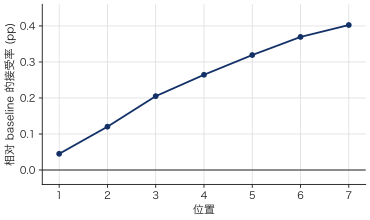{ width="50%" }

### MLA 与历史窗口

MLA 的可训练参数从 615.2M 降至 612.1M，\(\tau\) 下降 0.45%，差距未随 draft 位置明显扩大。

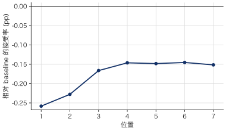{ width="50%" }

MLA 的压缩表示每层每 token 包含 \(512+64=576\) 个数，约为 GQA 的 \(1/3.6\)。当前实现缓存展开后的 K/V，这一比例不代表实际 KV cache 的节省。

进一步缩短历史窗口会降低接受长度，窗口越小损失越大。SWA128 相对 MLA 的 \(\tau\) 下降 5.47%，且差距在训练早期已出现。块内双向 attention 无法完全补偿历史信息的减少。

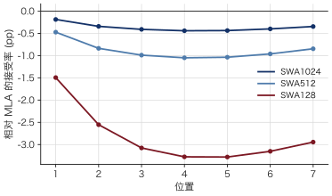{ width="50%" }

### Anchor 输入与块内 K/V

Context-only 和 all-mask 的 \(\tau\) 分别下降 1.76% 和 1.61%，但影响的位置不同：移除块内 K/V 主要影响后续位置，移除 anchor 输入主要影响首位置。两组均保留 Markov head 的前驱 token 输入。

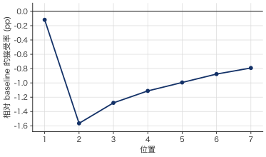{ width="50%" }

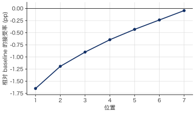{ width="50%" }

### 三层 aux

减少特征层使输入投影参数从 32.77M 降至 19.66M，总可训练参数减少 2.13%，代价是 \(\tau\) 下降 1.52%，后续位置受影响更大。

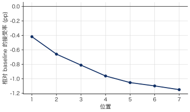{ width="50%" }

<details markdown="1">
<summary>训练过程曲线</summary>

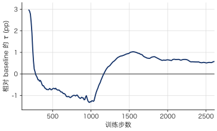{ width="50%" }

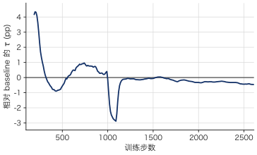{ width="50%" }

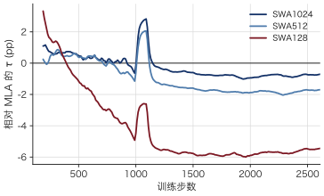{ width="50%" }

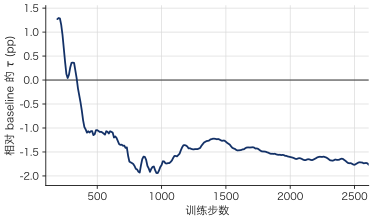{ width="50%" }

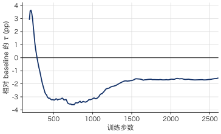{ width="50%" }

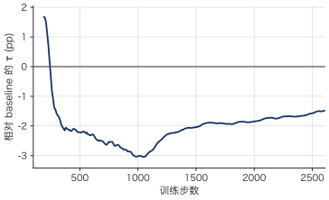{ width="50%" }

</details>

## Evaluation

### Settings

#### 训练数据集

训练消融使用 Open PerfectBlend。我们用 Qwen3-4B 在 non-thinking 模式下重新生成回复，采样参数为 `temperature=0.7`、`top-p=0.8`、`top-k=20`、`min-p=0`，每条回复最多生成 4,096 个 token。重新生成后共有 1,339,875 个训练样本，其 target hidden states 预先缓存，供 offline training 使用。

#### 测试数据集

- **GSM8K** 收录小学数学应用题，通常需要多步算术运算才能得到答案。本文使用全部 1,319 道测试题，比较 prompt 格式、shot 数和采样参数对接受长度的影响。[数据集](https://github.com/openai/grade-school-math)
- **HumanEval** 是 Python 函数补全基准。模型根据函数签名和文档字符串生成实现。本文在 Markov GQA 实验中用它观察代码生成时的接受率。[数据集](https://github.com/openai/human-eval)
- **MT-Bench** 是多轮对话基准，第二轮问题承接第一轮的回答。本文在 Markov GQA 实验中用它比较对话任务上的接受率。[论文](https://arxiv.org/abs/2306.05685)

#### 生成配置

Target 为 Qwen3-4B，采用 non-thinking 模式。Draft 每轮提出 7 个候选 token。

#### 指标

训练时，设 \(p_i\)、\(q_i\) 分别为第 \(i\) 个位置的 target 与 draft 分布。概率采样的接受率为

$$
a_i
=\sum_v\min\bigl(p_i(v),q_i(v)\bigr)
=1-\tfrac12\lVert p_i-q_i\rVert_1.
$$

估算的平均接受长度 \(\tau\) 由各位置接受率的前缀乘积计算，包含一个 bonus token：

$$
\tau
=1+\sum_{i=0}^{6}\prod_{j=0}^{i}a_j.
$$

生成评测直接统计接受的 draft token 总数（`accepted`）和验证轮数（`rounds`）。实测平均接受长度 MAL 按 `1 + accepted / rounds` 计算，其中 1 表示 bonus token。MOL 为每题平均输出的 token 数。`pos-i` 表示前 $i$ 个候选 token 全部被接受的轮次占比。

### 接受率 vs. 评测方法

这组实验使用官方 draft 权重 `deepseek-ai/dspark_qwen3_4b_block7`，在相同采样设置下比较 prompt 格式和 shot 数。Target 的采样参数固定为 `temperature=1`、`top-p=1`、`top-k=-1`、`min-p=0`。Draft 采用概率采样。

<details markdown="1">
<summary>Prompt 与复现设置</summary>

DeepSpec 用户 prompt 为：

```text
{question}
Please reason step by step, and put your final answer within \boxed{}.
```

我们使用自写评测脚本，0-shot 的用户 prompt 如下。

```text
Question: {question}
Answer:
```

5-shot 在测试题之前加入五个示例问答，沿用 `Question: ...\nAnswer: ...` 格式。

DeepSpec 评测的输出上限为 2048 tokens，并发数为 32，seed 从 980406 开始逐题递增。

</details>

<div class="js-sortable-table js-multisort js-row-reorder dspark-three-line dspark-compact" markdown="1">

| 评测方法 | MAL | pos-1 | pos-2 | pos-3 | pos-4 | pos-5 | pos-6 | pos-7 | MOL |
| --- | :---: | ---: | ---: | ---: | ---: | ---: | ---: | ---: | :---: |
| DeepSpec 0-shot | **6.1305** | 93.25% | 86.04% | 79.01% | 72.63% | 66.44% | 60.60% | 55.08% | 305.63 |
| 自写脚本 0-shot | **6.1511** | 93.63% | 86.72% | 79.56% | 73.08% | 66.52% | 60.68% | 54.92% | 248.38 |
| 自写脚本 5-shot | **5.1025** | 88.73% | 78.02% | 67.69% | 57.29% | 47.69% | 39.33% | 31.51% | 143.73 |

</div>

两种评测方法在 0-shot 下的 MAL 接近，但平均输出长度不同。使用自写脚本时，加入 5 个示例后，MAL 从 6.15 降至 5.10（约 17%），平均输出长度从 248 降至 144 tokens/题。后续对比采用自写脚本的 0-shot 设置。

### 接受率 vs. 采样参数

T 表示 target temperature，Top-p、Top-k 为 target 截断参数，min-p 固定为 0。Probabilistic draft 使用相同温度，但不做 top-p/top-k 截断；greedy draft 取最大概率 token。T=0 时两者均采用 greedy。

#### 官方权重

使用 `deepseek-ai/dspark_qwen3_4b_block7`。

<div class="js-sortable-table js-multisort js-row-reorder dspark-three-line dspark-compact dspark-sampling" markdown="1">

| T | Top-p | Top-k | Draft 采样 | **MAL** | pos-1 | pos-2 | pos-3 | pos-4 | pos-5 | pos-6 | pos-7 | MOL |
| :---: | ---: | ---: | --- | :---: | ---: | ---: | ---: | ---: | ---: | ---: | ---: | :---: |
| 1.0 | 1.0 | -1 | probabilistic | **6.1511** | 93.63% | 86.72% | 79.56% | 73.08% | 66.52% | 60.68% | 54.92% | 248.38 |
| 1.0 | 1.0 | -1 | greedy | **5.8528** | 90.82% | 82.53% | 74.72% | 68.03% | 61.80% | 56.39% | 51.00% | 247.51 |
| 0.7 | 0.8 | 20 | probabilistic | **6.2480** | 93.65% | 87.11% | 80.51% | 74.49% | 68.52% | 63.03% | 57.49% | 247.77 |
| 0.7 | 0.8 | 20 | greedy | **6.2437** | 93.43% | 86.86% | 80.05% | 74.34% | 68.54% | 63.24% | 57.91% | 251.56 |
| 0.0 | 1.0 | -1 | greedy | **6.3085** | 94.02% | 87.69% | 81.16% | 75.44% | 69.54% | 64.18% | 58.82% | 248.44 |

</div>

在 T=0.7、top-p=0.8、top-k=20 时，两种 draft 采样方式的 MAL 接近。T=1、无截断时，probabilistic 比 greedy 提高约 5.1%，而输出长度接近。Draft 采样方式的收益取决于 target 的采样设置。

#### Backbone MLA + Markov MLA

该变体将 backbone attention 替换为 MLA，并在原有 Markov head 的 `W₁ → W₂` 之间加入 MLA。Backbone 并行计算各位置的基础 logits，Markov head 则根据上一个生成 token 和 target context，逐步修正 logits 并采样。

<figure id="fig-markov-mla" markdown="span">
  { width="100%" style="display: block; margin: 0 auto;" }
  <figcaption style="color: var(--md-default-fg-color--light); font-style: normal; margin-top: 0;">Fig. 1: Backbone MLA 与 Markov MLA 架构</figcaption>
</figure>

五层 target features 按 token 拼接，经 FC 和 RMSNorm 融合为 \(C\)。Markov MLA 的 Q 来自上一个 token 的 embedding \(z_i=W_1[x_{i-1}]\)，K/V 由 \(C\) 投影得到。以本轮起始 token \(x_0\) 为边界，所有生成步骤都读取同一段早于 \(x_0\) 的 context：

$$
b_i=W_2\,\mathrm{MLA}(z_i,C),\qquad
\ell_i=\ell_i^0+b_i.
$$

其中 \(\ell_i^0\) 为 backbone 的基础 logits，\(b_i\) 为 Markov 修正项。Markov MLA 不加残差，其投影权重与 backbone 独立。

Baseline 和 Backbone MLA + Markov MLA 均采用 online training，学习率为 `3e-4`，训练 1 个 epoch。评测时，客户端并发数与服务端最大请求数均为 32。

<div class="js-sortable-table js-multisort js-row-reorder dspark-three-line dspark-compact dspark-sampling dspark-paired" markdown="1">

| T | Top-p | Top-k | Draft 采样 | 模型 | **MAL** | pos-1 | pos-2 | pos-3 | pos-4 | pos-5 | pos-6 | pos-7 | MOL |
| :---: | ---: | ---: | --- | --- | :---: | ---: | ---: | ---: | ---: | ---: | ---: | ---: | :---: |
| 0.7 | 0.8 | 20 | probabilistic | Baseline | <u>**5.5296**</u> | 90.66% | 80.98% | 71.91% | 63.88% | 55.85% | 48.38% | 41.32% | 245.48 |
| 0.7 | 0.8 | 20 | probabilistic | Markov MLA | **5.5191** | 90.11% | 80.34% | 71.45% | 63.58% | 55.78% | 48.67% | 41.99% | 246.44 |
| 0.7 | 0.8 | 20 | greedy | Baseline | <u>**5.5286**</u> | 90.15% | 80.46% | 71.62% | 63.67% | 55.85% | 48.84% | 42.27% | 247.83 |
| 0.7 | 0.8 | 20 | greedy | Markov MLA | **5.5041** | 89.79% | 79.81% | 70.92% | 63.17% | 55.67% | 48.76% | 42.30% | 246.93 |
| 1.0 | 1.0 | -1 | probabilistic | Baseline | **5.3181** | 89.75% | 79.12% | 69.09% | 60.25% | 51.88% | 44.34% | 37.36% | 249.02 |
| 1.0 | 1.0 | -1 | probabilistic | Markov MLA | <u>**5.3552**</u> | 89.37% | 78.82% | 69.21% | 60.69% | 52.76% | 45.70% | 38.98% | 247.19 |
| 1.0 | 1.0 | -1 | greedy | Baseline | **5.2065** | 87.52% | 76.22% | 66.42% | 58.17% | 50.62% | 44.03% | 37.68% | 249.29 |
| 1.0 | 1.0 | -1 | greedy | Markov MLA | <u>**5.2404**</u> | 87.78% | 76.47% | 66.93% | 58.78% | 51.21% | 44.56% | 38.32% | 246.08 |
| 0.0 | 1.0 | -1 | greedy | Baseline | <u>**5.6057**</u> | 90.94% | 81.60% | 72.69% | 64.87% | 57.19% | 50.05% | 43.24% | 252.05 |
| 0.0 | 1.0 | -1 | greedy | Markov MLA | **5.6015** | 90.49% | 81.18% | 72.38% | 64.56% | 57.24% | 50.39% | 43.91% | 251.15 |

</div>

### Markov GQA

Markov GQA 沿用 baseline 的 5 层 GQA backbone，在 Markov head 的 `W₁` 与 `W₂` 之间加入 GQA（32 个 Q heads、8 个 KV heads）。该 GQA 的位置对应 [Fig. 1](#fig-markov-mla) 中 Markov head 的 MLA。Baseline 与 Markov GQA 均采用 online training，训练约 10 个 epoch。

**GSM8K**：

<div class="js-sortable-table js-multisort js-row-reorder dspark-three-line dspark-compact dspark-sampling dspark-paired" markdown="1">

| T | Top-p | Top-k | Draft 采样 | 模型 | **MAL** | pos-1 | pos-2 | pos-3 | pos-4 | pos-5 | pos-6 | pos-7 | MOL |
| :---: | ---: | ---: | --- | --- | :---: | ---: | ---: | ---: | ---: | ---: | ---: | ---: | :---: |
| 0.7 | 0.8 | 20 | probabilistic | Baseline | <u>**6.2462**</u> | 93.69% | 87.20% | 80.60% | 74.52% | 68.51% | 62.78% | 57.31% | 249.19 |
| 0.7 | 0.8 | 20 | probabilistic | Markov GQA | **6.1649** | 92.88% | 86.01% | 78.97% | 73.16% | 67.31% | 61.68% | 56.47% | 247.49 |
| 0.7 | 0.8 | 20 | greedy | Baseline | <u>**6.2296**</u> | 93.44% | 86.80% | 80.13% | 74.21% | 68.27% | 62.70% | 57.41% | 252.57 |
| 0.7 | 0.8 | 20 | greedy | Markov GQA | **6.1676** | 92.79% | 85.90% | 79.08% | 73.12% | 67.29% | 61.87% | 56.72% | 251.82 |
| 1.0 | 1.0 | -1 | probabilistic | Baseline | <u>**6.1923**</u> | 93.70% | 86.86% | 80.04% | 73.65% | 67.37% | 61.75% | 55.87% | 249.34 |
| 1.0 | 1.0 | -1 | probabilistic | Markov GQA | **6.1198** | 93.08% | 85.97% | 78.63% | 72.41% | 66.26% | 60.61% | 55.02% | 247.33 |
| 1.0 | 1.0 | -1 | greedy | Baseline | <u>**5.8211**</u> | 90.49% | 81.81% | 74.07% | 67.62% | 61.44% | 56.05% | 50.63% | 249.36 |
| 1.0 | 1.0 | -1 | greedy | Markov GQA | **5.8080** | 90.33% | 81.65% | 73.83% | 67.22% | 61.24% | 55.82% | 50.71% | 248.13 |
| 0.0 | 1.0 | -1 | greedy | Baseline | <u>**6.3319**</u> | 94.05% | 87.84% | 81.67% | 75.89% | 69.96% | 64.65% | 59.13% | 248.59 |
| 0.0 | 1.0 | -1 | greedy | Markov GQA | **6.2771** | 93.50% | 87.18% | 80.53% | 74.88% | 69.12% | 63.81% | 58.68% | 251.46 |

</div>

**HumanEval**：

<div class="js-sortable-table js-multisort js-row-reorder dspark-three-line dspark-compact dspark-sampling dspark-paired" markdown="1">

| T | Top-p | Top-k | Draft 采样 | 模型 | **MAL** | pos-1 | pos-2 | pos-3 | pos-4 | pos-5 | pos-6 | pos-7 |
| :---: | ---: | ---: | --- | --- | :---: | ---: | ---: | ---: | ---: | ---: | ---: | ---: |
| 0.7 | 0.8 | 20 | probabilistic | Baseline | <u>**5.9714**</u> | 92.38% | 83.54% | 75.99% | 69.73% | 64.13% | 58.61% | 52.76% |
| 0.7 | 0.8 | 20 | probabilistic | Markov GQA | **5.7729** | 90.91% | 81.45% | 73.74% | 66.66% | 60.28% | 54.98% | 49.25% |
| 0.7 | 0.8 | 20 | greedy | Baseline | <u>**5.8489**</u> | 91.77% | 82.23% | 74.83% | 67.70% | 61.66% | 56.27% | 50.44% |
| 0.7 | 0.8 | 20 | greedy | Markov GQA | **5.8488** | 91.69% | 82.17% | 74.78% | 67.74% | 61.56% | 56.41% | 50.53% |
| 1.0 | 1.0 | -1 | probabilistic | Baseline | <u>**5.8079**</u> | 91.71% | 82.40% | 74.41% | 67.07% | 60.75% | 55.17% | 49.29% |
| 1.0 | 1.0 | -1 | probabilistic | Markov GQA | **5.7864** | 91.15% | 82.20% | 74.21% | 67.43% | 60.40% | 54.58% | 48.68% |
| 1.0 | 1.0 | -1 | greedy | Baseline | <u>**5.6532**</u> | 89.78% | 79.80% | 72.02% | 64.69% | 58.60% | 53.01% | 47.41% |
| 1.0 | 1.0 | -1 | greedy | Markov GQA | **5.6432** | 89.89% | 79.29% | 71.84% | 64.56% | 58.37% | 52.92% | 47.46% |
| 0.0 | 1.0 | -1 | greedy | Baseline | **5.9855** | 92.37% | 83.40% | 76.22% | 69.69% | 64.31% | 59.31% | 53.25% |
| 0.0 | 1.0 | -1 | greedy | Markov GQA | <u>**6.0151**</u> | 92.12% | 83.67% | 77.03% | 70.07% | 64.44% | 59.68% | 54.51% |

</div>

**MTBench**：

<div class="js-sortable-table js-multisort js-row-reorder dspark-three-line dspark-compact dspark-sampling dspark-paired" markdown="1">

| T | Top-p | Top-k | Draft 采样 | 模型 | **MAL** | pos-1 | pos-2 | pos-3 | pos-4 | pos-5 | pos-6 | pos-7 |
| :---: | ---: | ---: | --- | --- | :---: | ---: | ---: | ---: | ---: | ---: | ---: | ---: |
| 0.7 | 0.8 | 20 | probabilistic | Baseline | <u>**3.8245**</u> | 78.76% | 59.46% | 45.31% | 34.40% | 26.65% | 21.14% | 16.73% |
| 0.7 | 0.8 | 20 | probabilistic | Markov GQA | **3.7522** | 77.29% | 58.14% | 43.86% | 33.50% | 25.75% | 20.32% | 16.36% |
| 0.7 | 0.8 | 20 | greedy | Baseline | **3.7655** | 77.80% | 58.53% | 43.83% | 33.69% | 26.06% | 20.38% | 16.26% |
| 0.7 | 0.8 | 20 | greedy | Markov GQA | <u>**3.8650**</u> | 77.41% | 58.94% | 45.50% | 35.34% | 27.87% | 22.79% | 18.65% |
| 1.0 | 1.0 | -1 | probabilistic | Baseline | <u>**3.7381**</u> | 78.23% | 59.17% | 44.30% | 33.14% | 24.80% | 19.14% | 15.03% |
| 1.0 | 1.0 | -1 | probabilistic | Markov GQA | **3.6771** | 76.88% | 57.71% | 42.89% | 32.12% | 24.47% | 18.96% | 14.69% |
| 1.0 | 1.0 | -1 | greedy | Baseline | <u>**3.4888**</u> | 73.58% | 53.50% | 39.30% | 29.25% | 22.29% | 17.20% | 13.77% |
| 1.0 | 1.0 | -1 | greedy | Markov GQA | **3.4255** | 72.12% | 52.19% | 37.93% | 28.30% | 21.80% | 16.94% | 13.26% |
| 0.0 | 1.0 | -1 | greedy | Baseline | <u>**4.0498**</u> | 79.90% | 62.64% | 48.69% | 38.38% | 30.34% | 24.59% | 20.43% |
| 0.0 | 1.0 | -1 | greedy | Markov GQA | **4.0402** | 79.30% | 61.57% | 48.06% | 38.13% | 30.73% | 25.27% | 20.95% |

</div>

### Baseline vs. DrawSpec

DrawSpec 将五层 backbone 分为四层预计算和一层条件化，最后一层输入为 anchor + 6 states。此处使用 late-conditioning 分支的 12-state 权重，与 baseline 均训练约 1 epoch，target temperature 为 0.7。

<div class="js-sortable-table js-multisort js-row-reorder dspark-three-line dspark-compact" markdown="1">

| 模型 | **MAL** | pos-1 | pos-2 | pos-3 | pos-4 | pos-5 | pos-6 | pos-7 | MOL |
| --- | :---: | ---: | ---: | ---: | ---: | ---: | ---: | ---: | :---: |
| Baseline | **5.5271** | 90.67% | 81.04% | 71.74% | 63.77% | 55.84% | 48.34% | 41.32% | 247.98 |
| DrawSpec | **4.7163** | 85.80% | 70.82% | 59.19% | 49.87% | 41.73% | 35.07% | 29.14% | 248.58 |

</div>

两组输出长度接近，DrawSpec 的 MAL 下降约 14.7%。

## 历史评测

<details markdown="1">
<summary>早期 online / offline 评测记录</summary>

### Online training 与官方权重

在 vLLM 服务上评测 GSM8K test 全集 1,319 题。自训练 baseline 训练至 step 2616（约 1 epoch）。Prompt 使用 `Question: {question}\nAnswer:` 格式。Target 使用 **non-thinking**，采样参数为 **temperature=0.7、top-p=0.8、top-k=20、min-p=0**；Draft 均采用 **greedy**，每轮提出 7 个 draft tokens。

<div class="js-sortable-table js-multisort js-row-reorder dspark-three-line dspark-compact" markdown="1">

| 权重 | 峰值学习率 | MAL | pos-1 | pos-2 | pos-3 | pos-4 | pos-5 | pos-6 | pos-7 |
| --- | --- | :---: | ---: | ---: | ---: | ---: | ---: | ---: | ---: |
| 自训练 Online | \(3\times10^{-4}\) | 4.3013 | 85.29% | 70.73% | 56.23% | 42.57% | 32.30% | 24.66% | 18.34% |
| 官方权重 | — | 5.1804 | 89.00% | 78.72% | 68.65% | 58.42% | 49.22% | 40.80% | 33.21% |

</div>

### Offline training（5-shot）

<div class="js-sortable-table js-multisort js-row-reorder dspark-three-line dspark-compact" markdown="1">

| 权重 | 峰值学习率 | MAL | pos-1 | pos-2 | pos-3 | pos-4 | pos-5 | pos-6 | pos-7 |
| --- | --- | :---: | ---: | ---: | ---: | ---: | ---: | ---: | ---: |
| 自训练 Offline | \(6\times10^{-4}\) | 4.5908 | 86.33% | 73.03% | 60.17% | 48.10% | 38.23% | 29.82% | 23.40% |

</div>

</details>
