# Qwen3.8-Flash-Next DSpark 架构探索

以 Qwen3.8-Flash-Next 为目标模型（Target），冻结其参数，训练三层 DSpark 草稿模型（draft）。各实验使用相同的数据和隐藏状态缓存，比较不同结构的收敛情况、候选选择和接受长度。

## Baseline 架构

Baseline 采用标准 DSpark 结构。三层 draft 主干网络一次生成各预测位置的隐藏状态，LM head 将其映射为初始 logits。Markov head 根据前驱 token 添加偏置，confidence head 预测对应位置的分布重叠率。

{ width="100%" }

图示以 D 为 anchor；实际 block size 为 7，预测 E–K。

### DSpark 主干网络

设 block size 为 \(B\)，token embedding 为 \(E(\cdot)\)。对于前缀 `[... A B C]` 与新 anchor D，draft 输入为

$$
X=[E(D),\underbrace{E(\mathrm{MASK}),\ldots,E(\mathrm{MASK})}_{B-1\text{ 个槽}}],
\qquad B=7.
$$

MASK 槽共享输入 embedding，并使用不同的位置编号。anchor 槽对应 \(h_1\)，用于预测 E，后续槽依次预测 F – K。对 anchor 之前的每个位置 \(j\)，拼接 Target 第 45、46、47 层的隐藏状态，经投影与归一化得到上下文特征：

$$
c_j=\operatorname{RMSNorm}\!\left(
W_{\mathrm{aux}}[H_j^{45};H_j^{46};H_j^{47}]
\right),
\qquad
W_{\mathrm{aux}}:\mathbb R^{7680}\rightarrow\mathbb R^{2560}.
$$

\(W_{\mathrm{aux}}\) 为可训练的无偏置投影。每个 query 可读取 anchor 之前的有效 Target 上下文及自身 block 的全部输入槽；anchor 本身通过 token embedding 输入。

每层的 query 来自当前 draft 隐藏状态，上下文特征与当前 block 隐藏状态分别经过该层的 K/V 投影，沿序列维拼接后在同一次 attention 中读取。三层共享 \(c_j\)，但各层的 Q/K/V 投影参数独立。Draft 状态通过 attention、残差连接和 MLP 逐层更新，最终经 RMSNorm 得到 \(h_1,\ldots,h_B\)，再由冻结的 LM head 并行生成全词表初始 logits \(\ell_1^0,\ldots,\ell_B^0\)。

### Markov 顺序修正

令 \(t_0=D\)，\(t_i\) 为第 \(i\) 个生成位置的 token。Markov head 将前驱 token 映射为低秩表示 \(m_i\)，再投影为词表偏置 \(b_i\)：

$$
\begin{aligned}
m_i&=W_1[t_{i-1}]\in\mathbb R^{256},\\
b_i&=W_2m_i,\\
\ell_i&=\ell_i^0+b_i,\qquad
q_i=\operatorname{softmax}(\ell_i).
\end{aligned}
$$

\(W_1\) 与 \(W_2\) 均参与训练。前驱 token 提供偏置，上下文信息由 \(\ell_i^0\) 提供；greedy 选择 \(\hat t_i=\arg\max_v\ell_i(v)\)。

训练使用参考前驱 token，所有位置的 Markov 修正可并行计算。推理使用实际选出的前驱 token，依次查表、修正 logits 并选择下一个 token。主干网络的隐藏状态在整轮内保持不变。

### Confidence head 与训练目标

Confidence head 将 draft 隐藏状态 \(h_i\in\mathbb R^{2560}\) 与词表投影前的 Markov 表示 \(m_i\in\mathbb R^{256}\) 拼接为 2816 维向量，经线性层与 sigmoid 预测分布重叠率：

$$
s_i=w_c^\top[h_i;m_i]+b_c,
\qquad
\hat a_i=\sigma(s_i).
$$

监督目标为 teacher 与 Markov 修正后 draft 分布的重叠率 \(a_i\in[0,1]\)。将 \(a_i\) 作为停止梯度的软标签，以二元交叉熵训练：

$$
L_{\mathrm{conf},i}
=-a_i\log\hat a_i-(1-a_i)\log(1-\hat a_i).
$$

该损失推动预测值 \(\hat a_i\) 接近标签 \(a_i\)。Confidence head 估计分布重叠率，token 仍由修正后的 logits 选择。

基础训练目标由三项损失组成：CE 监督数据中记录的下一个 token，L1 拟合 teacher 的全词表分布，confidence loss 拟合分布重叠率。三项损失均在有效 response 位置按实验设置中的位置衰减权重求平均。

## Engram 增强 Markov head

Engram-Markov 在前驱 token 的低秩表示中加入 n-gram 特征，由当前 draft 隐藏状态控制其权重。主干网络与 MASK 输入保持不变。

{ width="100%" }

### 门控与特征注入

\(e_{i-1}\in\mathbb R^{2560}\) 为截至前驱 token \(t_{i-1}\) 的 n-gram 查表特征。

Draft 隐藏状态提供 query，Engram 特征提供 key 和 value。以下 RMSNorm 均不含可训练缩放参数，Markov rank 为 \(r=256\)，则

$$
\begin{aligned}
\bar e_{i-1}&=\operatorname{RMSNorm}(e_{i-1}),\\
\mathbf q_i&=\operatorname{RMSNorm}\!\left(W_Q\operatorname{RMSNorm}(h_i)\right),\\
\mathbf k_i&=\operatorname{RMSNorm}(W_K\bar e_{i-1}),\qquad
\mathbf v_i=W_V\bar e_{i-1},\\
s_i&=\frac{\mathbf q_i^\top\mathbf k_i}{\sqrt r},\\
g_i&=\sigma\!\left(\operatorname{sign}(s_i)
\sqrt{\max(|s_i|,10^{-6})}\right).
\end{aligned}
$$

各位置独立计算门值，增强后的 Markov 表示与 logits 为

$$
m_i=W_1[t_{i-1}]+g_i\mathbf v_i,
\qquad
\ell_i=\ell_i^0+W_2m_i.
$$

Confidence head 同样读取增强后的 \(m_i\)。

三个无偏置投影均为 \(2560\rightarrow256\)，新增 1.97M 参数。\(W_V\) 零初始化，初始 Engram 残差为零。

### 训练与推理

训练读取参考前驱位置的 Engram 缓存，并行计算各位置的门控与修正；推理随实际生成前缀逐 token 查表。Engram 表另占存储空间，查表和特征传输增加推理耗时。

### 训练准确率

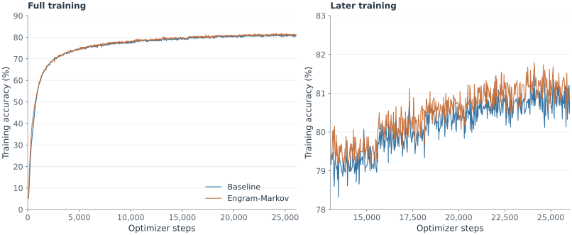{ width="100%" }

两种方法的准确率均在训练初期快速提高，随后逐渐趋缓，整体收敛形态接近。Engram-Markov 在后半程整体略高于 Baseline。第 10 epoch 结束时，两者的训练准确率分别为 81.21% 和 80.88%，相差约 0.34 个百分点。

#### 第 10 epoch 的逐位置准确率

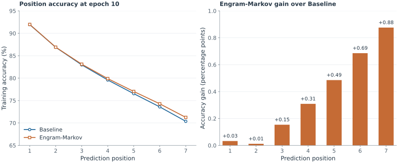{ width="100%" }

两种方法的准确率均随预测位置后移而下降，前两个位置基本重合。Engram-Markov 的优势主要出现在后段，第 5–7 位分别提高约 0.49、0.69、0.88 个百分点。

### 训练损失

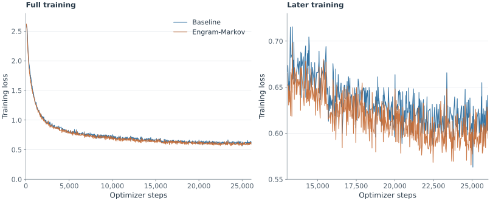{ width="100%" }

两种方法的总训练损失整体下降，Engram-Markov 的后期损失整体更低。第 10 epoch 结束时，Baseline 与 Engram-Markov 的损失分别为 0.6103 和 0.5944，后者相对降低约 2.62%。

### 置信度误差

`confidence_abs_error` 聚合各有效位置的置信度预测绝对误差：

$$
\left|\hat a_i-a_i\right|,
\qquad
a_i=\sum_v\min\bigl(p_i(v),q_i(v)\bigr).
$$

其中，\(p_i\) 与 \(q_i\) 分别为 teacher 和 draft 的概率分布，\(a_i\) 是二者的分布重叠率，也是训练时的监督目标；\(\hat a_i\) 是 confidence head 经 sigmoid 得到的预测值。误差越小，预测越接近监督目标。

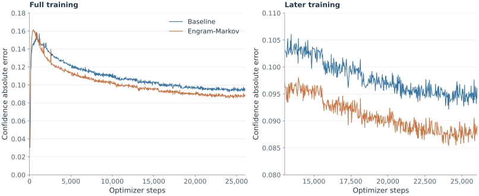{ width="100%" }

两种方法的误差在训练初期升至约 0.16，随后逐步下降。Engram-Markov 的后期误差整体低于 Baseline。第 10 epoch 结束时，Baseline 与 Engram-Markov 的误差分别为 0.0942 和 0.0874，后者相对降低约 7.26%，置信度预测更接近监督目标。

### 归一化设计与理论分析

**双重归一化的冗余。** Query 在投影前后各做一次 RMSNorm。由于归一化不含可训练缩放、投影无偏置，忽略数值稳定项与浮点误差时，第一次归一化产生的整体缩放会被第二次抵消。因此，投影前的归一化不增加表达能力，但会改变中间计算的数值范围。

**缺少可训练缩放的影响。** 本实验固定 query/key 归一化后的幅度，而 Target 的 PLE 保留逐维可训练缩放。[Target 参考实现](https://github.com/huggingface/transformers/blob/main/src/transformers/models/qwen4_exp/modeling_qwen4_exp.py#L1067-L1129) 可训练缩放能够调整各维度对匹配分数的贡献，以及整体门控强度。现有投影层已能学习特征选择和方向匹配，但整体放大投影权重会被归一化抵消，不能以此调整门控温度。缺少缩放可能使门控偏软或偏硬，影响 Engram 特征的注入强度，实际效果尚无消融验证。

## Engram 增强 MASK 输入

两种方案均读取 anchor 前一个位置的 Engram 特征，经投影后用于构造六个 MASK 槽的输入。直接替换方案使用投影特征替换 MASK embedding，门控残差方案将其叠加到原 MASK embedding 上。两者的 anchor 均保留 token embedding，后续使用 vanilla Markov head。设 anchor 位置为 \(a\)，共享特征为

$$
z_a=\operatorname{RMSNorm}(Pe_{a-1}),
\qquad P\in\mathbb R^{2560\times2560}.
$$

\(P\) 为随机初始化的无偏置投影，RMSNorm 无可训练仿射参数。六个槽共享 \(z_a\)，保留各自的位置编号、RoPE 和块内双向 attention。

### 直接替换

{ width="67%" }

$$
X_a=[E(x_a),\underbrace{z_a,\ldots,z_a}_{6\text{ 个槽}}].
$$

\(z_a\) 从训练开始直接替换六个 MASK embedding。新增参数为投影矩阵 \(P\)，共 \(2560^2=6{,}553{,}600\)。

#### 训练曲线

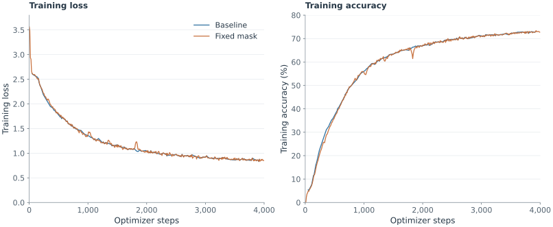{ width="100%" }

前 4,000 步中，Fixed mask 与 Baseline 的损失和准确率曲线大部分重合，整体收敛趋势接近。

### 门控残差

保留原 MASK embedding，通过逐槽标量门控制 Engram 残差的注入幅度。

{ width="67%" }

$$
u_{a,0}=E(x_a),
\qquad
u_{a,j}=E(\mathrm{MASK})+\tanh(\theta_j)z_a,
\quad j=1,\ldots,6.
$$

每槽一个可训练标量 \(\theta_j\)，由所有样本共享，零初始化后输入与 baseline 相同。门值离开零后，投影 \(P\) 开始获得任务梯度。新增参数为 \(2560^2+6=6{,}553{,}606\)。

#### 训练曲线

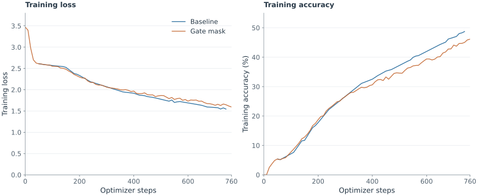{ width="100%" }

两种方法在训练初期的曲线接近。约 300 步后，Gate mask 的损失整体高于 Baseline，准确率整体低于 Baseline。

## Prefix reranker

Prefix reranker 用块内因果 Transformer 编码 anchor 与已选 token，结合当前 draft 隐藏状态，对 Markov top-16 候选进行残差打分，使候选选择利用整个块内前缀。

{ width="100%" }

### 候选与前缀表示

在第 \(i\) 个预测位置，先构造待重排的候选 token 集合 \(C_i\)，并将当前块内前缀编码为向量 \(r_i\)。令 \(t_0\) 为 anchor，\(t_1,\ldots,t_{i-1}\) 为其后的前缀 token。训练时使用参考 token，推理时使用当前轮已经选出的 token。

候选集合来自原 DSpark 的预测。Markov head 使用前驱 token \(t_{i-1}\) 查表得到低秩表示，再通过输出矩阵 \(W_2\) 修正主干网络给出的初始 logits：

$$
\ell_i(v)=\ell_i^0(v)+W_2[v,:]\,W_1[t_{i-1}],
\qquad
C_i=\operatorname{Top16}(\ell_i).
$$

其中，\(v\) 为词表中的 token，\(W_2[v,:]\) 为输出矩阵中对应 token 的一行。\(C_i\) 包含修正后分数最高的 16 个 token，reranker 随后在这 16 个候选中重新评分和选择。

前缀表示由一个因果 Prefix Transformer 生成。它读取当前 block 内从 anchor 到前驱 token 的序列 \([t_0,\ldots,t_{i-1}]\)。每个 token 复用 Markov head 的参数表 \(W_1\) 得到 256 维向量，再经过线性投影，加上可学习的块内位置 embedding，送入 Transformer。取最后一个输入 token \(t_{i-1}\) 对应的输出，经 LayerNorm 得到 \(r_i\in\mathbb R^{256}\)。该位置通过因果 attention 读取整个已有块内前缀。

例如，以 D 为 anchor，前两步已选出 E、F，当前要预测第三个 token G。Markov head 使用 F 修正 \(\ell_3^0\)，得到候选集合 \(C_3\)；Prefix Transformer 读取 `[D, E, F]`，取 F 所在位置的输出形成 \(r_3\)。下一节将 \(r_3\) 与当前 draft 隐藏状态 \(h_3\) 结合，对 \(C_3\) 中的候选进行残差打分。

Prefix Transformer 只编码当前 block 内的前缀，anchor 之前的历史上下文由 draft 隐藏状态 \(h_i\) 提供。该 Transformer 采用一个 pre-norm 因果层，宽度为 256，包含 4 个 attention heads，FFN 为 \(256\rightarrow1024\rightarrow256\)，使用 SiLU。

### 残差打分

对于候选集合 \(C_i\) 中的每个 token，reranker 计算一个分数修正量 \(\Delta_i(v)\)，加到原 DSpark 分数 \(\ell_i(v)\) 上。修正量由两个向量的内积得到：查询向量 \(u_i\) 表示当前位置的上下文与块内前缀，候选向量 \(k_v\) 表示待评分的 token。

查询向量由 draft 隐藏状态 \(h_i\) 和前缀表示 \(r_i\) 共同构造。先用 \(W_h\) 将 2560 维的 \(h_i\) 投影到 256 维，再与 256 维的 \(r_i\) 拼接为 512 维向量，经线性变换、SiLU 激活和输出投影得到 \(u_i\in\mathbb R^{256}\)：

$$
u_i=W_o\,\operatorname{SiLU}\!\left(W_q[W_hh_i;r_i]+\beta_q\right).
$$

其中，\([\,;\,]\) 表示向量拼接，\(W_q\) 与 \(\beta_q\) 为拼接后的线性变换参数，\(W_o\) 为输出投影。当前位置的 16 个候选共享同一个 \(u_i\)。

候选向量复用 Markov head 的输出矩阵 \(W_2\)。对每个候选 token \(v\)，取其对应的 256 维行向量 \(W_2[v,:]\)，转为列向量后，通过可训练投影 \(W_c\) 得到 \(k_v\in\mathbb R^{256}\)：

$$
k_v=W_cW_2[v,:]^\top.
$$

将查询向量与各候选向量做内积，并除以 \(\sqrt{256}\) 缩放，得到残差分数。最终分数和 greedy 选择为

$$
\begin{aligned}
\Delta_i(v)&=\frac{u_i^\top k_v}{\sqrt{256}},\\
s_i(v)&=\ell_i(v)+\Delta_i(v),\qquad v\in C_i,\\
\hat t_i&=\arg\max_{v\in C_i}s_i(v).
\end{aligned}
$$

\(\Delta_i(v)\) 为正时提高该候选的分数，为负时降低其分数。重排后的选择由原分数与修正量共同决定，候选范围仍为 \(C_i\)。

沿用预测 G 的例子，\(h_3\) 与编码了 `[D, E, F]` 的 \(r_3\) 共同形成 \(u_3\)。对 \(C_3\) 中的 16 个候选，分别计算 \(u_3^\top k_v/\sqrt{256}\)，加到各自的 \(\ell_3(v)\) 上，再选择总分最高的 token。前缀表示与查询向量在该位置各计算一次，16 个候选的内积评分可以并行完成。

输出投影 \(W_o\) 零初始化，因此初始 \(u_i=0\)，所有候选的修正量 \(\Delta_i(v)=0\)，重排分数与原 DSpark 分数相同。并列最高分时优先保留原 DSpark 的选择，使初始 greedy 选择与原模型一致。

### 训练目标与更新范围

训练沿用现有的 Target 隐藏状态缓存，并使用参考 token 构造块内前缀。例如，以 D 为 anchor、参考预测序列为 `[E, F, G, H, I, J, K]` 时，Prefix Transformer 的输入为 `[D, E, F, G, H, I, J]`，即在预测序列前放入 anchor，并去掉最后一个 token。因果掩码使各位置只读取截至自身的输入：预测 E 的位置读取 D，预测 F 的位置读取 `[D, E]`，预测 G 的位置读取 `[D, E, F]`。因此，一次前向计算即可得到所有预测位置的前缀表示 \(r_1,\ldots,r_7\)。Markov head 同样使用对应的参考前驱 token，生成各位置的 top-16 候选集合 \(C_i\)。

重排训练要求模型在候选中选出 teacher 分数最高的 token。记 \(p_i\) 为缓存参考前缀对应的 teacher 分布，监督标签为

$$
v_i^\star=\arg\max_v p_i(v).
$$

这里，参考 token 用于构造训练输入，teacher argmax 用作重排标签。由于参考回复由采样生成，记录的下一个 token 与 \(v_i^\star\) 可能不同。

排序损失只在具有有效监督、且 \(v_i^\star\) 已进入候选集合 \(C_i\) 的位置计算。例如，在预测 G 的位置，若 teacher argmax 为 G 且 \(G\in C_3\)，就对 \(C_3\) 中的 16 个重排分数做 softmax，以 G 为标签计算交叉熵。如果 G 没有进入 \(C_3\)，该位置跳过排序损失，因为 reranker 只能在已有候选中选择。

记这些有效且候选命中的位置构成集合 \(\mathcal H\)。对每个命中位置，候选内 softmax 给标签 \(v_i^\star\) 分配的概率越高，交叉熵越小。将各位置的损失按位置权重求平均，得到

$$
L_{\mathrm{rank}}
=-\frac{
\sum_{i\in\mathcal H} w_i
\log\frac{\exp s_i(v_i^\star)}
{\sum_{v\in C_i}\exp s_i(v)}
}{
\sum_{i\in\mathcal H}w_i
}.
$$

其中，\(s_i(v)\) 为上一节定义的重排分数，\(w_i=\exp(-(i-1)/4)\)，\(i\) 为块内预测位置，从 1 开始。越靠后的预测位置权重越小。公式省略样本和 block 下标，求和覆盖当前 batch 中所有 block 的有效命中位置，分母为这些位置的权重之和。当前 batch 没有命中位置时，令 \(L_{\mathrm{rank}}=0\)。

联合训练同时保留基于重排前预测计算的原 DSpark 基础目标：

$$
L=L_{\mathrm{base}}+L_{\mathrm{rank}}.
$$

\(L_{\mathrm{base}}\) 包含 token CE、teacher 分布的 L1 拟合损失和 confidence loss，作用于全部有效监督位置。\(L_{\mathrm{rank}}\) 作用于候选命中位置，训练候选之间的相对分数。因此，未命中的位置仍参与基础训练。

两组实验的初始化和参数更新范围如下：

| 实验 | 初始化 | 更新范围 |
| --- | --- | --- |
| 联合训练 | 从头训练 DSpark 与 reranker | 更新 draft 主干网络、Markov head、confidence head 和 reranker 新增参数；Target backbone、token embedding 与 LM head 保持冻结 |
| 冻结基线 | 加载已训练 2,604 步的 baseline，初始化 reranker 新增参数 | 固定已有主干网络、Markov head 和 confidence head，仅更新 reranker 新增参数 |

Markov 参数 \(W_1,W_2\) 被原 DSpark 和 reranker 共同使用：联合训练时参与更新，冻结基线实验中保持固定。

冻结基线实验会重新初始化优化器与学习率调度。曲线横轴显示“此前 2,604 步 + 本次新增步数”，学习率则只按本次新增步数调度。例如，新增训练 100 步后，曲线横轴为 2,704，学习率调度对应本次训练的第 100 步。

### 训练曲线

比较联合训练的 Prefix reranker 与 Baseline，横轴取两种方法较小的最终 step 18,630。

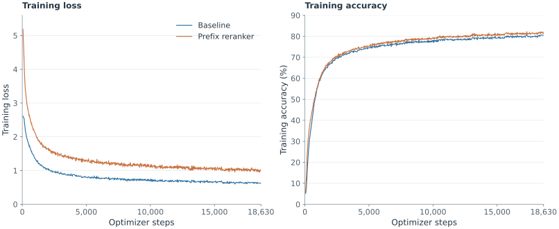{ width="67%" }

两条损失曲线均逐步下降。Baseline 的训练目标为 \(L_{\mathrm{base}}\)，联合训练的 reranker 目标为 \(L_{\mathrm{base}}+L_{\mathrm{rank}}\)。在共同终点 step 18,630，损失分别为 0.6321 和 1.0037。

Prefix reranker 的后期训练准确率整体更高。在 step 18,630，Baseline 与 Prefix reranker 的准确率分别为 80.57% 和 82.00%，后者提高约 1.43 个百分点。

#### 逐位置准确率

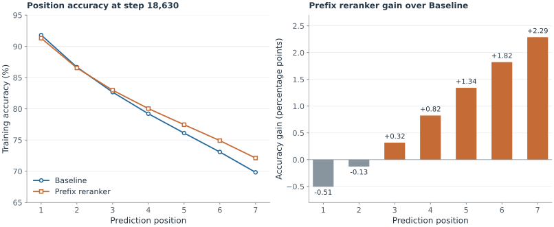{ width="67%" }

Prefix reranker 在第 1、2 位的准确率分别降低约 0.51、0.13 个百分点，第 3–7 位均有提高。收益主要集中在后段，第 5–7 位分别提高约 1.34、1.82、2.29 个百分点。

### 重排评估

以下四项指标来自 Prefix reranker 的导出记录，每项包含 1,000 个数据点，覆盖 step 50–18,630，曲线未做平滑。三项增益均比较同一 checkpoint、同一批 anchor 上重排前后的结果。

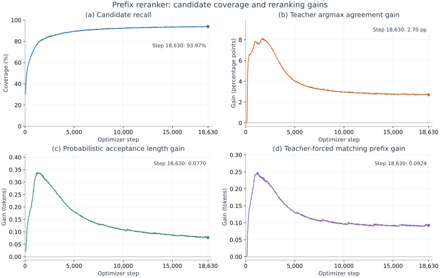{ width="100%" }

**候选覆盖率。** `reranker/candidate_recall` 统计 teacher argmax 落在 Markov top-16 内的比例。覆盖率从首个记录点的 30.57% 整体提高，后期增幅趋缓，在 step 18,630 达到 93.97%。该指标反映候选生成阶段能否保留目标 token。在相同评估位置和统计口径下，它也是重排后选中 teacher argmax 的比例上界。终点仍有约 6.03% 的位置未覆盖 teacher argmax，这些位置无法仅靠候选内重排选中目标。

**Teacher argmax 一致率增益。** `rerank_target_agreement_gain` 是重排后与重排前选中 teacher argmax 的比例之差，图中转换为百分点。增益在训练早期快速上升，随后回落，后期趋于稳定。step 18,630 的增益为 2.70 个百分点，说明此时重排仍能改善候选选择。这一差值比较的是同一个联合训练模型内部的两种选择结果，与上一节相对独立 Baseline 的训练准确率提升采用不同的比较对象和标签口径。

**概率接受长度增益。** `rerank_tau_gain` 表示重排后与重排前的 \(\tau_{\mathrm{prob}}\) 之差。其在早期达到较高水平后逐渐回落，终点仍为正，约为 0.0770。重排后的分布由 top-16 修正分数经过 softmax 得到，候选之外的概率置零；重排前的 DSpark 分布与 teacher 分布均在全词表上归一化。因此，该增益同时包含残差打分、top-16 截断和重新归一化的影响。`train/tau_probabilistic` 和 `eval/tau_probabilistic` 使用上述重排后的分布。

**参考前缀连续匹配长度增益。** `rerank_teacher_forced_prefix_gain` 衡量重排前后，与参考 token 序列连续匹配的前缀长度之差。其变化趋势与一致率增益接近，终点为 0.0924 个 token。该指标使用参考 token 作为前驱输入，在 teacher forcing 条件下计算，不能直接视为在线 Target 验证得到的 MAL 增益。

已有曲线显示，训练后期候选覆盖率整体提高，重排增益则逐渐缩小并保持为正。一种可能的解释是，联合训练也改善了原 DSpark 分支的排序质量：排序损失作用于 \(s_i(v)=\ell_i(v)+\Delta_i(v)\)，梯度同时更新主干网络和共享 Markov 参数，因此原分数 \(\ell_i(v)\) 也能从排序监督中学习。当原分支已经选对更多 token，留给残差重排纠正的空间就会缩小。若候选覆盖率为 \(R\)、重排前的 teacher argmax 一致率为 \(A_0\)，则一致率增益至多为 \(R-A_0\)，并不只由 \(R\) 决定。

这一解释尚需验证：当前增益曲线衡量的是联合训练模型内部残差重排的额外收益，不能单独证明原分支改善主导了增益回落，也不能据此判断整体模型效果变差。还需记录重排前后的一致率绝对值，确认原分支的提升是否缩小了重排空间；整体收益则结合独立 Baseline 对照和在线评测判断。

## Draft Memory

Draft Memory 保留上一轮 draft 对后续位置的隐藏表示，供下一轮预测使用。训练分两次执行同一个 draft 模型，复用已有 Target 隐藏状态缓存。

{ width="100%" }

### 两阶段训练

第一阶段不输入 memory，也不保留梯度，计算 draft 最终 RMSNorm 后的隐藏表示。LM head 与 Markov head 使用参考前驱 token 选择分数最高的 token，再找到预测与记录序列首次不匹配的位置。首次不匹配之前的前驱与 greedy 生成一致，因此可以用这次并行计算确定新的 anchor。

图中前两个预测匹配、第三个不匹配时，以参考 token F 为新 anchor，上下文扩展至 E。移除 \(h_1,h_2,h_3\)，保留后缀 \(h_4,h_5\)；这些状态来自原 block 前向，选出错误 token 后不重新计算。

第二阶段输入新 anchor、对应的 Target 上下文和保留的 memory，使用参考前驱 token 计算基础训练损失。梯度由这一阶段回传，更新共享 draft 和 memory 适配器。

### Memory 筛选与读取

令旧 anchor 的绝对位置为 \(a\)，block size 为 \(B\)，第 \(i\) 个输出 hidden 为 \(h_i^{\mathrm{old}}\)，其中 \(i=1,\ldots,B\)。该 hidden 的旧 query 位置为 \(a+i-1\)，预测的 token 位置为 \(a+i\)。若连续匹配了 \(m<B\) 个 token，则

$$
a'=a+m+1,\qquad
\mathcal I=\{m+2,\ldots,B\}.
$$

新 anchor 为 \(a'\)。后缀索引集合 \(\mathcal I\) 中的隐藏表示经共享的无偏置线性投影和带可训练尺度参数的 RMSNorm 转换为 memory：

$$
M_i=\operatorname{RMSNorm}_{\gamma}
\left(P\,\operatorname{stopgrad}(h_i^{\mathrm{old}})\right),
\qquad i\in\mathcal I.
$$

\(P\in\mathbb R^{2560\times2560}\) 随机初始化，\(\gamma\) 为可训练归一化尺度；共新增 6,556,160 个参数，由第二阶段损失优化。

Memory 的 RoPE 位置采用预测位置 \(a+i\)，即旧 query 位置编号加一。因此，首条保留状态对齐新 anchor 后的第一个预测位置 \(a'+1\)。图中 \(h_4,h_5\) 分别对齐 G、H。

Adapter 计算一次，得到的同一组 \(M\) 供三层 draft 使用。每层的 query 来自当前 draft 隐藏状态。将正确上下文、memory 和当前 draft 隐藏状态拼接，再通过该层原有的投影得到 K/V。省略归一化与 RoPE 后，可写为

$$
\operatorname{Attn}_{\ell}
\left(
Q_{\ell}(X_{\ell}),
K_{\ell}([H_{\mathrm{ctx}};M;X_{\ell}]),
V_{\ell}([H_{\mathrm{ctx}};M;X_{\ell}])
\right).
$$

其中 \(H_{\mathrm{ctx}}\) 为投影后的正确前缀特征，\(X_\ell\) 为当前层的 draft 隐藏状态。

若整块全部匹配，则转移至记录序列的 bonus 位置，memory 为空。缺少后续监督或跨越回答边界的样本跳过。其余样本保留全部有效后缀。

### 训练与推理

每步训练增加一次无梯度 draft 前向、后缀筛选、memory 投影与 K/V 计算。

在线推理为每个请求保存上一轮 draft 的最终隐藏表示。Target 验证后，移除已接受位置和首次拒绝位置的状态，将剩余后缀按预测位置用于下一轮。各层通过自身投影生成 memory K/V。

训练用参考序列确定拒绝位置，memory 来自未输入 memory 的第一阶段。在线推理由 Target 验证确定拒绝位置，并连续复用上一轮的隐藏状态，因此可能累积更早轮次的 memory 信息。

### 训练准确率

比较 Draft Memory 与 Baseline 的训练 token 准确率，横轴截取至 Draft Memory 的最终 step 3,510。曲线使用原始导出数据，未做平滑；差值仅在双方均有记录的相同步数上计算，不做插值。

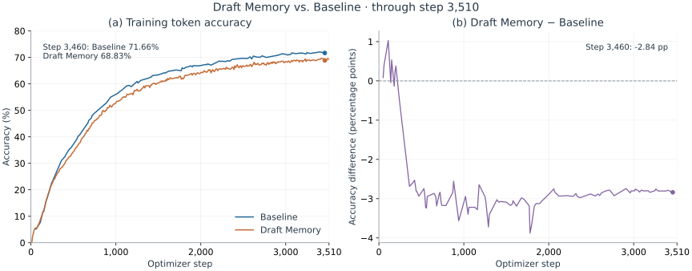{ width="100%" }

两种方法的准确率均随训练提高，但 Draft Memory 整体低于 Baseline。最后一个共同记录点为 step 3,460，此时两者分别为 68.83% 和 71.66%，Memory 低 2.84 个百分点。在 step 1,000–3,510 范围内，72 个共同记录点的差值算术平均约为 −2.99 个百分点。Memory 在 step 3,510 的准确率为 69.19%，仍处于上升阶段，当前短程结果尚未显示准确率收益。

这一差距不能直接解释为 memory 特征降低了预测能力。Memory 的训练在首次不匹配后重选 anchor，并筛除缺少后续监督的样本，因此其第二阶段的 anchor 与有效位置分布可能不同于 Baseline。另一个待验证的解释是，训练早期的 draft 后缀表示尚不稳定，随机初始化的 memory adapter 也需要学习如何利用这些特征，可能增加优化难度。区分这些因素，需要在相同 anchor 和监督位置上比较有无 memory 的预测，并结合更长训练与在线接受长度评测判断效果。相同 optimizer step 下，Memory 还多执行一次无梯度前向，因此这张图不代表相同计算开销下的比较。

## Evaluation

### 1.Experimental Setup

| **项目** | 设置 |
| --- | --- |
| **Target** | Qwen3.8-Flash-Next；Target backbone、token embedding 与 LM head 冻结 |
| **训练数据** | PerfectBlend，经 Target 重新生成回复 |
| **离线 cache** | 通过 SGLang 提取并缓存 Target 的 aux hidden states 与 `target_last_hidden_states`；后者经冻结的 LM head 得到 teacher 分布 |
| **验证集** | GSM8K 256 条问题对应的重新生成回复及 hidden cache |
| **最大序列长度** | 4096 tokens，包含 prompt 与 response |
| **Draft 架构** | 3 层；隐藏维度 2560；FFN 中间维度 9728；GQA：24 个 Q heads、2 个 KV heads，head dim 256 |
| **Attention 设置** | 三层均为 full attention，无滑动窗口；Q/K RMSNorm 与 RoPE，RoPE theta 为 \(10^6\) |
| **Aux 层** | `[45, 46, 47]`，按配置中的零基层号记录 |
| **Block size** | 7；Baseline 输入为 `[anchor, MASK × 6]` |
| **Anchor 采样** | 每个样本最多 512 个 |
| **监督** | Response-only |
| **Markov head** | Vanilla，rank 256 |
| **Batch size** | 4 GPUs × micro-batch 4 × 梯度累积 32；global batch 512 |
| **学习率** | 峰值 \(3\times10^{-4}\)；warmup 比例 0.04 |
| **训练计划** | 完整 scheduler 为 26,040 optimizer steps；约 2,604 步 / epoch |
| **Baseline loss** | \(0.1L_{\mathrm{CE}}+0.9L_{\mathrm{L1}}+L_{\mathrm{conf}}\)；位置权重 \(\exp(-i/4)\)，\(i=0,\ldots,6\) |
| **精度与随机种子** | BF16；seed 42 |
| **Checkpoint** | 每 651 步保存一次 |

短程实验沿用完整学习率调度。

#### Dataset

训练使用 [Open PerfectBlend Regenerated with Qwen3.8-Flash-Next](https://huggingface.co/datasets/xpzhao11/open-perfectblend-qwen38-flash-next-regen)：prompt 来自 [mlabonne/open-perfectblend](https://huggingface.co/datasets/mlabonne/open-perfectblend)，response 由 `Qwen/Qwen3.8-Flash-Next` 在 non-thinking 模式下重新生成。采样参数为 temperature 0.7、top-p 0.8、top-k 20、min-p 0，单次最多生成 4096 tokens。

数据共 **1,349,859 条对话记录**、1,790,298 次 assistant 回复；其中 204,494 条为多轮记录，占 15.15%。使用 Target tokenizer 统计截断前的长度：prompt 累计所有非 assistant 消息正文，response 累计所有 assistant 回复正文，总长度按 non-thinking 对话模板编码，包含特殊 token，不追加新回复提示。

截断前，完整对话（含 chat template）共 **1,782,301,322 tokens，约 1.782B**；prompt 正文共 182,134,895 tokens，response 正文共 1,575,153,460 tokens（约 1.575B）。

- **Prompt**：平均 134.9 tokens，中位数 72，P95 为 495，P99 为 973。
- **Response**：平均 1,166.9 tokens，中位数 554，P95 为 4,242，P99 为 7,975。
- **总长度**：平均 1,320.4 tokens，中位数 681，P95 为 4,621，P99 为 8,226。

训练的 4096 tokens 上限包含 prompt 和 response；截断前总长度超过该上限的记录有 **111,429 条，占 8.25%**。多轮记录累计全部回复，因此 response 长度可以超过单次生成上限。

#### Evaluation Metrics

**离线指标**

给定相同的参考前缀，记 Target 的概率分布（teacher 分布）为 \(p_i\)，draft 的概率分布为 \(q_i\)。两者的分布重叠率为

$$
a_i=\sum_v\min\bigl(p_i(v),q_i(v)\bigr)
=1-\frac12\lVert p_i-q_i\rVert_1.
$$

每个有效 block 的概率接受长度定义为

$$
\tau_{\mathrm{prob}}
=1+\sum_{i=0}^{6}\prod_{j=0}^{i}a_j,
$$

不足 7 个有效位置时，将无效位置的 \(a_i\) 置零，再对有效 block 求平均。各位置的 `accept_rate@i` 按有效 token 数求平均，各 token 等权。离线计算使用参考 token 作为前驱（teacher forcing）。

**在线指标**

接受统计使用各次评测的服务端计数增量。记 draft 轮数为 \(R\)，前 \(i\) 个候选连续被接受的轮数为 \(C_i\)，则

$$
A_i=\frac{C_i}{R},
\qquad \mathrm{MAL}=1+\frac{\sum_{i=1}^{7}C_i}{R}.
$$

逐位置接受率 \(A_i\) 表示一轮中前 \(i\) 个候选均被接受的比例，结果表记为 `pos-1` 至 `pos-7`。MAL 包含每轮一个 bonus 或纠正 token。整体输出吞吐为总输出 tokens 除以评测总耗时。重复评测的准确率以均值 ± 样本标准差表示。

服务器非独占，吞吐和耗时测量不稳定，不用于速度比较，仅作记录。

每轮固定 7 个候选，整体 Draft 接受率为 \( (\mathrm{MAL}-1)/7 \)。验证使用标准 rejection sampler。

## 实验分组

| **实验** | 初始化与更新范围 | 比较的问题 |
| --- | --- | --- |
| **Baseline** | 从头训练原 DSpark | 原结构随训练步数增加的收敛情况 |
| **Engram-Markov** | 从头联合训练 draft 与 Engram 门控投影 | Markov head 的 n-gram 条件对接受长度的影响 |
| **Engram-MASK：门控残差** | 从头联合训练 draft、输入投影与逐槽标量门 | 保留 MASK embedding 的门控注入效果 |
| **Engram-MASK：直接替换** | 从头联合训练 draft 与输入投影 | 内容相关输入替代固定 MASK 的效果 |
| **Draft Memory** | 从头训练 draft 与 memory adapter，仅第二阶段回传 | 上一轮 draft 状态对新 anchor 下续写的作用 |
| **Prefix reranker：联合训练** | 从头联合训练 draft 与 reranker | 加入前缀重排后，相对独立 baseline 的效果 |
| **Prefix reranker：冻结基线** | 加载 baseline step 2604，仅训练新加的 reranker | 固定原模型后，重排模块能改善多少 |

### Evaluation Results

#### 1. Acceptance rate vs. Sampling

固定 Baseline step 7812（3 epochs），在 non-thinking 模式下评测 GSM8K test 全集 1,319 题，使用 5-shot。Setting 1 使用 greedy draft，Setting 2、3 分别比较 greedy 与 probabilistic draft，共五种组合。

Target 使用 TP4，最大并发为 256。每轮生成 7 个候选，关闭 adaptive verification。上下文上限为 8,192 tokens，原 non-thinking 评测输出上限为 1,024 tokens，Baseline Setting 2/3 为 4,096 tokens。

- **Setting 1**：temperature=0、top-p=1.0、top-k=0、min-p=0。Target 与 Draft 均为 greedy。
- **Setting 2**：temperature=0.7、top-p=0.8、top-k=20、min-p=0，与训练回复 regen 的采样参数相同。
- **Setting 3**：temperature=1.0、top-p=0.95、top-k=20、min-p=0。

#### 整体结果

| Target 采样 | Draft 采样 | MAL | pos-1 | pos-2 | pos-3 | pos-4 | pos-5 | pos-6 | pos-7 | 吞吐（tokens/s） |
| --- | --- | ---: | ---: | ---: | ---: | ---: | ---: | ---: | ---: | ---: |
| Setting 1 | greedy | 4.9568 | 92.89% | 82.49% | 69.81% | 56.50% | 43.12% | 30.55% | 20.32% | 2,708.712 |
| Setting 2 | greedy | 4.9209 | 92.47% | 81.82% | 68.99% | 55.55% | 42.63% | 30.39% | 20.25% | 2,643.963 |
| Setting 2 | probabilistic | 4.8986 | 92.65% | 81.95% | 68.89% | 55.02% | 41.92% | 29.75% | 19.68% | 2,709.611 |
| Setting 3 | greedy | 4.7277 | 90.03% | 78.29% | 65.36% | 52.04% | 39.82% | 28.27% | 18.97% | 2,653.968 |
| Setting 3 | probabilistic | 4.7048 | 91.20% | 79.25% | 65.59% | 51.58% | 38.52% | 26.81% | 17.53% | 2,920.471 |

Setting 1 的准确率为 96.7%。Setting 2 下，greedy 与 probabilistic draft 分别为 96.8% ± 0.0%、97.0% ± 0.0%。Setting 3 下分别为 96.7% ± 0.4%、96.6% ± 0.2%。

Greedy draft 下，Setting 2 相比 Setting 1 的 MAL 降低 0.72%。Setting 2、3 切换为 probabilistic draft 后，MAL 分别降低约 0.45%、0.48%。

#### 2. Acceptance rate vs. Epochs

比较 Baseline step 7812（3 epochs）与 step 26040（10 epochs）在 GSM8K test 全集 1,319 题上的结果，使用 5-shot、Setting 1、greedy draft 与 non-thinking。10 epoch 数据来自 2026 年 10 月 9 日的两次评测，汇总值为各次指标的算术平均。

| Epochs | MAL | pos-1 | pos-2 | pos-3 | pos-4 | pos-5 | pos-6 | pos-7 | 吞吐（tokens/s） |
| --- | ---: | ---: | ---: | ---: | ---: | ---: | ---: | ---: | ---: |
| 3 | 4.9568 | 92.89% | 82.49% | 69.81% | 56.50% | 43.12% | 30.55% | 20.32% | 2,708.712 |
| 10 | 5.1290 | 93.29% | 83.60% | 71.72% | 59.13% | 46.67% | 34.46% | 24.05% | 2,888.485 |

从 3 epoch 到 10 epoch，MAL 提高约 3.47%，整体 Draft 接受率从 56.53% 升至 58.99%（提高 2.46 个百分点）。第 1 位接受率提高约 0.40 个百分点，第 5–7 位分别提高约 3.54、3.91、3.73 个百分点，提升主要体现在 block 后段。3 epoch 的准确率为 96.7%，10 epoch 两次日志均为 96.8%，invalid rate 均为 0%。

### Prefix reranker 的效果

在 GSM8K 上固定 Target 采样、greedy draft 与 non-thinking，对比 Baseline 和联合训练的 Prefix reranker。两者均使用 step 7812 的导出模型。

| 方法 | Target 采样 | Draft 采样 | 思考 | MAL | pos-1 | pos-2 | pos-3 | pos-4 | pos-5 | pos-6 | pos-7 | 吞吐（tokens/s） |
| --- | --- | --- | --- | ---: | ---: | ---: | ---: | ---: | ---: | ---: | ---: | ---: |
| Baseline | Setting 1 | greedy | non-thinking | 4.9568 | 92.89% | 82.49% | 69.81% | 56.50% | 43.12% | 30.55% | 20.32% | 2,708.712 |
| Prefix reranker | Setting 1 | greedy | non-thinking | 5.0629 | 93.48% | 82.22% | 70.65% | 57.83% | 45.17% | 33.64% | 23.30% | 3,711.9851 |
| Baseline | Setting 2 | greedy | non-thinking | 4.9209 | 92.47% | 81.82% | 68.99% | 55.55% | 42.63% | 30.39% | 20.25% | 2,643.963 |
| Prefix reranker | Setting 2 | greedy | non-thinking | 4.9977 | 92.69% | 81.30% | 69.36% | 56.68% | 44.33% | 32.69% | 22.71% | 3,563.909 |

Reranker 在 Setting 1、2 下的准确率分别为 96.9%、96.5%。

Reranker 在 Setting 1、2 下的 MAL 分别提高 2.14%、1.56%。

### Thinking 的影响

Prefix reranker 在 GSM8K 上使用 greedy draft，比较 thinking 模式下的 Setting 2、3。Thinking 使用模板默认设置，每题输出上限为 4,096 tokens，不发送自定义 stop。

| 方法 | Target 采样 | Draft 采样 | 思考 | MAL | pos-1 | pos-2 | pos-3 | pos-4 | pos-5 | pos-6 | pos-7 | 吞吐（tokens/s） |
| --- | --- | --- | --- | ---: | ---: | ---: | ---: | ---: | ---: | ---: | ---: | ---: |
| Prefix reranker | Setting 2 | greedy | thinking | 3.1763 | 66.21% | 46.26% | 34.98% | 26.63% | 19.78% | 14.15% | 9.64% | 2,857.751 |
| Prefix reranker | Setting 3 | greedy | thinking | 2.8463 | 59.63% | 39.70% | 29.25% | 21.76% | 15.84% | 11.07% | 7.38% | 2,565.931 |

Thinking 在 Setting 2、3 下的准确率分别为 97.6%、97.3%。

Thinking 的 Setting 3 相比 Setting 2，MAL 降低 10.39%。

### MATH-500

2026 年 10 月 9 日，Baseline 在 non-thinking 模式下使用 Setting 1、2、3 评测全部 500 题。Setting 1 使用 greedy draft，Setting 2、3 使用 probabilistic draft。采用 0-shot 提示，由 Math-Verify 计分。输出上限为 4,096 tokens，最大并发为 256。

| 方法 | Target 采样 | Draft 采样 | 思考 | MAL | pos-1 | pos-2 | pos-3 | pos-4 | pos-5 | pos-6 | pos-7 | 吞吐（tokens/s） |
| --- | --- | --- | --- | ---: | ---: | ---: | ---: | ---: | ---: | ---: | ---: | ---: |
| Baseline | Setting 1 | greedy | non-thinking | 5.6069 | 92.35% | 82.67% | 73.38% | 64.73% | 56.71% | 49.06% | 41.81% | 4,638.802 |
| Baseline | Setting 2 | probabilistic | non-thinking | 5.4771 | 91.80% | 81.68% | 71.63% | 62.49% | 54.15% | 46.58% | 39.34% | 4,516.657 |
| Baseline | Setting 3 | probabilistic | non-thinking | 5.2532 | 90.66% | 79.45% | 68.61% | 58.87% | 50.15% | 42.41% | 35.15% | 4,108.819 |

Setting 1、2、3 的准确率分别为 96.0%、95.4% ± 0.3%、95.6%。

Setting 2 为两次评测的算术平均。Setting 1、2、3 的截断率分别为 3.6%、4.1%、3.4%。逐位置接受率由日志中的条件接受率换算，为近似值。

## 附录

### 学习率与训练稳定性

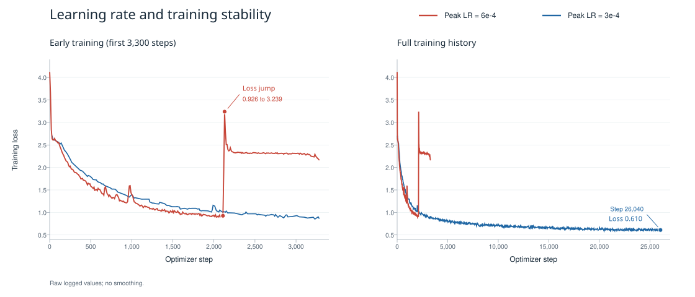{ width="100%" }

峰值学习率为 \(6\times10^{-4}\) 时，损失在 step 2110–2130 从约 0.926 突增至 3.239，到 step 3280 仍为 2.168，未恢复至突增前的水平。

降低峰值学习率至 \(3\times10^{-4}\) 后，训练保持稳定，损失整体下降，step 26040 时约为 0.610。后续实验采用这一学习率。
