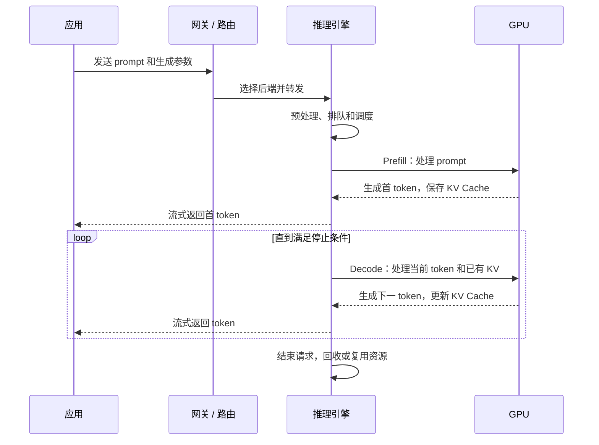

# 推理请求生命周期

一次在线推理请求从应用发出后，需要经过路由、排队和模型计算，才能生成输出。模型先处理输入 prompt，生成第一个 token；随后反复执行 decode，逐步生成后续 token。请求结束后，系统释放该请求占用的运行时资源。

这条路径将用户看到的延迟与系统内部的工作联系起来：首 token 到达前的时间受路由、排队和 prefill 等环节影响；生成过程中的速度则主要取决于 decode 和流式传输。

图中省略了返回流经过网关的转发过程，也省略了多个请求之间的调度交错。下面沿着单个请求展开。

## 1. 构造与路由请求

应用先构造模型输入，包括用户消息、系统提示词、历史对话，以及可能的检索结果或工具调用结果。输入长度在这里就基本确定，并直接影响后续 prefill 的计算量和 KV Cache 占用。

请求随后到达网关或路由层。网关可以完成鉴权、限流、模型选择和请求转发；路由策略决定请求最终到哪个后端或副本。对于使用 prefix cache 的系统，把相同前缀的请求送到持有对应缓存的副本，有机会减少重复的 prefill 计算。

例如，一种部署方式是 `应用 → ELB → LiteLLM → vLLM`：ELB 将流量分发给网关实例，LiteLLM 选择并访问模型后端，vLLM 则负责后端的调度和模型执行。应用构造 prompt 的时间属于用户感知的端到端延迟，但不一定包含在从模型 API 发出请求开始测量的 TTFT 中。

## 2. 预处理与排队

推理引擎接收请求后，将文本转换为 token，并根据生成参数创建内部请求。请求进入等待队列，直到调度器为它安排计算和所需资源。具体预处理发生在网关还是引擎内，取决于部署方式。

排队时间受到达速率、正在运行的请求、batch 容量和 KV Cache 可用空间等因素影响。系统繁忙时，即使 GPU 上的计算本身很快，新请求也可能在开始 prefill 前等待较长时间。

## 3. Prefill：处理输入

调度器选中请求后，模型处理 prompt 中的 token，计算注意力所需的 Key 和 Value，并将它们保存在 KV Cache 中。模型利用 prompt 的计算结果得到首个输出 token；如果命中可复用的 prefix cache，则可以跳过已缓存前缀的部分重复计算。

Prompt 越长，通常需要处理的输入和保存的 KV 状态越多。某些运行时会将长 prompt 分块处理，以便与其他请求交错调度；因此，一次请求的 prefill 不一定连续完成。更多 KV Cache 的细节见 [KV Cache](kv-cache.md)。

首 token 到达用户之前，除了 prefill，还可能经历应用处理、网络传输、路由、排队和返回传输。分析 TTFT 时，需要先确认指标的起止时间，再判断时间花在哪一段。

## 4. Decode：逐步生成输出

首 token 产生后，请求进入 decode。每一轮中，模型处理当前 token，读取此前保存的 KV Cache，计算下一个 token 的分布，再通过解码和采样策略选出输出。新产生的 KV 状态被保存，供后续轮次使用。

推理引擎通常会把多个请求的工作组合成 batch。随着请求到达和完成，batch 的成员也会变化，这种方式称为 continuous batching。调度器需要在新请求的 prefill 和已有请求的 decode 之间分配计算资源：前者影响新请求等待首 token 的时间，后者影响正在生成的请求的输出节奏。

流式响应会在生成过程中持续返回结果，但用户收到的文本块不一定与模型生成的单个 token 一一对应。Decode 的执行效率、调度等待和传输缓冲，都可能影响用户感知到的输出间隔。采样过程见[解码与采样](decoding.md)，调度机制见[推理运行时](serving-runtime.md)。

## 5. 结束与资源回收

当模型生成停止 token、达到最大输出长度，或请求被取消时，引擎结束该请求并停止后续调度。请求独占的资源会被释放；KV Cache 中可共享的前缀是否保留，取决于缓存策略。最终响应也可能包含 token 用量、停止原因等元数据。

如果应用还要解析结果、调用工具或发起下一次模型请求，这些工作发生在本次模型调用之外，但仍属于用户任务的端到端生命周期。

## 从生命周期定位性能问题

- **TTFT 高**：先区分应用处理、路由、排队和 prefill 各占多少时间，再检查 prompt 长度、缓存命中和系统负载。
- **生成速度慢或输出间隔不稳定**：检查 decode 调度、batch 组成、设备计算与通信，以及流式传输是否有缓冲。
- **系统吞吐低**：结合请求长度和到达速率，检查 batch 是否足够有效、KV 容量是否限制并发，以及计算或通信是否成为瓶颈。
- **Prefix cache 命中率或收益低**：检查请求前缀是否一致、路由是否保持缓存局部性，以及缓存是否被频繁淘汰。

这些现象可能同时出现。定位时应结合各阶段的时间和资源指标，而不是仅凭最终响应时间判断。指标定义见 [AI Infra 指标](metrics.md)，跨设备执行见[并行策略](parallelism.md)。
