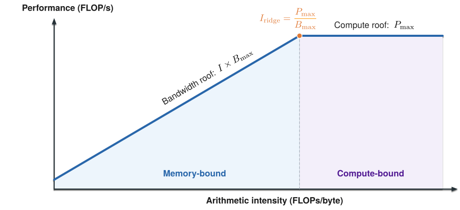

# 推理系统中的 Roofline Model

Roofline model 用算力和内存带宽估计计算任务的性能上界。它帮助我们判断：一个算子需要的数据能否被足够快地送到计算单元，还是计算本身更可能成为瓶颈。

## 算力与带宽的性能上界

设一个算子的一次执行需要 $F$ 次浮点运算，从设备内存读写 $D$ 字节，其**算术强度**为：

$$
I = \frac{F}{D}\quad\text{(FLOPs/byte)}
$$

如果设备的峰值计算吞吐为 $P_{\max}$，峰值内存带宽为 $B_{\max}$，则该算子的性能上界为：

$$
P \leq \min(P_{\max},\ I B_{\max})
$$

其中 $I B_{\max}$ 是内存带宽能够支撑的计算吞吐。算术强度较低时，数据供应速度不足以支撑峰值算力，性能上界由内存带宽决定，对应图中的 **memory-bound** 区域。随着算术强度提高，单位数据对应的计算量增加，带宽所能支撑的计算吞吐随之上升。当它达到设备的算力上限 $P_{\max}$ 后，继续提高算术强度也不会抬高性能上界，此时进入 **compute-bound** 区域。两条上界相交时的算术强度等于设备的**算力带宽比**：

$$
I_{\mathrm{ridge}} = \frac{P_{\max}}{B_{\max}}
$$

{ width="100%" }

比较算子的 $I$ 和设备的 $I_{\mathrm{ridge}}$，可以初步判断哪个上界更紧。这里的带宽和数据量必须对应同一层内存：例如分析 HBM 时，$D$ 应统计 HBM 与芯片之间的流量。实际性能通常低于上界，还取决于矩阵形状、kernel 实现和硬件利用率。

## Batch 如何提高权重复用

考虑一个线性层 $Y=XW$。设输入 $X$ 的形状为 $[b,d]$，权重 $W$ 的形状为 $[d,d]$，其中 $b$ 是一次计算中处理的 token 数。矩阵乘的计算量约为：

$$
F \approx 2bd^2
$$

假设权重为每个元素 2 字节，且这次计算从 HBM 读取一遍权重，权重读取量为 $2d^2$ 字节。暂时忽略输入和输出的读写，得到：

$$
I \approx \frac{2bd^2}{2d^2} = b\quad\text{FLOPs/byte}
$$

Batch 从 1 增加到 32 时，同一份权重服务的 token 数增加到 32 倍，算术强度也从约 1 增加到 32 FLOPs/byte。

假设设备的有效算力带宽比为 100 FLOPs/byte，按照这个简化估算，两种情况都在带宽受限一侧，但 $b=32$ 的带宽性能上界是 $b=1$ 的 32 倍。这里比较的是 FLOPs/s 上界，并不意味着单个请求的延迟会降低 32 倍。

## Prefill 和 Decode 的区别

**Prefill** 处理输入 prompt。多个输入 token 可以一起参与线性层计算，使权重在更多 token 间复用，因此算术强度通常较高。长 prompt 或较大的 batch 往往能形成更大的矩阵运算，使计算吞吐成为更重要的约束。

**Decode** 每轮为每个活跃请求推进一个 token。低并发时，一轮中的 token 数较少，模型权重的复用有限。Attention 还需要读取已有 KV Cache。尤其在模型权重较大或上下文较长时，HBM 流量可能成为主要约束。较大的并发 batch 可以提高权重复用，但也会增加 KV 读取和排队压力。

## 常见优化如何改变计算与数据搬运

**Batching** 通过权重复用提高算术强度。在带宽受限时，增大 batch 可以提高吞吐，但也会增加排队和单步执行时间。

**量化。** 权重量化减少每个权重占用的字节数，能降低模型加载和执行中的权重流量。KV 量化则减少缓存容量和读取流量。在带宽受限的算子中，这些变化可能缩短执行时间。

量化也可能改变可用的计算指令和峰值吞吐。实际收益取决于低精度 kernel 的效率，以及量化和反量化的额外开销。

**KV Cache** 避免每个 decode step 都重新计算历史 token 的 Key 和 Value，但 attention 仍需要访问缓存状态。上下文越长或活跃请求越多，KV 读取量通常越大。压缩 KV 或减少需要访问的位置可以降低流量。相关机制见 [KV Cache](kv-cache.md)。

**Speculative decoding** 先生成候选 token，再由 target model 一次验证多个位置。较宽的验证步骤可能提高权重复用，并减少 target model 串行执行的轮数。草稿生成和验证本身也有成本，最终收益取决于接受长度、batch 和实现效率。详见 [Speculative Decoding](speculative-decoding.md)。

## 如何判断实际瓶颈

先确定分析对象：是单个 kernel、一个模型层，还是整个 decode step？然后估算 FLOPs 和目标内存层的读写字节数，将算术强度与对应设备、精度下的算力带宽比比较。

再结合实测判断：

- 实际带宽已接近可达到的带宽，且算术强度较低，说明减少流量或提高复用可能有效。
- 实际计算吞吐已接近该算子可达到的上限，说明减少计算量或使用更高效的计算实现可能更有帮助。
- 带宽和计算吞吐都不高时，应检查 kernel 规模、启动开销、同步和并行度。这些问题需要结合其他方法定位。

请求排队、跨设备通信和应用编排也会影响端到端性能，并不直接包含在单设备 HBM Roofline 中。应结合[推理请求生命周期](request-lifecycle.md)、[指标](metrics.md)和[并行策略](parallelism.md)一起分析。
